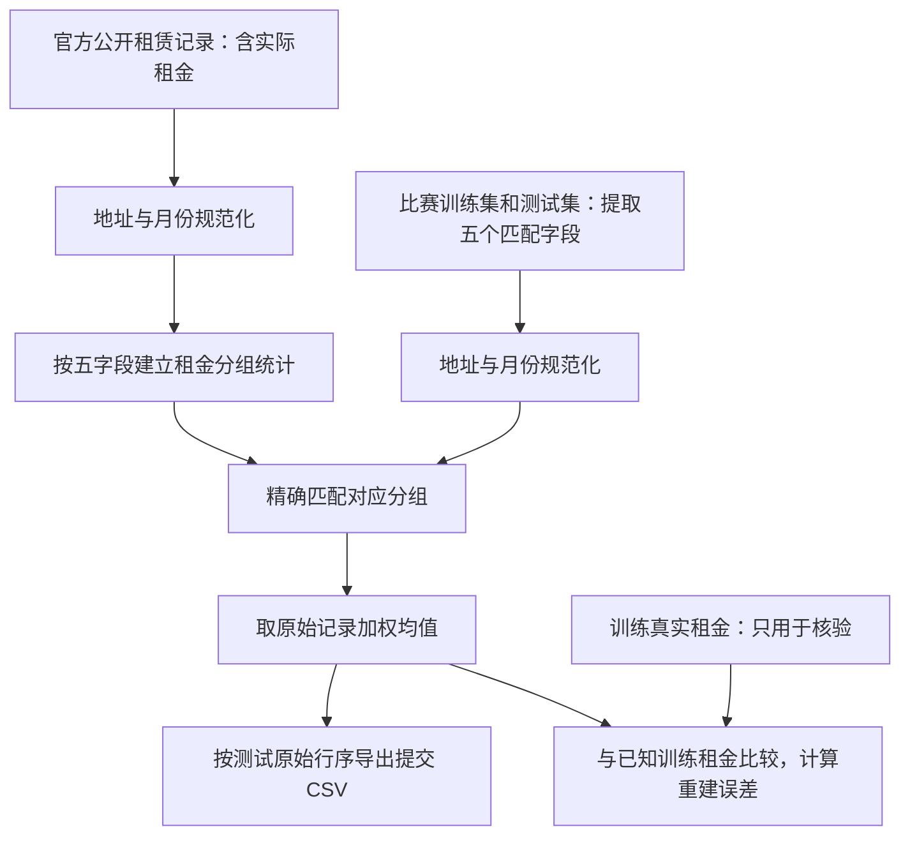

# 完整思路与复现步骤

## 1. 我们到底在做什么

比赛要求给定一条 HDB 租赁记录的属性，返回月租金，评价指标为 RMSE。
正常的预测流程会使用历史记录训练模型，再预测未知月份。
本实验探索的是另一种信息条件：**政府公开数据是否已经包含这些样本对应的原始租金记录？**



如果公开源含有同月、同地址、同户型的实际租金，就可以清洗地址后匹配候选记录，
根据候选租金生成结果。本方法的核心工作是数据来源核验、字符串规范化和分组匹配，没有模型训练。

调查动机是比赛 Public 榜出现约 170 多与 400 以上的明显分层。
2026-10-24 核验时，榜单前九名约 172.43 至 183.18，第十名为 411.76。
这只是查找信息差异的线索，不能据此确定任何队伍的做法。
来源：[比赛榜单](https://www.kaggle.com/competitions/cs-5228-2610-project/leaderboard)。

## 2. 四份数据各有什么用

| 输入 | 内容 | 本方法中的作用 |
| --- | --- | --- |
| `data/train.csv` | 150,000 条，包含真实 `MONTHLY_RENT` | 核验已知标签的匹配情况和重建误差 |
| `data/test.csv` | 50,000 条，不含比赛真实租金标签 | 提供待匹配的月份、地址、户型 |
| `data/example-submission.csv` | `Id,Predicted` 示例 | 只取格式与 ID 顺序；示例预测值不参与计算 |
| `source/hdb_public_rents.csv` | 212,597 条官方公开租赁记录，包含 `monthly_rent` | 提供候选原始租金 |

比赛来源：[CS5228-2610](https://www.kaggle.com/competitions/cs-5228-2610-project)。
公开来源：[HDB 官方租赁数据](https://data.gov.sg/datasets/d_c9f57187485a850908655db0e8cfe651/view)，
数据集 ID 为 `d_c9f57187485a850908655db0e8cfe651`。

固定快照的月份覆盖为 2021-01 至 2026-09；训练集为 2021-01 至 2025-03，
测试集为 2025-03 至 2026-07。训练和测试在 2025-03 均有记录，但不是同一份行集合。
公开快照已覆盖测试月份，因此这里存在使用目标月份租金信息的条件。

原始官方 API 返回的记录带 `_id`。下载时按返回总数分页读取，检查行数和 `_id` 唯一性，
保存完整快照并计算 SHA-256；详情见 `source/hdb_public_rents.json`。
这份固定快照 SHA-256 为：

```text
4fd7ed2ab936f7ec33aa2e32a4185bf83bb9148c6bbcc874a424e310eb78adc9
```

本分支包含全部四份 CSV。默认运行不调用 API、不引用其他目录的缓存，也不需要从其他分支取数据。

## 3. 为什么必须先统一地址

比赛文件与官方文件经常使用不同写法。例如下面的两行应指向相同的月份、地址和户型：

| 字段 | 比赛写法 | 官方写法 | 规范化后 |
| --- | --- | --- | --- |
| 市镇 | `central` | `CENTRAL AREA` | `CENTRAL` |
| 街道 | `New Market Road` | `NEW MKT RD` | `NEW MKT RD` |
| 街道 | `Bedok North Street 3` | `BEDOK NTH ST 3` | `BEDOK NTH ST 3` |
| 户型 | `4 room` | `4-ROOM` | `4ROOM` |

代码中的 `canonical_keys()` 完成以下步骤：

1. 月份解析为日期，再转成 `YYYY-MM`。
2. 字符串转大写，去首尾空格，连续空格合并。
3. 市镇斜杠两侧去空格，`CENTRAL AREA` 统一为 `CENTRAL`。
4. 楼栋去空格；数字被读成类似 `1.0` 时还原为 `1`，保留 `604A` 等后缀。
5. 街道去撇号及多余标点，按完整单词替换常见缩写。
6. 户型去掉空格和连字符，保留字母与数字。
7. 有缺失或空匹配字段时直接报错。

完整的街道单词替换表是 `run.py` 的 `STREET_WORDS`：

```text
AVENUE→AVE       ROAD→RD          STREET→ST       DRIVE→DR
CRESCENT→CRES    CLOSE→CL         PLACE→PL        BOULEVARD→BLVD
CENTRAL→CTRL     JALAN→JLN        BUKIT→BT        UPPER→UPP
TANJONG→TG       KAMPONG→KG       LORONG→LOR      SAINT→ST
TERRACE→TER      MOUNT→MT         NORTH→NTH       SOUTH→STH
GARDENS→GDNS     HEIGHTS→HTS      PARK→PK         COMMONWEALTH→CWEALTH
MARKET→MKT
```

这是精确规范化匹配，不做编辑距离或近似地址匹配。缩写替换按单词执行，避免把其他单词的内部片段误替换。
街道字段内的 `CENTRAL→CTRL` 与市镇字段的 `CENTRAL AREA→CENTRAL` 是两条不同规则。

## 4. 匹配键如何建立

比赛字段与官方字段一一对应：

| 规范键 | 比赛字段 | 官方字段 |
| --- | --- | --- |
| `month` | `RENT_APPROVAL_DATE` | `rent_approval_date` |
| `town` | `TOWN` | `town` |
| `block` | `BLOCK` | `block` |
| `street` | `STREET` | `street_name` |
| `flat_type` | `FLAT_TYPE` | `flat_type` |

五个字段组合成一个键。保留月份，避免把不同月份的租金混到一起；保留市镇和街道，
避免仅按楼栋号匹配到其他位置；保留户型，避免将同楼栋不同房型混合。

**租金不参与预测匹配键。** 楼层、单元号等能唯一识别具体租约的信息在当前公开字段中不充分，
所以一个键仍可能对应多笔租约。匹配到同组并不等于已经唯一识别了每笔交易。

## 5. 同组多笔租金如何处理

`build_statistics()` 对公开数据按键分组，统计记录数、不同租金数、均值、最小值、最大值和总体方差。
预测是全部记录的均值：

```text
某组原始租金：r1, r2, ..., rn
预测租金：mu = (r1 + r2 + ... + rn) / n
```

- 组里只有一种不同租金值时，均值就是该值，输出类型为 `single_rent`。
- 组里有多个不同租金值时，输出原始记录加权的均值，类型为 `multiple_rents_mean`。

下面是构造示例，不是真实个人租约：

```text
公开候选租金 = [2000, 2000, 5000]
记录数 = 3
不同租金数 = 2
预测 = (2000 + 2000 + 5000) / 3 = 3000
```

不能先去重再平均；`(2000 + 5000) / 2 = 3500` 会改变原始记录的权重。
也不能为每个待预测样本任意分配一个候选租金，因为缺乏识别具体租约的依据。

在“目标是从对应组的原始记录中等概率抽取”的假设下，组均值使期望平方误差最小。
这解释了使用均值与 RMSE 指标之间的关系；该抽样假设不是已经确认的比赛数据生成规则。

## 6. 程序实际按什么顺序运行

执行 `python -m public_rent_lookup.run` 后：

1. 根据脚本位置寻找本分支根目录下的四份 CSV，检查输出目录没有落入输入目录。
2. 计算四份输入的 SHA-256，记录运行前状态。
3. 读取数据，楼栋按字符串处理，检查训练标签有效性。
4. 规范化公开数据并建立分组统计。
5. 分别规范化训练与测试记录，为每行保留 `source_row` 原始位置。
6. 用五字段精确左连接公开分组，要求多对一连接；任意行缺匹配则报错，不静默填值。
7. 使用公开组均值生成结果。训练真实租金只用于核验，不用于挑选预测候选。
8. 单独检查训练真实租金是否出现在对应公开组中。此检查会使用真实租金做已知标签比对，
   它与第 6、7 步的预测逻辑分开；测试预测没有此标签输入。
9. 对已知训练标签计算 RMSE 和 MAE，并单列 2024-04 之后窗口。
10. 使用示例文件的 ID，要求其恰为原始测试行位置 `0..49999`，替换 `Predicted`。
11. 写入 CSV 后重新读取，检查 ID、预测值和行序一致。
12. 保存逐行明细、月度统计、歧义分组与摘要；再次核对输入哈希未改变。

关键函数位置：

| 函数 | 职责 |
| --- | --- |
| `canonical_keys()` | 统一月份、地址和户型 |
| `build_statistics()` | 公开租金分组统计 |
| `lookup()` | 精确匹配并保持输入行序 |
| `known_label_presence()` | 仅对已知训练标签做来源重合核验 |
| `make_submission()` | 检查提交格式、ID 与预测值 |
| `run()` | 完整流程、导出与哈希检查 |

## 7. 为什么本地约 180，又为什么可能出现线上 170 多

本地训练标签已知，直接计算：

```text
RMSE = sqrt(mean((真实租金 - 对应公开组均值)^2))
```

固定快照的实际结果是：

| 核验项目 | 结果 |
| --- | ---: |
| 训练键匹配公开分组 | 150,000 / 150,000 |
| 训练真实租金存在于匹配组 | 150,000 / 150,000 |
| 全训练集重建 RMSE | 179.9471744827 |
| 2024-04 至 2025-03，35,158 行的重建 RMSE | 181.2533674383 |
| 测试键匹配公开分组 | 50,000 / 50,000 |
| 测试单一租金行 | 36,487，72.974% |
| 测试多候选租金行 | 13,513，27.026% |

测试真实标签不可见，**100% 测试键覆盖不能称作 100% 测试答案命中率**。
训练标签全部存在于对应组，提供了强烈的数据重合证据；测试仍保留标签未核验的边界。

测试误差量级的估算按以下步骤计算。设测试第 i 行匹配组均值为 mu_i，该组包含 n_i 条原始记录：

```text
组内总体方差 v_i = sum_j((r_ij - mu_i)^2) / n_i
估算的整体均方误差 = mean_i(v_i)
误差量级 = sqrt(mean_i(v_i)) = 173.4121857270
```

这里先按每条测试行平均方差，再开平方。一个公开组若对应多条测试行，会按测试行数计权。
组内方差使用 `ddof=0`；只有一种租金的组，其方差为零。

**173.41 是等概率候选假设下的 sqrt(E[MSE])，不是实际测试 RMSE，也不是置信区间。**
Public 榜使用约一半测试样本，故也不能把全测试键加权的估算值视作 Public 分数。
来源：[Kaggle 比赛榜单说明](https://www.kaggle.com/competitions/cs-5228-2610-project/leaderboard)。

测试月份匹配组的加权租金方差更小，因而同一套组均值方法可以出现本地约 180、测试估算约 173 的情况。
同组多笔交易无法唯一消歧，是这套简单方法仍有误差的主要来源。

## 8. 组员如何自己完整复现

先按根目录 `README.md` 安装固定依赖并运行检查，然后执行主脚本。
当前 Python 3.11、NumPy 2.4.6、pandas 3.0.5 是验证环境，不需要 PyTorch、GPU 或模型文件。

运行后依次检查：

1. `outputs/summary.json`：训练重建 RMSE 应约为 179.9472、181.2534，测试覆盖 50,000 行。
2. 对比 `results/summary.json`：输入文件的 SHA-256 应相同；时间戳会随运行时间改变。
3. `outputs/submission.csv`：两列 `Id,Predicted`，共 50,000 行，ID 从 0 到 49,999，无缺失预测。
4. `outputs/test_matches.csv`：找一条 `single_rent`，按键筛选公开源，应只有一种租金；
   再找一条 `multiple_rents_mean`，手工平均其全部候选记录，结果应等于 `public_mean`。
5. `outputs/ambiguous_test_groups.csv`：查看各组测试行数、公开记录数、不同租金数和取值范围。
6. `outputs/monthly_metrics.csv`：观察不同月份的候选方差与已知训练重建误差。

测试覆盖了重复候选的次数权重、总体方差、输入行序、重复输入行、月份精确匹配、缺失字段报错、
提交 ID 对齐、标签只影响审计、不影响预测，以及 CSV 导出和输入字节保持不变。
可选下载器还检查分页和下载不完整时不生成快照。

## 9. 常见问题和边界

**为什么不是零误差？** 同一个月、楼栋、街道和户型仍可存在多笔不同租金的租约。
现有公开键无法把每个比赛样本对应到其中唯一一笔，均值留下组内误差。

**为什么这不能说明模型预测能力很强？** 公开候选池已经含有目标月份的租金，训练行甚至包含自身真实租金。
这是重建任务的信息条件。事前预测需只使用预测时点已经可获得的信息，不能把事后公布的租金当作当时可用特征。

**是不是可以确定领先队伍都用了这个方法？** 不能。我们验证了机制与相近的误差量级，没有取得他们的实现。

**是否允许用于课程比赛？** [比赛说明](https://www.kaggle.com/competitions/cs-5228-2610-project/overview)
欢迎额外数据收集，但当前可见说明未明确授权直接恢复测试期原始目标。应结合课程补充要求与组织者解释判断。
本分支的代码及运行结果不构成对合规性的认定，也不自动提交 Kaggle。

**为什么换一份官方数据后结果不同？** 官方来源可能补充或修订历史记录，也可能新增字段。
要复现本结果，应使用仓库包含的固定快照，并核对哈希。可选下载器默认另存最新快照，不替换固定版本。

**可以怎样继续研究？** 可以在明确规则允许后，研究多候选组的消歧方法；任何改进都应明确区分
公开目标信息重建与严格历史信息预测，并且为候选选择提供可验证依据。
