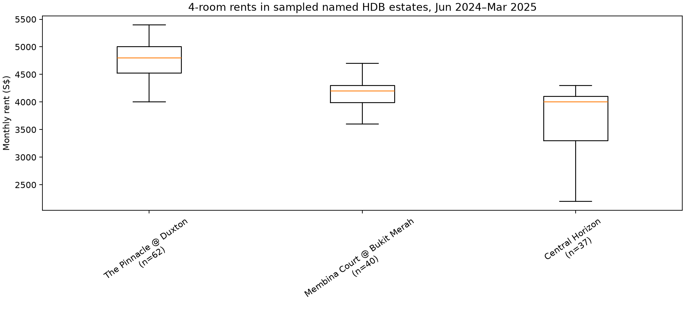
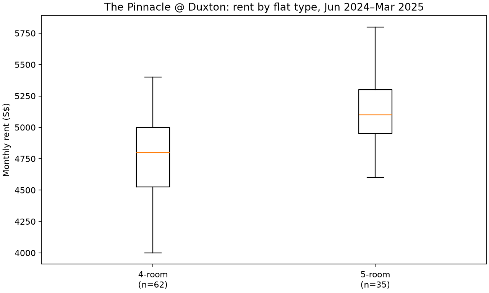

# Rent distributions in sourced HDB estate groups

SLA's *Computerised HDB Estates* list (updated 7 August 2023) explicitly groups multiple blocks under named HDB estates. The saved crosswalk transcribes 27 named, multi-block entries and joins each listed town/street/block address to the local HDB block table and the 150,000 labeled rent approvals. This is a selected sample of named estates, not a complete precinct boundary map. A named estate is used as an observable precinct-scale grouping; legal/upgrade precinct boundaries can differ.

[SLA source PDF](https://app.sla.gov.sg/inlis/assets/SamplePDF/HDBEstate.pdf) · [HDB's NRP explanation](https://www.hdb.gov.sg/managing-my-home/upgrading-and-redevelopment/neighbourhood-renewal-programme-nrp)

## Coverage

The source lists 243 addresses across 27 selected estates; 170 match the local block table and 169 have at least one labeled rental. There are 2,936 assigned rentals from January 2021–March 2025 and 631 from June 2024–March 2025. Missing matches can be nonresidential blocks or differences between the 2023 SLA list and the local block table.

| SLA estate | Town | Listed blocks | Matched | Rented blocks | Rentals Jun 2024–Mar 2025 |
| --- | --- | ---: | ---: | ---: | ---: |
| The Pinnacle @ Duxton | central | 8 | 7 | 7 | 97 |
| Membina Court @ Bukit Merah | bukit merah | 9 | 8 | 8 | 68 |
| Central Horizon | toa payoh | 8 | 5 | 5 | 41 |
| Ghim Moh Valley | queenstown | 8 | 5 | 5 | 40 |
| The Peak @ Toa Payoh | toa payoh | 7 | 5 | 5 | 31 |
| Treelodge @ Punggol | punggol | 9 | 7 | 7 | 26 |
| The River Vista @ Kallang | kallang/whampoa | 6 | 5 | 5 | 26 |
| Trivelis | clementi | 5 | 3 | 3 | 25 |
| Punggol Vista | punggol | 9 | 7 | 7 | 25 |
| Matilda Edge | punggol | 15 | 9 | 9 | 24 |
| Tampines Greenleaf | tampines | 11 | 9 | 9 | 23 |
| Punggol Lodge | punggol | 10 | 8 | 8 | 19 |
| Keat Hong Axis | choa chu kang | 13 | 9 | 8 | 19 |
| Compassvale Cape | sengkang | 17 | 11 | 11 | 18 |
| The Premiere @ Tampines | tampines | 12 | 8 | 8 | 17 |
| Fernvale Vista I | sengkang | 7 | 5 | 5 | 16 |
| Fernvale Vista II | sengkang | 6 | 4 | 4 | 16 |
| Fajar Hills | bukit panjang | 8 | 7 | 7 | 16 |
| Eastwave @ Canberra | sembawang | 8 | 6 | 6 | 12 |
| Senja Green | bukit panjang | 8 | 4 | 4 | 11 |
| Waterway View | punggol | 13 | 9 | 9 | 11 |
| Hougang Meadow | hougang | 8 | 6 | 6 | 10 |
| Punggol Central | punggol | 9 | 6 | 6 | 9 |
| Compassvale Boardwalk | sengkang | 5 | 5 | 5 | 9 |
| Keat Hong Colours | choa chu kang | 13 | 6 | 6 | 9 |
| Senja Parc View | bukit panjang | 5 | 3 | 3 | 8 |
| Hougang Crimson | hougang | 6 | 3 | 3 | 5 |

## Rent distributions

The distribution files report transaction count, contributing blocks, and 10th/25th/50th/75th/90th percentiles by estate and flat type, for both the full labeled period and the ten-month recent window. The monthly file gives the same summaries at a single time step. These are approval distributions; they do not reveal the rents of occupied units that did not transact.

The table compares 4-room approval rents in the recent ten-month window. Each range is the 25th to 75th percentile; these pooled ranges can include changes over time as well as differences between blocks and units.

| Named estate | Rentals | Blocks | 25th percentile | Median | 75th percentile |
| --- | ---: | ---: | ---: | ---: | ---: |
| The Pinnacle @ Duxton | 62 | 7 | S$4,525 | S$4,800 | S$5,000 |
| Membina Court @ Bukit Merah | 40 | 7 | S$3,988 | S$4,200 | S$4,300 |
| Central Horizon | 37 | 5 | S$3,300 | S$4,000 | S$4,100 |
| Treelodge @ Punggol | 24 | 7 | S$3,200 | S$3,400 | S$3,500 |
| Ghim Moh Valley | 20 | 3 | S$4,000 | S$4,400 | S$4,600 |
| The River Vista @ Kallang | 17 | 5 | S$3,800 | S$4,000 | S$4,000 |
| Punggol Lodge | 17 | 8 | S$3,000 | S$3,200 | S$3,300 |
| Trivelis | 13 | 3 | S$4,000 | S$4,400 | S$4,500 |
| Fernvale Vista II | 12 | 4 | S$3,000 | S$3,050 | S$3,100 |
| Eastwave @ Canberra | 12 | 4 | S$3,300 | S$3,350 | S$3,500 |
| Matilda Edge | 10 | 6 | S$3,200 | S$3,300 | S$3,438 |

In June 2024–March 2025 there are 340 observed estate × month × flat-type cells. Only 60 have at least three rentals from at least two blocks. Among those cells, median within-cell interquartile range is S$250 (90th percentile S$655). Most single-month distributions remain thin even after grouping several blocks.

Illustration: The Pinnacle @ Duxton has 97 rentals in the ten-month window. Its type-specific distributions are shown below; read medians alongside sample counts.

Within this estate, the recent 4-room median also varies across blocks:

| Block | Rentals | Median monthly rent |
| --- | ---: | ---: |
| 1A | 4 | S$4,800 |
| 1B | 7 | S$5,000 |
| 1C | 9 | S$4,600 |
| 1D | 13 | S$4,800 |
| 1E | 12 | S$4,650 |
| 1F | 6 | S$4,875 |
| 1G | 11 | S$4,950 |

## Use in forecasting

Estimate rent conditional on estate, flat type, and month, with shrinkage toward town × flat-type and national × flat-type levels. Preserve building identity because a named estate can contain blocks with different property mixes. Use only estate maps that existed before the forecast origin; this SLA list is dated 2023, whereas its public PDF includes older entry effective dates. Estate boundaries and named developments are not identical to every HDB upgrading precinct.

Saved data: [block mapping](sla_estate_block_mapping.csv), [estate coverage](estate_coverage.csv), [estate × type distributions](estate_type_rent_distribution.csv), [recent block × type distributions](estate_block_type_rent_distribution_recent.csv), [monthly estate × type distributions](estate_month_type_rent_distribution.csv), [assigned rental rows](estate_rental_transactions.csv), [summary](summary.json).

Reproduce: `.venv/Scripts/python.exe analysis/analyze_sla_hdb_estate_rents.py`.
