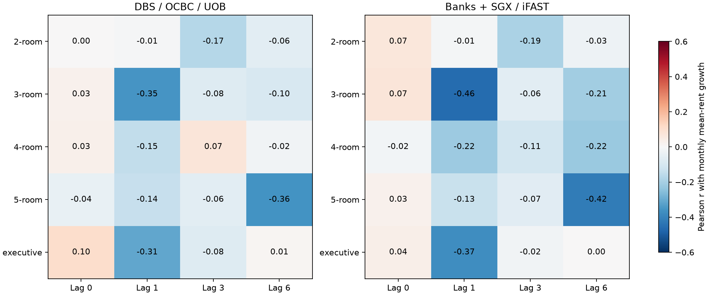
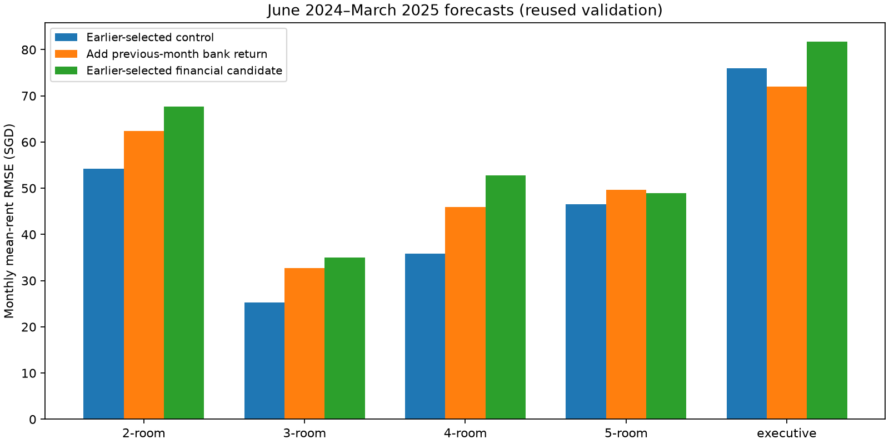

# Financial-sector stocks and mean HDB rents by room type and flat model

Tested 5 room types and 9 flat-model categories. Full-control development associations surviving global 5% dependent-FDR: 0 / 1512. Primary bank/room-type associations surviving their primary-family correction: 0 / 10.

The strongest descriptive lag-1 finance-basket correlation among room types is 3-room: r=-0.463. This is not robust evidence of a predictive or causal effect. No category's earlier-selected financial candidate beats its earlier-selected control in both forecast periods. The direct slope-equality tests also provide no reliable evidence that financial-stock sensitivity differs across room types or flat models. Recommendation: do not add category-specific financial-stock features to the current model from this experiment.

Earlier-selected financial candidates beat the earlier-selected control in 2/14 categories on earlier forecasts and 1/14 on later forecasts. Both-period gains occur in 0/14. Small later-only improvements are exploratory and require fresh data before feature promotion.

## Room-type results

Correlations below compare the previous calendar month's bank/finance return with the current month's log change of arithmetic mean rent. The 95% bank-correlation intervals use paired three-month blocks. These descriptive correlations use all available 2021–March 2025 data; the controlled slopes use January 2022–May 2024 only.

| Room type | Bank r | Bank 95% interval | Finance r | Controlled bank p | Corrected bank q |
| --- | --- | --- | --- | --- | --- |
| 2-room | -0.006 | -0.31 to 0.32 | -0.010 | 0.528 | 1.000 |
| 3-room | -0.353 | -0.61 to -0.03 | -0.463 | 0.065 | 0.957 |
| 4-room | -0.146 | -0.43 to 0.17 | -0.218 | 0.844 | 1.000 |
| 5-room | -0.136 | -0.42 to 0.19 | -0.132 | 0.713 | 1.000 |
| executive | -0.312 | -0.52 to -0.07 | -0.372 | 0.509 | 1.000 |

## Does the relationship differ across categories?

The equality tests directly compare category slopes using the same resampled monthly blocks for every category. An apparently significant correlation in one category and a nonsignificant correlation in another do not establish different slopes. The tests below use lag 1, adjusted stock closes and full development-period controls. Pairwise contrasts with simultaneous intervals are in category_slope_contrasts.csv.

| dimension | signal | target | months | categories | equality_p_value | q_all_equality_tests |
| --- | --- | --- | --- | --- | --- | --- |
| room_type | banks_equal | mean_rent | 29 | 5 | 0.762 | 1.000 |
| room_type | banks_equal | adjusted_mean_rent | 29 | 5 | 0.708 | 1.000 |
| room_type | finance_equal | mean_rent | 29 | 5 | 0.384 | 1.000 |
| room_type | finance_equal | adjusted_mean_rent | 29 | 5 | 0.343 | 1.000 |
| room_type | banks_cap_seeded | mean_rent | 29 | 5 | 0.833 | 1.000 |
| room_type | banks_cap_seeded | adjusted_mean_rent | 29 | 5 | 0.743 | 1.000 |
| flat_model | banks_equal | mean_rent | 29 | 9 | 0.931 | 1.000 |
| flat_model | banks_equal | adjusted_mean_rent | 29 | 9 | 0.918 | 1.000 |
| flat_model | finance_equal | mean_rent | 29 | 9 | 0.779 | 1.000 |
| flat_model | finance_equal | adjusted_mean_rent | 29 | 9 | 0.845 | 1.000 |
| flat_model | banks_cap_seeded | mean_rent | 29 | 9 | 0.909 | 1.000 |
| flat_model | banks_cap_seeded | adjusted_mean_rent | 29 | 9 | 0.879 | 1.000 |

## Forward prediction

Expanding one-month-ahead Ridge models use only earlier rent labels and preceding-month market data. January 2023–May 2024 forecasts select the best financial candidate and the best of persistence, three-month momentum, rent history, and rent history plus market controls. The candidates scan the same nine bank/finance/individual signals and 1/3/6-month delays as the national experiment, including three basket momentum/volatility bundles. June 2024–March 2025 is already-examined validation, not a new untouched test. All candidates share monthly cases, and normalization is fitted on earlier data only.

| category | selected_control | selected_finance | earlier_control_growth_rmse | earlier_finance_growth_rmse | later_control_growth_rmse | later_selected_finance_growth_rmse | selected_delta_ci_low | selected_delta_ci_high |
| --- | --- | --- | --- | --- | --- | --- | --- | --- |
| 2-room | persistence | U11.SI_lag3 | 3.708 | 4.557 | 2.459 | 3.066 | -0.553 | 1.472 |
| 3-room | persistence | finance_equal_lag1 | 1.324 | 1.521 | 0.925 | 1.284 | -0.190 | 0.563 |
| 4-room | persistence | S68.SI_lag1 | 1.491 | 2.049 | 1.099 | 1.619 | 0.251 | 0.807 |
| 5-room | persistence | S68.SI_lag3 | 1.422 | 1.983 | 1.328 | 1.394 | -0.106 | 0.397 |
| executive | persistence | S68.SI_lag6 | 1.934 | 1.971 | 2.071 | 2.227 | -0.054 | 0.293 |

Growth RMSE is in log percentage points. The following SGD RMSE measures errors in a category's monthly mean rent, not individual rental prices.

| category | later_control_mean_rmse_sgd | later_bank_mean_rmse_sgd | later_finance_mean_rmse_sgd | later_selected_mean_rmse_sgd |
| --- | --- | --- | --- | --- |
| 2-room | 54.233 | 62.399 | 62.543 | 67.702 |
| 3-room | 25.262 | 32.703 | 35.051 | 35.051 |
| 4-room | 35.902 | 45.889 | 45.971 | 52.808 |
| 5-room | 46.493 | 49.722 | 49.019 | 48.929 |
| executive | 76.007 | 72.023 | 72.498 | 81.738 |

For executive, the fixed bank lag-1 candidate improves later mean-rent RMSE from S$76.01 to S$72.02, but worsens earlier RMSE from S$66.29 to S$73.84. This is inconsistent across periods.

## Flat-model sensitivity

Flat model describes the design, whereas room type describes the number/type of rooms. These are overlapping views of the same records, not independent samples. Global exploratory corrections include both dimensions and both rent targets/price fields.

| category | rentals | bank_lag1_r | bank_r_ci_low | bank_r_ci_high | finance_lag1_r | bank_controlled_p | bank_global_q | selected_control | selected_finance | later_selected_delta |
| --- | --- | --- | --- | --- | --- | --- | --- | --- | --- | --- |
| apartment | 4724 | -0.227 | -0.425 | 0.032 | -0.259 | 0.408 | 1.000 | rent_history | S68.SI_lag1 | 0.051 |
| improved | 44008 | -0.141 | -0.487 | 0.214 | -0.160 | 0.504 | 1.000 | persistence | S68.SI_lag3 | 0.112 |
| maisonette | 2346 | -0.316 | -0.597 | -0.045 | -0.413 | 0.669 | 1.000 | rent_market_control | S68.SI_lag6 | 0.035 |
| model a | 42745 | -0.136 | -0.392 | 0.154 | -0.213 | 0.951 | 1.000 | persistence | O39.SI_lag6 | 0.160 |
| model a2 | 1553 | -0.001 | -0.378 | 0.408 | -0.103 | 0.977 | 1.000 | persistence | finance_equal_bundle_lag6 | 0.330 |
| new generation | 27380 | -0.277 | -0.518 | -0.005 | -0.297 | 0.204 | 1.000 | persistence | banks_equal_bundle_lag3 | 0.067 |
| premium apartment | 12312 | -0.203 | -0.393 | 0.027 | -0.189 | 0.534 | 1.000 | persistence | banks_equal_bundle_lag6 | 0.325 |
| simplified | 6794 | -0.111 | -0.385 | 0.191 | -0.198 | 0.886 | 1.000 | persistence | banks_equal_lag3 | 0.315 |
| standard | 5903 | -0.205 | -0.443 | 0.080 | -0.193 | 0.240 | 1.000 | persistence | banks_cap_seeded_bundle_lag1 | -0.351 |

## Coverage and methods

The 150,000 source rentals span January 2021–March 2025. Category spelling variants (for example 4 room / 4-room) are normalized before aggregation. Eligibility requires at least 20 rentals in EACH of the twelve 2021 months and uses no later outcomes. All raw category/month means and counts are saved, including sparse categories. Later cells below 20 rentals are masked before growth calculations; no forward-fill, interpolation or missing-month bridging is used. Counts and eligibility for every category follow.

| dimension | category | rentals | months_observed | reference_minimum_monthly_count | minimum_monthly_count | eligible |
| --- | --- | --- | --- | --- | --- | --- |
| room_type | 1-room | 42 | 30 | 0 | 0 | False |
| room_type | 2-room | 3098 | 51 | 30 | 30 | True |
| room_type | 3-room | 49024 | 51 | 872 | 740 | True |
| room_type | 4-room | 54079 | 51 | 920 | 859 | True |
| room_type | 5-room | 35523 | 51 | 667 | 551 | True |
| room_type | executive | 8234 | 51 | 166 | 117 | True |
| flat_model | 2 room | 224 | 47 | 0 | 0 | False |
| flat_model | 3gen | 12 | 9 | 0 | 0 | False |
| flat_model | adjoined flat | 218 | 50 | 1 | 0 | False |
| flat_model | apartment | 4724 | 51 | 101 | 64 | True |
| flat_model | dbss | 1090 | 51 | 16 | 8 | False |
| flat_model | improved | 44008 | 51 | 799 | 685 | True |
| flat_model | improved maisonette | 1 | 1 | 0 | 0 | False |
| flat_model | maisonette | 2346 | 51 | 38 | 28 | True |
| flat_model | model a | 42745 | 51 | 727 | 647 | True |
| flat_model | model a maisonette | 140 | 48 | 1 | 0 | False |
| flat_model | model a2 | 1553 | 51 | 21 | 21 | True |
| flat_model | new generation | 27380 | 51 | 489 | 422 | True |
| flat_model | premium apartment | 12312 | 51 | 226 | 185 | True |
| flat_model | premium apartment loft | 51 | 28 | 0 | 0 | False |
| flat_model | premium maisonette | 21 | 17 | 0 | 0 | False |
| flat_model | simplified | 6794 | 51 | 119 | 103 | True |
| flat_model | standard | 5903 | 51 | 93 | 87 | True |
| flat_model | terrace | 19 | 16 | 0 | 0 | False |
| flat_model | type s1 | 299 | 47 | 0 | 0 | False |
| flat_model | type s2 | 160 | 41 | 0 | 0 | False |

Property-adjusted arithmetic means subtract a property prediction and add the category's fixed 2021 prediction anchor. The shared Ridge property model is fitted on 2021 only using building address, room type, flat model, floor area and lease commencement year. This sensitivity reduces changes in the composition of rented properties without forcing categories to the same rent level. It is not a complete hedonic index.

Stock definitions and historical weight provenance match [the national finance experiment](../financial_sector_rents/report.md): banks = DBS/OCBC/UOB; broader available finance = banks + SGX/iFAST; nonbank finance = SGX/iFAST. Equal weights rebalance monthly. Historical-cap-seeded bank weights drift from the archived December 2020 STI-fund snapshot; January–February 2021 are a descriptive backcast. The available five firms are not a comprehensive financial-sector universe. Adjusted-close returns are primary and unadjusted closes are sensitivity checks.

Controlled regressions use lagged rent growth, trailing three-month growth, trend, annual sine/cosine, 37 inception Singapore stocks excluding the five financial names, S&P 500 returns and USD/SGD changes. Financial and market-comparator returns use the same lag. Newey-West covariance uses three monthly lags. Development inference has only 29 monthly cases despite the many rental records. The primary BY family comprises adjusted-close bank lag-1 full-control tests across room types and both rent targets. Exploratory BY families span both category dimensions, all eligible categories, both rent targets, both price fields, nine signals and three lags, separately for each control specification. Equality q-values span the twelve dimension/basket/target tests. Raw correlation intervals and forecast intervals are not multiplicity-adjusted; forecast intervals also omit model-selection uncertainty.

A negative empirical relationship does not mean rising bank prices cause lower rents. Interest rates, labor demand, migration, credit and other common drivers are not causally identified. Only 51 calendar months are available and later validation has been reused across project experiments. No submission or TabPFN model is changed.

## Reproduction

Run `.venv/Scripts/python.exe analysis/compare_financial_sector_rent_categories.py`. Settings: analysis/configs/financial_sector_rent_categories.json. decision_summary.csv contains the category-level headline results. Other files retain raw/adjusted means, coverage, all correlations, controlled associations, global q-values, equality tests, forecasts, errors and charts. results.json records input/code hashes, versions and cutoff checks.
