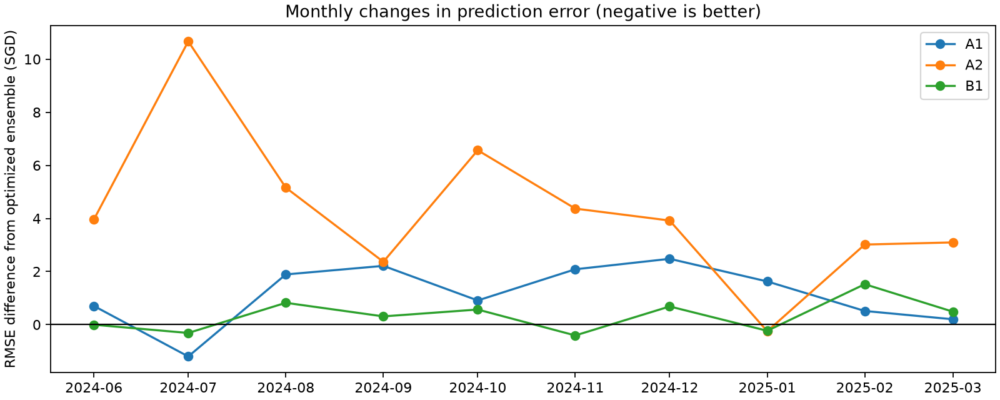
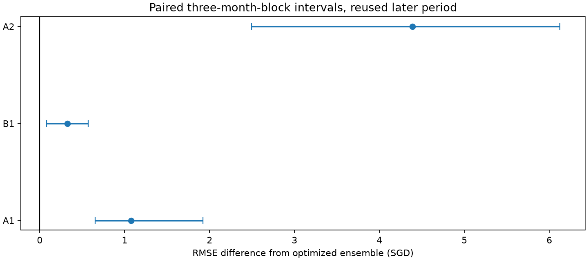

# Targeted spatial-temporal and economic experiments

**Decision: retain the existing optimized frozen ensemble.** All three completed additions worsen later RMSE; no combination is promoted. Quarterly-cycle and workforce-demand hypotheses remain untested because admissible historical vintages were not established.

The reference is the existing optimized **frozen three-member TabPFN ensemble**, not the weaker single-member control and not DiagScale. Its cached June2024–March2025 RMSE reproduces **S$455.171873**. All 28,995 evaluation rentals and all original training rows, targets, temporal baselines, feature representations and native inference settings are preserved.

## Main ablations

| variant | rows | rmse_sgd | rmse_delta_sgd | rmse_improvement_pct | mae_sgd | mae_delta_sgd | mae_improvement_pct | rmse_delta_ci_low | rmse_delta_ci_high |
| --- | --- | --- | --- | --- | --- | --- | --- | --- | --- |
| A0 | 28995 | 455.172 | 0.000 | -0.000 | 328.202 | 0.000 | 0.000 | 0.000 | 0.000 |
| A1 | 28995 | 456.245 | 1.074 | -0.236 | 327.055 | -1.147 | 0.350 | 0.651 | 1.919 |
| A1_fixed_weights | 28995 | 456.224 | 1.053 | -0.231 | 328.276 | 0.074 | -0.023 | 0.704 | 1.734 |
| B1 | 28995 | 455.499 | 0.327 | -0.072 | 330.620 | 2.418 | -0.737 | 0.080 | 0.569 |
| B1_fixed_weights | 28995 | 455.428 | 0.256 | -0.056 | 329.769 | 1.567 | -0.477 | 0.040 | 0.539 |
| A2 | 28995 | 459.559 | 4.387 | -0.964 | 341.687 | 13.485 | -4.109 | 2.494 | 6.121 |

Negative RMSE/MAE differences are better; positive improvement percentages are better. A1_fixed_weights and B1_fixed_weights retain the reference ensemble weights exactly. Other A1/B1 rows reapply the established earlier-only convex weighting method to their added-feature predictions. Neither method tunes weights on the later labels.

## Earlier chronological results

| origin | variant | rows | rmse_sgd | rmse_delta_sgd | mae_sgd |
| --- | --- | --- | --- | --- | --- |
| 2022-09 | A0 | 2000 | 635.086 | 0.000 | 512.052 |
| 2022-09 | A1 | 2000 | 643.692 | 8.606 | 516.309 |
| 2022-09 | A1_fixed_weights | 2000 | 643.692 | 8.606 | 516.309 |
| 2022-09 | B1 | 2000 | 637.418 | 2.332 | 512.401 |
| 2022-09 | B1_fixed_weights | 2000 | 637.418 | 2.332 | 512.401 |
| 2022-09 | A2 | 2000 | 635.086 | 0.000 | 512.052 |
| 2023-07 | A0 | 2000 | 570.480 | 0.000 | 430.628 |
| 2023-07 | A1 | 2000 | 570.036 | -0.444 | 428.707 |
| 2023-07 | A1_fixed_weights | 2000 | 566.329 | -4.151 | 426.888 |
| 2023-07 | B1 | 2000 | 560.196 | -10.284 | 426.295 |
| 2023-07 | B1_fixed_weights | 2000 | 562.632 | -7.848 | 425.203 |
| 2023-07 | A2 | 2000 | 566.008 | -4.472 | 429.859 |

The September2022–June2023 and July2023–April2024 windows contain 200 label-independent queries per month and population sampling weights, with all60,079/87,937 available context rows. The first window uses the baseline member as the established cold-start ensemble fallback; July weights use only September-window labels. June2024 weights use only the two earlier disjoint windows. Main context is121,005 rows, with28,995 complete later queries. These periods have all been examined in earlier project work.

## A1: hierarchical local rental dynamics

The reference already contains37 historical rental fields, nine local temporal fields, and nearby same-type500/1000m and Gaussian comparable histories in its spatial member. Those are reused. Eleven additions test missing town/street hierarchy and relative growth: town/type and street/type shrunken3-month level,6-month count and dispersion, and3-month growth relative to national/type growth; building/type level and relative growth shrunken toward the street; and a no-history indicator.

At every pseudo-origin, stats use only the preceding permitted six-month history. Recent three months are compared with the previous three months. Pooled national -> national/type -> town/type -> street/type -> building/type sufficient statistics borrow20 observations from their parent, including second moments for dispersion. Local growth is100log(recent/previous) minus national/type growth. Existing room counts/model/area and nearby comparables remain in the original members. No new hyperparameters are selected.

Each existing row has its original forecast origin reconstructed from its month and TEMP_FORECAST_HORIZON. Added features stop one extra month before that origin, preserving the spatial member’s conservative publication buffer. Main query features therefore stop April2024 and remain fixed over the ten-month forecast. Context rows use their individual earlier pseudo-origins; the first unsupported rows retain NaN,zero support and explicit missingness. No current/query labels or future rental months enter the additions. history_cutoffs.csv and targeted future-label poisoning tests verify this.

## B1: town housing completions

One substantive supply feature is annual completed HDB residential units / reported town HDB stock, accompanied by observation age and unavailability. It is extracted from archived HDB2018/19,2020/21,2021/22,2022/23 tables. Numeric extraction is checked against every printed national stock/completion total and selected source tables are visually verified. This is new information beyond building age and static geography.

Availability is conservative and explicit: 2019 report fromJanuary2020; the retrieved2021 SGX filing only fromJanuary2023 because its verified broadcast isNovember2022;2022 report fromJanuary2023 after the October2022 release;2023 report fromJanuary2024 after the October2023 release. The newer2022 report supersedes2021 when both become available. FY2019/20 and an earlier verified2021 circulation were not reconstructed, so the older2019 snapshot remains in use through the gap, with its age exposed. That is stale known information, not interpolation or future backfill. See housing_supply_sources.json for URLs, timing evidence, PDF hashes and totals.

Completions include home-ownership/public-rental housing and do not directly measure newly rentable open-market units. Minimum-occupation rules and owner-occupier moves can delay or change their relation to rental supply. This experiment tests a broad supply proxy, not the number of available rental listings. Zero-stock/unknown cells retain missing values and an explicit flag; no query is removed.

## C1 and B2: not admitted to retrospective inference

C1: official quarterly HDB medians extend to2005, but the current retrieved series was updated inOctober2026. Public metadata and its See history component record ingestion timestamps, not historical-value vintages. A historical2020Q1 Annex D link returned404. A dated2021Q4 release verifies publication lag but is insufficient to reconstruct an entire original-value panel. Using the latest series with an arbitrary quarter lag would not establish absence of retrospective revisions. Long-term-cycle inputs are therefore not fabricated or tested under a false point-in-time claim.

B2: MOM’s current foreign-workforce page/workbook reports historical EP/S Pass levels, but the original series and original publication schedule at every earlier forecast cutoff were not established. The page notes revisions at industry level; that does not prove the pass totals were revised, nor does it certify they were unchanged. Current historical values are not silently backdated. No workforce-demand performance claim is made. external_data_review.json records the inspected sources and precise limitation.

## A2: cross-fitted historical residual correction

Reused4,000 disjoint earlier out-of-time queries from the reference ensemble. Every source residual is actual minus a prediction whose context predates that target month; the ensemble weights themselves also use only earlier windows. The smoother uses exponential six-month decay and global -> flat type -> town/type -> street/type -> building/type shrinkage, with sample weights normalized to observed effective support. The small search selects gamma=0.5 and shrink=50 using July–December2023 targets only, with January–April2024 reserved for an earlier confirmation check. No new TabPFN inference is needed.

July2023 smoothing sees only residuals throughMay2023. MainJune2024 smoothing sees only residuals throughApril2024; later validation residuals never update it. Training/query cross-fitting alone would not suffice, so both provenance and maturity are audited. The aggregate July2023 A2 row includes tuning labels and is a calibration diagnostic. The separate January–April2024 check is the earlier out-of-time correction result.

Earlier confirmation baseline RMSE: S$585.052; A2: S$575.770. A2 CPU work took4.76s in this run and reused the existing ensemble predictions; no additional GPU inference cost.

## Uncertainty and subgroups

Main intervals jointly resample paired contiguous three-month blocks, retaining all source rows and their population weights within a month. There are ten later calendar months, not28,995 independent time observations. Intervals condition on fitted models and omit fitting/feature-search uncertainty. They are exploratory, without fresh confirmation after repeated reuse of this holdout. monthly_scores.csv records each month’s RMSE,MAE and paired squared/absolute-error differences; subgroup_scores.csv reports all towns and flat types, including small groups whose estimates are unstable.

## Inference cost and frozen-model verification

| variant | fit_seconds | predict_seconds | peak_vram_gib | internal_estimators | cached_baseline |
| --- | --- | --- | --- | --- | --- |
| A0 | 80.136 | 349.705 | 9.131 | 6 | True |
| A1 | 86.401 | 360.330 | 9.136 | 6 | False |
| B1 | 82.238 | 351.245 | 9.132 | 6 | False |

Each added-feature variant has three sequential plain V3.5Fast models, two internal estimators per member,seed42,200-row batches,full unchanged context,native estimator batching and no adapter/subsampling. All gradient calls are prohibited; before/after parameter digests and versions match. Peak memory is the maximum across sequential members, not their sum. The table uses measured inference timings; feature preparation/acquisition/hashing were not separately timed. Baseline times are prior audited runs on the same RTX4080, not simultaneous benchmarks. No paid API inference is used.

## Decision and execution status

| experiment | status | reason |
| --- | --- | --- |
| A1 | completed | 11 new hierarchy fields appended to each original ensemble member; existing nearby comparables retained |
| C1 | not run: historical vintages unavailable | Official current quarterly-median dataset extends to 2005 but is a 2026-updated snapshot. Public metadata and update-history UI provide ingestion timestamps, not historical values. An original 2020-Q1 Annex D link returned404 and a 2021-Q4 release confirmed release timing but did not restore a full historical median panel. Cannot certify original values at earlier feature origins; publication delay alone cannot fix revisions. |
| B1 | completed with archive gaps | Official archived 2019,2021,2022,2023 town stock/completion tables; conservative explicit availability, no backfill, age/missingness exposed. Older snapshots persist through documented gaps. |
| B2 | not run: historical vintages unavailable | Official MOM page and linked workbook are a current historical snapshot; no complete original EP/S Pass vintage series and original release schedule was established. Reporting-frequency lag cannot certify unrevised historical values. No current figures are backdated or made up. |
| A2 | completed | Reuse 4,000 disjoint frozen-ensemble forward-origin predictions; correction sees only matured earlier residuals; gamma/shrink selected July-Dec2023, checked Jan-Apr2024 |
| A3/B3/other combinations | not run: component gates failed | A1, B1 and A2 fail the earlier/later consistency gate; B2 has no admitted historical vintages |

Consistency gates (earlier and later RMSE): {"A1": false, "B1": false, "A2": false}. Only independently consistent components qualify for combinations. A2 uses its separate early confirmation rather than its calibration rows for that gate. No additional broad feature/parameter search is performed to rescue a negative result.

Retain the existing optimized frozen ensemble unless a component passes the documented consistency gate and its benefit is meaningful relative to uncertainty and cost. The source submissions and all prior reports/models remain untouched. This report has no Kaggle test score because test rents are unavailable.

## Reproduction

1. `.venv/Scripts/python.exe analysis/acquire_targeted_economic_sources.py` (downloads original documents without replacing existing files; validates hashes when a manifest exists).
2. `.venv/Scripts/python.exe analysis/run_targeted_spatial_economic.py --stage all`
3. `.venv/Scripts/python.exe analysis/run_targeted_housing_supply.py --stage all`
4. `.venv/Scripts/python.exe analysis/summarize_targeted_spatial_economic.py --stage all`
5. `.venv/Scripts/python.exe -m unittest tests.test_targeted_spatial_economic`

Prepared bundles live in.cache/targeted_spatial_economic/ with hashes and full feature lists in this directory. settings.json and B1_settings.json freeze inputs/code. Individual member predictions/timings,ensemble_predictions.csv,ensemble_weights.json,A2_selection.json,ablation_scores.csv,monthly_scores.csv,subgroup_scores.csv and verification.json retain complete results.

Official sources: [HDB quarterly medians](https://data.gov.sg/datasets/d_23000a00c52996c55106084ed0339566/view), [MOM workforce numbers](https://www.mom.gov.sg/foreign-workforce-numbers), [HDB2022 annual-report release](https://www.hdb.gov.sg/hdb-pulse/news/2022/hdb-annual-report-fy2021). Original annual PDFs and availability citations are recorded in housing_supply_sources.json.

## Independent verification

All18 model/origin cases pass exact original-input/target/baseline/row checks, original ensemble-weight replay, source/prediction hashes and pretrained-weight digest checks. Added supply fields and residual corrections are replayed from their permitted historical cutoffs.

The inherited static amenity/geography dating limitations of the frozen baseline remain; this is a matched incremental experiment, not a claim that the entire original pipeline has reconstructed historical data vintages. The FY2018/19 supply pilot used an incorrect column order, was invalidated and quarantined, and all accepted B1 inference was rerun with the printed15,748 completion total verified.

After the report-generation command, finalize checks and reporting with `.venv/Scripts/python.exe analysis/audit_targeted_spatial_economic.py`. This last step also records package versions and corrects the source-timing citation to the [official CNA video published31October2023](https://www.youtube.com/watch?v=goZ1m5R9r0M).
