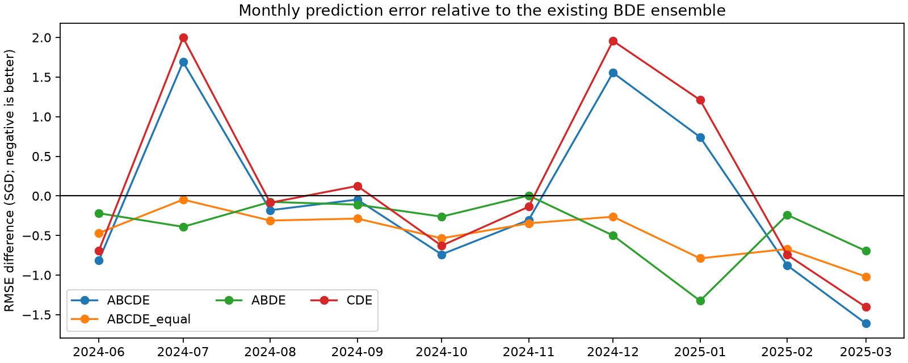
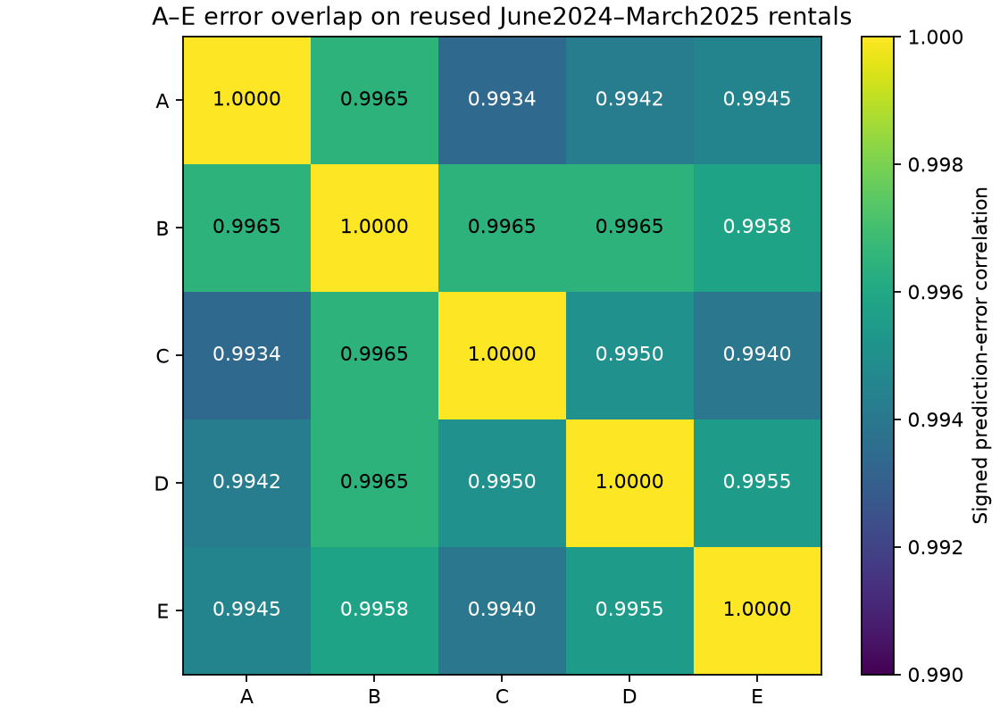

# A/B/C/D/E weighted TabPFN ensembles

**Earlier-only family selection: CDE.** Its reused later RMSE is S$455.359761, versus S$455.171873 for existing BDE and S$455.071028 for A alone. The lowest observed later score among all reported candidates is ABCDE_equal at S$454.703987; this observed ranking does not replace the earlier selection.

The most promising learned-weight candidate on the later period is ABDE at S$454.787412. The fixed equal-weight ABCDE sensitivity has the lowest observed score overall. The unregularized simplex fit over ABCDE collapses to about7.3%A/92.7%C and omits B,D,E, illustrating weight instability between historical periods. Neither observed winner was the family chosen by the earlier-transfer rule, so neither is promoted as an independently validated winner.

## Analysis before new weight fitting

A=77-feature MSE-only DiagScale (one inference view); B=77-feature plain frozen Fast (two views); C=77-feature relative-history Fast (two views); D=84-feature seasonal Fast (two views); E=89-feature nearby-comparable Fast (two views). All use the same pretrained Fast backbone, original residual targets and original temporal baselines, adding the baseline exactly once before averaging.

ABCDE contains CDE and BDE as feasible subsets: zero A/B weights reproduces CDE, and zero A/C reproduces BDE. Therefore the exact nonnegative sum-one optimizer cannot have higher CALIBRATION MSE for ABCDE on identical cases. There is no corresponding guarantee on later months. Unstable extra weights can worsen transfer. Equal weighting also has no nesting guarantee, because adding a model changes every other weight.

For an existing prediction p and an added prediction a, let e=p-y and d=a-p. The blend p+alpha*d changes MSE by 2*alpha*E[e*d]+alpha^2*E[d^2]. A small positive addition helps precisely when E[e*d]<0. Individual RMSE and pairwise error correlation alone do not establish this condition for a multi-model blend.

The saved, previously inspected main scores favored A individually. Its error correlation with C (~0.9934) was lower than with B (~0.9965), motivating AC and ACDE; B might still add bias/error cancellation. This analysis motivated the declared groups A,BDE,CDE,AC,ABDE,ACDE,ABCDE before NEW weights were fitted. It was informed by already-inspected development labels, so this is retrospective exploration, not a new untouched experiment. No main-period oracle weights or exhaustive subset search are fitted.

## Earlier-only calibration and selection

The same original full-context historical windows are reused: September2022–June2023 (60,079 context,2,000 sampled queries) and July2023–April2024 (87,937 context,2,000 sampled queries). Queries are200 label-independent cases per month, weighted to each month’s rental population. All five models share exactly the same query IDs,months,labels and population weights.

September has no earlier weight labels and uses declared equal weights as cold start. July weights fit September predictions only; July’s nested transfer RMSE chooses the family, with ties favoring fewer active models. After selection is saved, June2024 weights refit each declared group on the two disjoint earlier windows, with last targetApril2024. June2024–March2025 supplies28,995 complete later cases. It does not fit weights, choose gamma/intercepts, select clipping, or choose a new family.

| group | rmse_sgd | mae_sgd | bias_sgd | active_members |
| --- | --- | --- | --- | --- |
| A | 571.100 | 430.483 | 120.613 | 1 |
| BDE | 570.480 | 430.628 | 121.853 | 2 |
| CDE | 566.160 | 426.608 | 113.064 | 2 |
| AC | 566.808 | 427.114 | 113.964 | 2 |
| ABDE | 570.422 | 429.975 | 121.814 | 2 |
| ACDE | 566.835 | 427.126 | 114.181 | 3 |
| ABCDE | 566.835 | 427.126 | 114.181 | 3 |

The exact existing five-member active-face simplex optimizer is reused; it enumerates candidate stationary faces for the convex optimum, rather than a hyperparameter grid. No negative weights, intercept or target calibration are introduced. The earlier-data nested-simplex inequality is independently checked in nested_simplex_checks.csv.

## Historical A adapters and leakage checks

The final adapter trained beforeDecember2023 cannot be backdated to predict September2022/July2023 queries. Instead, the existing one-epoch September2022 adapter is reused only after exact complete X_train,y_train and residual-baseline replay against the original historical bundle. A new July2023 adapter is fitted only on labels throughJune2023, using the fixed existing MSE-only recipe: one epoch,lr0.01,weight decay0.01,seed42,1024-row tasks,20% supervised queries,two training views and one inference view. No query evaluation, early stopping or checkpoint selection is permitted. All other backbone tensors match the frozen checkpoint digest.

Historical A forecasts cover the same ten-month origins/horizons as B–E, rather than mixing the older four-month OOF forecasts with incompatible fixed-origin predictions. Existing main A and every B–E forecast are reused unchanged. The main A adapter is the previously selected preDecember2023 model; historical A follows the fixed one-epoch recipe rather than selecting epochs on its own query windows. That recipe was developed in prior project work, so historical simulation is conditional on that already chosen algorithm.

| origin | adapter_reused | context_rows | query_rows | new_adapter_fit_seconds | prediction_seconds |
| --- | --- | --- | --- | --- | --- |
| 2022-09 | True | 60079 | 2000 | 0.000 | 9.499 |
| 2023-07 | False | 87937 | 2000 | 46.705 | 18.150 |

## Main reused development comparison

| model | rows | rmse_sgd | mae_sgd | bias_sgd | delta_vs_existing_BDE |
| --- | --- | --- | --- | --- | --- |
| A_single | 28995 | 455.071 | 330.790 | -8.428 | -0.101 |
| BDE | 28995 | 455.172 | 328.202 | 5.763 | -0.000 |
| CDE | 28995 | 455.360 | 329.033 | 0.857 | 0.188 |
| AC | 28995 | 455.139 | 328.963 | 0.166 | -0.033 |
| ABDE | 28995 | 454.787 | 329.114 | -1.703 | -0.384 |
| ACDE | 28995 | 455.139 | 328.963 | 0.166 | -0.033 |
| ABCDE | 28995 | 455.139 | 328.963 | 0.166 | -0.033 |
| B | 28995 | 455.396 | 327.794 | 10.792 | 0.224 |
| C | 28995 | 455.370 | 329.042 | 0.842 | 0.198 |
| D | 28995 | 455.804 | 329.237 | 3.516 | 0.632 |
| E | 28995 | 456.482 | 330.482 | -1.780 | 1.311 |
| BDE_existing | 28995 | 455.172 | 328.202 | 5.763 | 0.000 |
| selected | 28995 | 455.360 | 329.033 | 0.857 | 0.188 |
| CDE_equal | 28995 | 455.097 | 328.790 | 0.859 | -0.075 |
| BDE_equal | 28995 | 455.247 | 328.489 | 4.176 | 0.075 |
| ABCDE_equal | 28995 | 454.704 | 328.526 | 0.988 | -0.468 |

BDE is reoptimized by the unchanged original earlier-only method and independently reproduces existing BDE predictions/weights. BDE_existing also retains the old earliest-origin baseline fallback, unlike the declared equal cold starts; the two BDE versions match at July2023 andJune2024. *_equal rows are fixed equal-weight sensitivities, not selected models.

## Main weights

| group | A | B | C | D | E |
| --- | --- | --- | --- | --- | --- |
| A | 1.000 | 0.000 | 0.000 | 0.000 | 0.000 |
| BDE | 0.000 | 0.492 | 0.000 | 0.257 | 0.252 |
| CDE | 0.000 | 0.000 | 0.995 | 0.005 | 0.000 |
| AC | 0.073 | 0.000 | 0.927 | 0.000 | 0.000 |
| ABDE | 0.411 | 0.139 | 0.000 | 0.200 | 0.250 |
| ACDE | 0.073 | 0.000 | 0.927 | 0.000 | 0.000 |
| ABCDE | 0.073 | 0.000 | 0.927 | 0.000 | 0.000 |

Weights describe earlier calibration fit, not main-label optimization. Zero-weight members may be omitted. Costs in internal inference views are A=1 and B/C/D/E=2 each: all-positive ABCDE costs9 views, ACDE/ABDE7, CDE/BDE6, AC3. Sequential deployment peak memory is the largest member peak, not a sum across all members. Four components already have full-data test predictions; C still needs a separate full-data inference if it is retained.

## Paired comparisons

| candidate | reference | delta_rmse | ci_low | ci_high | months | block_months |
| --- | --- | --- | --- | --- | --- | --- |
| ABCDE | CDE | -0.220 | -0.316 | -0.155 | 10 | 3 |
| ABCDE | BDE | -0.033 | -0.371 | 0.597 | 10 | 3 |
| ACDE | CDE | -0.220 | -0.316 | -0.155 | 10 | 3 |
| ABDE | BDE | -0.384 | -0.650 | -0.155 | 10 | 3 |
| selected | BDE_existing | 0.188 | -0.183 | 0.883 | 10 | 3 |
| selected | A | 0.289 | -0.279 | 1.192 | 10 | 3 |
| CDE | BDE | 0.188 | -0.183 | 0.883 | 10 | 3 |
| AC | A | 0.068 | -0.453 | 0.898 | 10 | 3 |
| ABDE | A | -0.284 | -0.470 | -0.100 | 10 | 3 |
| ABCDE_equal | A | -0.367 | -0.625 | -0.054 | 10 | 3 |
| ABCDE_equal | BDE_existing | -0.468 | -0.646 | -0.272 | 10 | 3 |
| ABCDE_equal | CDE_equal | -0.393 | -0.523 | -0.290 | 10 | 3 |
| ABCDE_equal | BDE_equal | -0.543 | -0.676 | -0.365 | 10 | 3 |
| ABCDE_equal | ABDE | -0.083 | -0.202 | 0.100 | 10 | 3 |

Intervals jointly resample contiguous three-month blocks of the ten later months, retaining all paired rental observations within each sampled month. They condition on fitted models and omit weight/family-selection uncertainty and project-wide repeated holdout reuse. Do not interpret28,995 rentals as28,995 independent time observations. monthly_scores.csv and subgroup_scores.csv retain monthly,town and flat-type errors.

## Decision and limits

Separate-candidate gate: False. It requires the earlier-selected family to beat both A and existing BDE on July nested transfer and later RMSE, with main paired-block upper95 differences below zero versus both. No existing submission is changed. Failure does not establish that all mixtures are useless; it means this declared retrospective experiment does not justify promotion under the gate.

Existing feature and adapter hyperparameters were developed using these already-examined dates. No genuinely untouched later labeled holdout exists. Model errors are highly correlated, so small aggregate changes can be unstable even with convex weights. A Kaggle score cannot be measured without hidden test labels.

## Reproduce

Run `.venv/Scripts/python.exe analysis/compare_tabpfn_abcde.py --stage all`. It reuses validated caches and resumes completed A forecasts. `--stage select` fits/locks earlier-only weights; `--stage evaluate` recreates the report from predictions. Settings,source/code hashes,pre_analysis.txt,A adapter/context provenance,selection.json,weights.csv,all row predictions and verification.json are retained in this directory. Feature bundles/adapters are under.cache/tabpfn_abcde_ensemble/. Original scripts,reports,adapters and submissions are preserved.

Independent audit: `.venv/Scripts/python.exe analysis/audit_tabpfn_abcde.py` verifies all32,995 saved cases,source predictions,population weights,convex weights and score reconstruction; both historical A adapters predate their targets. Existing BDE and both protected submissions reproduce their recorded hashes.
