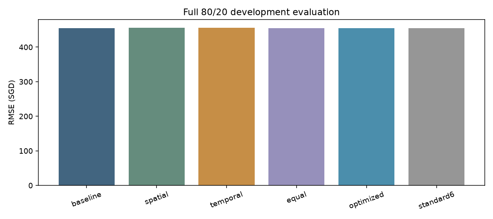
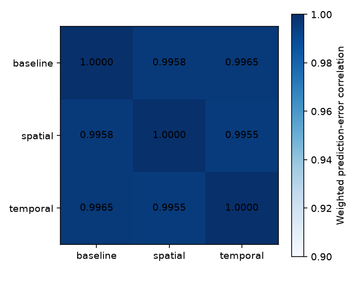
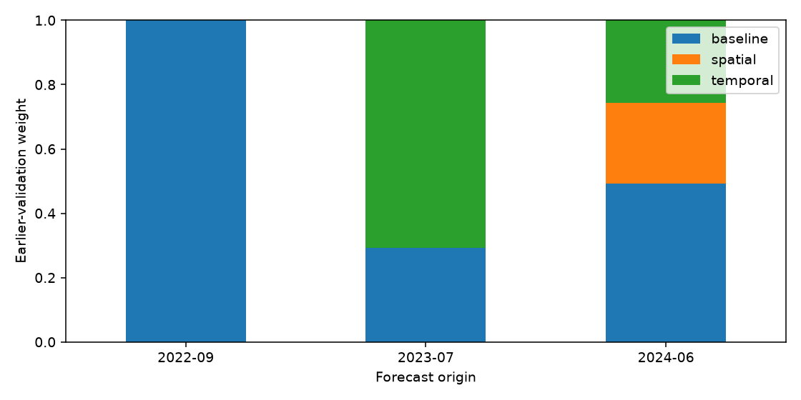
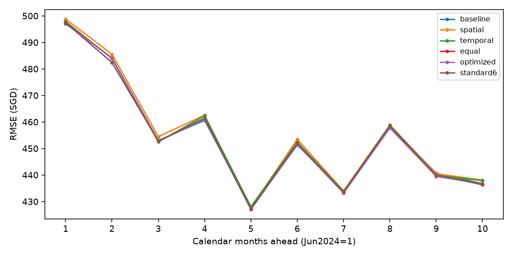
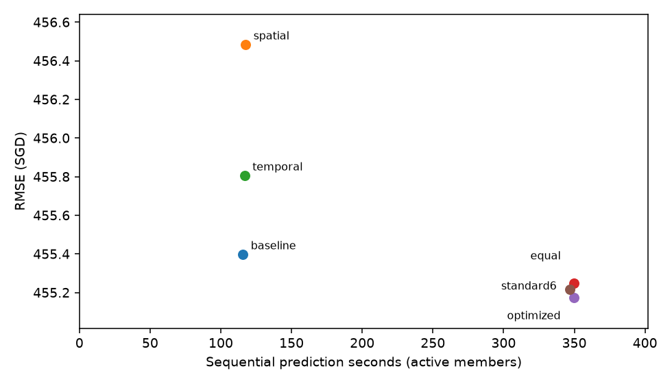

# Spatial-temporal feature-diversified frozen TabPFN

The optimized feature-diversified ensemble improves main development RMSE. Optimized minus baseline RMSE is -0.224 SGD (+0.049% improvement). Optimized averaging changes RMSE by -0.075 SGD relative to equal averaging. **Retain existing model; specified feature-diversified ensemble lacks sufficient stable evidence.** This is a repeatedly examined development backtest; no untouched labeled chronological test is available.

## Main 80/20 results

All121,005 pre-June2024 context rows and28,995 June2024-March2025 evaluation rows. RMSE,MAE,bias are original SGD; negative RMSE difference is better. Costs sum sequential inference for active members and exclude feature preparation, hashing and serialization. Internal-estimator count is total active TabPFN views.

| model | rmse_sgd | mae_sgd | bias_sgd | rmse_difference_sgd | rmse_improvement_pct | predict_seconds | peak_allocated_vram_gib | internal_estimators |
| --- | --- | --- | --- | --- | --- | --- | --- | --- |
| baseline | 455.396 | 327.794 | 10.792 | 0.000 | 0.000 | 115.539 | 9.124 | 2 |
| spatial | 456.482 | 330.482 | -1.780 | 1.086 | -0.239 | 117.449 | 9.131 | 2 |
| temporal | 455.804 | 329.237 | 3.516 | 0.408 | -0.090 | 116.717 | 9.127 | 2 |
| equal | 455.247 | 328.489 | 4.176 | -0.149 | 0.033 | 349.705 | 9.131 | 6 |
| optimized | 455.172 | 328.202 | 5.763 | -0.224 | 0.049 | 349.705 | 9.131 | 6 |
| opt_baseline_spatial | 455.342 | 328.361 | 5.563 | -0.054 | 0.012 | 232.988 | 9.131 | 4 |
| opt_baseline_temporal | 455.159 | 327.939 | 7.954 | -0.237 | 0.052 | 232.257 | 9.127 | 4 |
| opt_spatial_temporal | 455.666 | 329.410 | 0.589 | 0.270 | -0.059 | 234.166 | 9.131 | 4 |
| standard6 | 455.215 | 327.091 | 15.151 | -0.181 | 0.040 | 346.856 | 9.124 | 6 |

Main optimized weights: **baseline=0.4920, spatial=0.2515, temporal=0.2565**. The optimized ensemble retains 3 members; zero-weight members can be omitted at deployment. No intercept, target calibration or post-hoc clipping is used. Only earlier out-of-time validation targets determine weights; there is no optimization on the main holdout or Kaggle test. The four optimized rows include the prespecified pair ablations, rather than outer-selected alternatives.

## Representation choices

All members use the same pretrained V3.5FAST checkpoint, seed42, plain TabPFNRegressor, full expanding context, no subsampling, fit_with_cache, GPU caches, one preprocessing job, batch200 and two internal preprocessing estimators. All retain the same original raw labels and residual target: y minus the local temporal baseline, adding that baseline once after prediction. No DiagScale,LoRA,adapter training or neural optimization occurs. TabPFN's internal estimator ensemble differs from this external ensemble across feature matrices.

Baseline: retained **77** categorical-month inputs with31 static/calendar/identity,37 causal histories and9 temporal inputs. Every final baseline,feature and seed model uses the plain two-view class with **native-default estimator batching**, without environment overrides on row/cell budgets. The main E0 was freshly computed and all earlier E0 predictions regenerated with that same execution policy. No trained-adapter predictions or parameters are consumed. Existing adapted DiagScale455.071 is outside the frozen-weight comparison.

A final strict replay exposed a hidden execution mismatch in the initially reused baseline: the prior hierarchical experiment set TABPFN_MAX_BATCHED_ESTIMATOR_ROWS=0, running estimators separately, whereas new feature/seed models used native-default batching. This changes individual prices by up to0.554555 SGD even though aggregate baseline RMSE changes only from455.396319 to455.395927. A controlled400-row plain-model probe with the rows0 override reproduces the old sequential output, isolating the cause; see estimator_batching_isolation.json. The current full plain baseline also agrees with the earlier two-view frozen-column reference within5e-9 SGD; that is verification only, not reuse of an adapter model. Provisional mixed-execution outputs and decisions are archived in batching_reconciliation/. Final weights are recomputed by the unchanged earlier-only optimizer from the corrected earlier baseline predictions. Feature definitions,folds,hyperparameters and decision thresholds stay fixed; no outer targets enter this correction.

Spatial: **89** inputs, adding the existing market_smoothed12 columns: same-flat-type500/1000m6/12-month shrunken rent means and counts, plus Gaussian neighborhood rent/support/rent-per-sqm and a missing-history flag. Existing screening favored these over raw neighborhood means (608.353 vs624.615 pooled earlier RMSE in the one-view60-per-month study); they later worsened standalone main RMSE. That negative result does not rule out complementary prediction errors. Here they are evaluated with matched two-view inference. No extra MRT,mall,school,park,census or amenity-quality features are appended. The fields include own-building **earlier** labels; they never include the current observation or future labels. Coordinates are inherited existing geography, not a new dataset.

Temporal: **84** inputs, keeping all rental histories, nine trend/forecast variables and the residual baseline; replaces the categorical month with sine/cosine and adds six existing recurring January school-opening and January/August university-intake/lead-window proxies. Prior controlled earlier folds preferred this calendar representation (599.762 vs602.587 categorical-month one-view RMSE), while broader20-feature dynamic replacements worsened main performance and created reference warmup gaps. Thus this focused seasonal representation tests diversity without changing the target baseline or rebuilding an unpromising complex dynamics model. Calendar proxies are hypotheses, not precise historical school calendars; they are deterministic and complete in every context month. This result does not test every possible market-dynamics representation.

These three definitions were locked before new ensemble scoring. Complete per-fold feature names, new/removed columns, categories and row-ID hashes are in features_*.json; new-feature coverage is in new_feature_coverage.csv. Spatial cached training features are reused only after exact original context-frame agreement. New earlier200-per-month spatial queries reproduce all corresponding prior600-query cached values within1e-8. Source and code hashes are fixed in settings.json.

## Causality and validation

Earlier fixed-origin windows: September2022-June2023 and July2023-April2024; each uses the original200 label-independent queries/month and month-population/sample weights (2,000 cases per window). All60,079/87,937 context rows are retained. The main June2024 origin fits weights on those4,000 earlier predictions. Both earlier label windows end before June2024; their physical source row IDs and target months are disjoint. The shared original pseudo-origins govern context histories. Query rental histories remain fixed at the forecasting cutoff throughout each10-month horizon.

New spatial fields preserve the existing additional one-month publication lag: labels<=feature_origin-1. For a query forecast beginning at T, feature_origin=T-1, so the spatial field's latest rental month is T-2; baseline histories retain their original T-1 cutoff. This conservative policy is kept identical to the earlier implementation, not silently shifted. Query targets are dropped before spatial feature construction. Early missing history retains native NaN,zero support and explicit missing-history flag. Categorical/unknown-value handling and native numeric missingness remain unchanged; no full-data scaling or imputation is added.

For genuine chronological transfer of the weights, September2022 has no earlier ensemble calibration and defaults to baseline-only; July2023 learns weights only on the preceding September2022 window (labels throughJune2023). Main weights use both earlier windows. Pooled training-weight RMSE is a calibration criterion, not out-of-sample performance of the weight optimizer. All metrics use original-scale aligned predictions. Weighted pooled objectives use summed squared errors, never averaged fold RMSEs. Weight fitting enumerates the faces of a nonnegative simplex, giving the convex quadratic MSE optimum for<=3 members, with exact ties favoring the baseline. No exhaustive feature/weight hyperparameter search is used.

| origin | model | baseline_weight | spatial_weight | temporal_weight | active_members | fit_label_max | cold_start |
| --- | --- | --- | --- | --- | --- | --- | --- |
| 2022-09 | optimized | 1.000 | 0.000 | 0.000 | 1 | none; cold-start baseline | True |
| 2022-09 | opt_baseline_spatial | 1.000 | 0.000 | 0.000 | 1 | none; cold-start baseline | True |
| 2022-09 | opt_baseline_temporal | 1.000 | 0.000 | 0.000 | 1 | none; cold-start baseline | True |
| 2022-09 | opt_spatial_temporal | 1.000 | 0.000 | 0.000 | 1 | none; cold-start baseline | True |
| 2023-07 | optimized | 0.293 | 0.000 | 0.707 | 2 | 2023-06 | False |
| 2023-07 | opt_baseline_spatial | 1.000 | 0.000 | 0.000 | 1 | 2023-06 | False |
| 2023-07 | opt_baseline_temporal | 0.293 | 0.000 | 0.707 | 2 | 2023-06 | False |
| 2023-07 | opt_spatial_temporal | 0.000 | 0.000 | 1.000 | 1 | 2023-06 | False |
| 2024-06 | optimized | 0.492 | 0.252 | 0.257 | 3 | 2024-04 | False |
| 2024-06 | opt_baseline_spatial | 0.584 | 0.416 | 0.000 | 2 | 2024-04 | False |
| 2024-06 | opt_baseline_temporal | 0.610 | 0.000 | 0.390 | 2 | 2024-04 | False |
| 2024-06 | opt_spatial_temporal | 0.000 | 0.553 | 0.447 | 2 | 2024-04 | False |

## Chronological transfer and ablations

| origin | model | n | rmse_sgd | mae_sgd | bias_sgd | rmse_improvement_pct |
| --- | --- | --- | --- | --- | --- | --- |
| 2022-09 | baseline | 2000 | 635.086 | 512.052 | 51.207 | 0.000 |
| 2022-09 | spatial | 2000 | 637.496 | 512.831 | 61.969 | -0.379 |
| 2022-09 | temporal | 2000 | 634.025 | 512.831 | 51.802 | 0.167 |
| 2022-09 | equal | 2000 | 634.845 | 512.005 | 54.993 | 0.038 |
| 2022-09 | optimized | 2000 | 635.086 | 512.052 | 51.207 | 0.000 |
| 2022-09 | standard6 | 2000 | 634.604 | 511.375 | 47.859 | 0.076 |
| 2023-07 | baseline | 2000 | 569.479 | 430.428 | 117.528 | 0.000 |
| 2023-07 | spatial | 2000 | 567.845 | 427.761 | 110.665 | 0.287 |
| 2023-07 | temporal | 2000 | 571.934 | 431.611 | 123.650 | -0.431 |
| 2023-07 | equal | 2000 | 568.681 | 429.034 | 117.281 | 0.140 |
| 2023-07 | optimized | 2000 | 570.480 | 430.628 | 121.853 | -0.176 |
| 2023-07 | standard6 | 2000 | 563.307 | 426.394 | 100.380 | 1.084 |
| 2024-06 | baseline | 28995 | 455.396 | 327.794 | 10.792 | 0.000 |
| 2024-06 | spatial | 28995 | 456.482 | 330.482 | -1.780 | -0.239 |
| 2024-06 | temporal | 28995 | 455.804 | 329.237 | 3.516 | -0.090 |
| 2024-06 | equal | 28995 | 455.247 | 328.489 | 4.176 | 0.033 |
| 2024-06 | optimized | 28995 | 455.172 | 328.202 | 5.763 | 0.049 |
| 2024-06 | standard6 | 28995 | 455.215 | 327.091 | 15.151 | 0.040 |

The optimized pair ablations in comparison.csv answer whether the spatial or temporal member contributes beyond the baseline without selecting weights on the main targets. Compare optimized_baseline_spatial,optimized_baseline_temporal and the three-member optimized result under the same earlier training labels. The earliest optimized row is explicitly a cold-start baseline fallback. No new feature variant was selected after observing these scores.

## Complementarity

Main weighted signed-error correlations range **0.995521-0.996470**. High correlations limit the available error cancellation, even if averaging reduces noise. Pairwise prediction differences and uncentered error second moments are saved in complementarity.csv,error_correlations_*.csv and error_second_moments_*.csv. An exact check verifies ensemble MSE=w'Qw in SGD. The equal-weight diversity identity compares the ensemble with average individual member MSE; a positive diversity gain alone does not establish improvement over the strongest member. Different biases can also affect averaging; bias is reported directly.

| first | second | error_correlation | rms_prediction_difference_sgd | first_bias_sgd | second_bias_sgd | pair_equal_rmse_sgd |
| --- | --- | --- | --- | --- | --- | --- |
| baseline | spatial | 0.996 | 43.573 | 10.792 | -1.780 | 455.419 |
| baseline | temporal | 0.996 | 38.964 | 10.792 | 3.516 | 455.183 |
| spatial | temporal | 0.996 | 43.502 | -1.780 | 3.516 | 455.624 |

## Does diversity beat comparable inference compute?

A standard **six-view same-feature TabPFN ensemble** provides the nominal compute control: three sequential two-estimator77-feature models with seeds42/43/44, averaged equally. It uses the same checkpoint,target/context,batch and GPU cache settings, with no feature diversity. Feature-diversified members instead all use seed42, isolating a comparison with ordinary seed/preprocessing diversity at the same total six-view budget. This control is not one six-estimator TabPFN object. It matches total views, not exact wall-clock cost; preprocessing,84/89 versus77 columns and execution can differ. A zero-weight external member may be skipped, reducing optimized deployment cost below the nominal three-member ensemble.

The original monolithic six-estimator pilot finished its two earlier folds, but at87,937 context rows it allocated19.54GiB and left less than0.5GiB available hostRAM on this16GiB machine. It was therefore not scaled to the main121,005-row context. Pilot results/configurations are preserved in monolithic_six_view_pilot/ and excluded from the uniform sequential control. No feature-member predictions or learned combination weights changed. The sequential control is evaluated uniformly at all three origins; memory is reclaimed between processes.

Nominal three-member sequential prediction time: **349.7s**, versus115.5s for baseline and346.9s for standard6. The optimized active-member sum is349.7s. Feature diversity is only supported beyond extra internal views if it compares favorably with standard6; mere improvement over baseline2 is insufficient for that claim. All jobs run sequentially on one RTX4080 in separate processes. Memory is peak PyTorch allocation, not total driver reservation; external-ensemble peak is the maximum across sequential active members, not their sum.

All main-window cost timers use the final native-default estimator execution and memory policy: release unused CUDA allocator cache between batches while retaining the live fitted context. This avoids memory paging without changing the fitted model. The current native-default main baseline has a complete measured fit/predict run under the same policy; the old sequential-estimator baseline timer is not mixed into these costs. All1,600 spatial predictions computed before the allocator change reproduce exactly; see allocator_prediction_replay.json. Timing still reflects single-run wall-clock measurements, not a controlled hardware microbenchmark.

| model | fit_seconds | predict_seconds | peak_allocated_vram_gib | internal_estimators | external_members |
| --- | --- | --- | --- | --- | --- |
| baseline | 25.708 | 115.539 | 9.124 | 2 | 1 |
| spatial | 27.931 | 117.449 | 9.131 | 2 | 1 |
| temporal | 26.496 | 116.717 | 9.127 | 2 | 1 |
| standard6 | 77.220 | 346.856 | 9.124 | 6 | 3 |
| equal | 80.136 | 349.705 | 9.131 | 6 | 3 |
| optimized | 80.136 | 349.705 | 9.131 | 6 | 3 |
| opt_baseline_spatial | 53.640 | 232.988 | 9.131 | 4 | 2 |
| opt_baseline_temporal | 52.204 | 232.257 | 9.127 | 4 | 2 |
| opt_spatial_temporal | 54.427 | 234.166 | 9.131 | 4 | 2 |

## Paired uncertainty

3,000 paired bootstrap replicates,seed42, clustering separately by target month or building. Negative differences favor the model; these are descriptive development intervals, not confirmatory significance. Ten adjacent month clusters are few; building resampling does not capture all common market shocks. Weight-estimation uncertainty and repeated feature development are not removed by these intervals.

| cluster | clusters | model | reference | rmse_difference_sgd | lower95_sgd | upper95_sgd |
| --- | --- | --- | --- | --- | --- | --- |
| month | 10 | equal | baseline | -0.149 | -0.504 | 0.176 |
| month | 10 | optimized | baseline | -0.224 | -0.509 | 0.037 |
| month | 10 | optimized | equal | -0.075 | -0.143 | -0.000 |
| month | 10 | standard6 | baseline | -0.181 | -0.680 | 0.265 |
| month | 10 | optimized | standard6 | -0.043 | -0.395 | 0.435 |
| month | 10 | opt_baseline_spatial | baseline | -0.054 | -0.337 | 0.206 |
| month | 10 | opt_baseline_temporal | baseline | -0.237 | -0.439 | -0.041 |
| building | 8210 | equal | baseline | -0.149 | -0.437 | 0.144 |
| building | 8210 | optimized | baseline | -0.224 | -0.443 | -0.002 |
| building | 8210 | optimized | equal | -0.075 | -0.146 | -0.006 |
| building | 8210 | standard6 | baseline | -0.181 | -0.457 | 0.095 |
| building | 8210 | optimized | standard6 | -0.043 | -0.277 | 0.202 |
| building | 8210 | opt_baseline_spatial | baseline | -0.054 | -0.283 | 0.173 |
| building | 8210 | opt_baseline_temporal | baseline | -0.237 | -0.427 | -0.055 |

## Horizon and subgroup checks

Horizon1 isJune2024, horizon10 isMarch2025. Existing evaluation covers10 months, so12/17-month accuracy is unavailable; no Kaggle test labels are used. Month,town,flat-type and exact-horizon tables are in subgroup_scores.csv. The6-month row means exactly horizon6.

| group | model | n | rmse_sgd | rmse_difference_sgd |
| --- | --- | --- | --- | --- |
| 1-3 months | baseline | 9089 | 479.046 | 0.000 |
| 1-3 months | spatial | 9089 | 480.595 | 1.549 |
| 1-3 months | temporal | 9089 | 479.113 | 0.067 |
| 1-3 months | equal | 9089 | 479.108 | 0.062 |
| 1-3 months | optimized | 9089 | 479.012 | -0.033 |
| 1-3 months | standard6 | 9089 | 478.487 | -0.558 |
| 4-5 months | baseline | 5371 | 444.479 | 0.000 |
| 4-5 months | spatial | 5371 | 445.561 | 1.082 |
| 4-5 months | temporal | 5371 | 445.675 | 1.196 |
| 4-5 months | equal | 5371 | 444.630 | 0.151 |
| 4-5 months | optimized | 5371 | 444.498 | 0.020 |
| 4-5 months | standard6 | 5371 | 444.826 | 0.348 |
| 6 months | baseline | 2715 | 451.302 | 0.000 |
| 6 months | spatial | 2715 | 453.450 | 2.148 |
| 6 months | temporal | 2715 | 452.413 | 1.111 |
| 6 months | equal | 2715 | 451.752 | 0.450 |
| 6 months | optimized | 2715 | 451.542 | 0.239 |
| 6 months | standard6 | 2715 | 452.051 | 0.749 |
| 7-10 months | baseline | 11820 | 442.390 | 0.000 |
| 7-10 months | spatial | 11820 | 442.846 | 0.456 |
| 7-10 months | temporal | 11820 | 442.558 | 0.168 |
| 7-10 months | equal | 11820 | 441.787 | -0.603 |
| 7-10 months | optimized | 11820 | 441.787 | -0.603 |
| 7-10 months | standard6 | 11820 | 442.064 | -0.326 |

## Limitations and correctness

An untouched labeled chronological test **cannot be supplied from this repository**: all available labeled periods were previously used in development, and the supplied Kaggle test is unlabelled. The final requested untouched-test claim therefore remains unfulfilled. The work provides locked-weight chronological development evaluations only; independent future labeled data or a new competition score is required for confirmation. Existing full-history DiagScale Kaggle output remains unchanged.

The inherited static amenity/MRT snapshot includes sites whose historical opening availability was not enforced. It remains identical across all compared models; no claim of fully point-in-time external geography is made. The spatial additions require no new external sources; deterministic calendar windows have complete historical availability. Earlier queries are sampled (context/main are full), and only two older market regimes estimate weights. Although weights are chosen without outer labels, the designs were informed by repeatedly examined past experiments. High error correlation and regime changes can make old optimal weights transfer poorly. This focused study covers one spatial and one seasonal temporal representation; it cannot rule out all feature-diversified ensembles.

All24 tests pass: exact convex/simplex boundary and interior solutions, sample-weight behavior, finite inputs, member permutation, coarse-grid dominance, exact baseline-vertex reconstruction, equivalence of three two-view means to a six-view mean, causal rental features under future/own-label mutation, calendar consistency and missingness. Runtime checks enforce identical member row IDs,labels,months,weights and residual baselines, pre-origin context cutoffs, finite predictions, unchanged parameter hashes and prohibited autograd. See tests.log and verification.json. The6-view control and all new two-view members use the plain pretrained class, no adapters and no context subsampling. All original source/checkpoint/submission hashes remain unchanged.

An independent numerical audit replays all12 new spatial fields at sampled query rows in every horizon month plus two context pseudo-origins per fold. Changing unavailable fitting labels and query targets has no effect. See [independent_feature_audit.json](independent_feature_audit.json). This validates the additional rental fields, while the inherited static MRT availability caveat remains.

## Figures

## Reproduce

Run `.venv/Scripts/python.exe analysis/compare_tabpfn_feature_ensemble.py --stage prepare`, then `--stage earlier`, then `--stage select`. Lock reporting with `.venv/Scripts/python.exe -c "from analysis.summarize_tabpfn_feature_ensemble import lock_plan; lock_plan()"`, then run `--stage outer` and `--stage summarize`. Existing completed inference outputs are reused only after hash verification. An incomplete new-memory-policy job replays its saved first200 rows and recomputes the complete query for comparable full timing. Settings/selection guards prevent silently overwriting experiments with different code or weights. Optional independent feature audit: `.venv/Scripts/python.exe analysis/audit_tabpfn_feature_ensemble.py`. Outputs include comparison.csv,learned_weights.csv,complementarity.csv,costs.csv,subgroup_scores.csv,paired_cluster_bootstrap.csv and row-aligned predictions_all_origins.csv. No test submission is generated.
