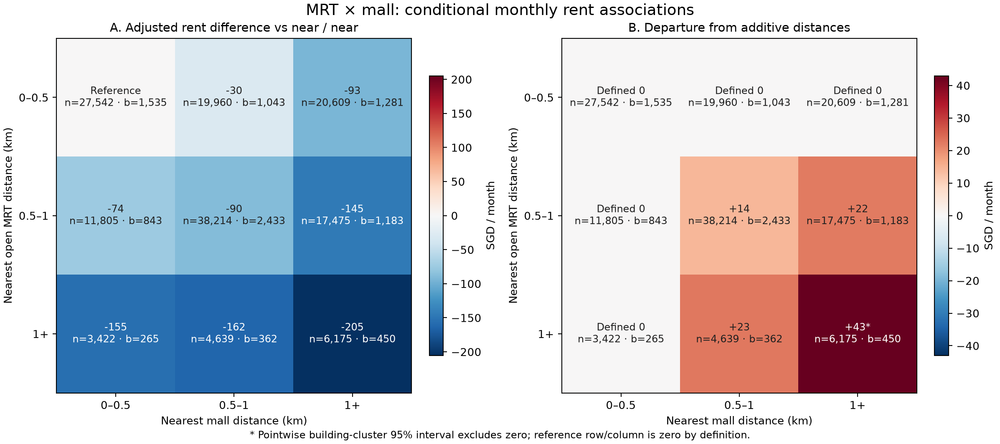

# MRT × 商场距离交互：月租条件关联

在共同完整训练样本 149,841 笔、9,395 栋上，以最近已开放 MRT 距离和最近商场距离各分三组，形成 3×3 个格子。每格至少 3,422 笔和 265 栋；图内 n 为交易笔数、b 为不同楼栋数。完整九格系数及逐项 95% 区间见 [CSV](mrt_mall_joint_cells.csv)，模型秩、缺失和源文件哈希见 [分析清单](analysis_manifest.json)。

左图是每个组合相对于“两者都在 0.5 km 内”格子的调整后月租差，单位 SGD/月。右图是**偏离可加关系的交互对比**：该格子的调整差，减去“仅 MRT 属该距离组”的差，再减去“仅商场属该距离组”的差。基准行与基准列按定义为 0，不是独立估计出无交互。内侧四格的对比及 95% 区间为：

| MRT km | 商场 km | 交互偏离 SGD/月 | 楼栋聚类 95% 区间 | 交易/楼栋 |
|---|---|---:|---:|---:|
| 0.5–1 | 0.5–1 | +14 | [-9, +38] | 38,214/2,433 |
| 0.5–1 | 1+ | +22 | [-2, +46] | 17,475/1,183 |
| 1+ | 0.5–1 | +23 | [-13, +58] | 4,639/362 |
| 1+ | 1+ | +43 | [+7, +79] | 6,175/450 |

内侧四格的交互偏离均为正；其中两种距离都超过 1 km 的格子约 +43 SGD/月，逐项 95% 区间为 +7 至 +79，图上以 * 标记。其余三格的区间都跨 0；这组探索性结果并未做多重比较校正。正偏离表示该格子的租金降幅比两个单独距离差直接相加时较小，并不表示绝对租金更高。

回归包含精确“审批月份 × 户型”及 town 固定效应，面积和楼龄各含标准化值与平方项，并控制楼栋最高楼层、CBD 直线距离及小学距离六组。两种热图来自同一显式 3×3 组合模型；标准误及对比区间使用 town+street+block 楼栋聚类的完整协方差矩阵。区间逐项计算，多个格子同时查看时不能当作整体显著性检验；预设少于 100 笔或 30 栋的格子会在图中遮蔽。图上浅灰表示支持不足，并非零效应。

设施距离为球面直线距离，设施清单是当前快照；未还原每笔交易时的开业状态，也未测量步行距离。控制变量不能排除 town 内细微区位、装修等混杂，因此图只描述条件关联，不能作为设施的因果效应或预测提升证据。复现：`.venv-model-benchmark/bin/python scripts/test_analyze_amenity_interactions.py`，然后 `.venv-model-benchmark/bin/python scripts/analyze_amenity_interactions.py`。
