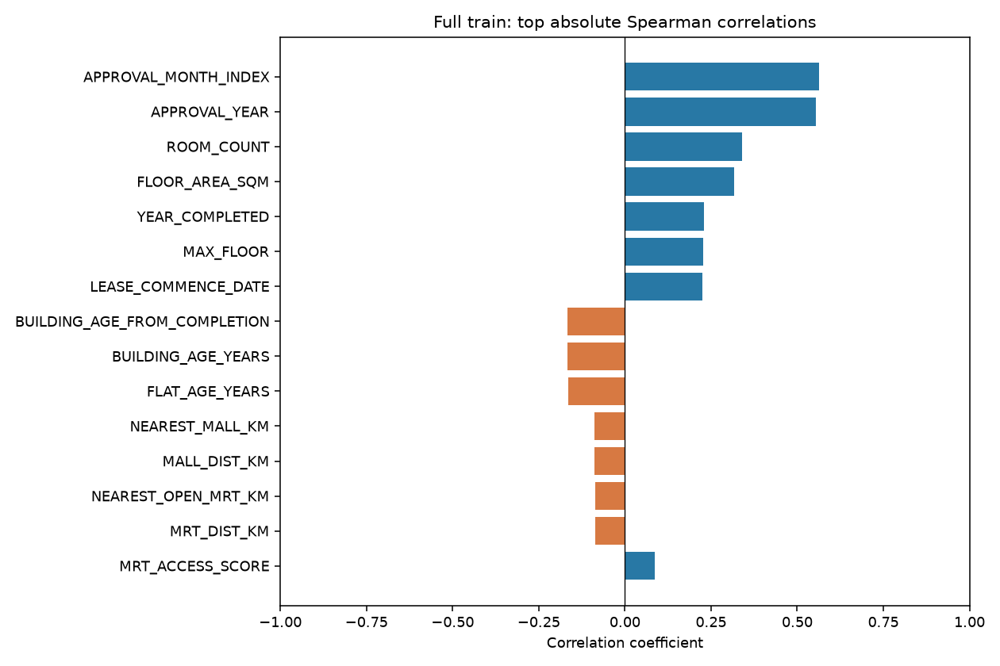
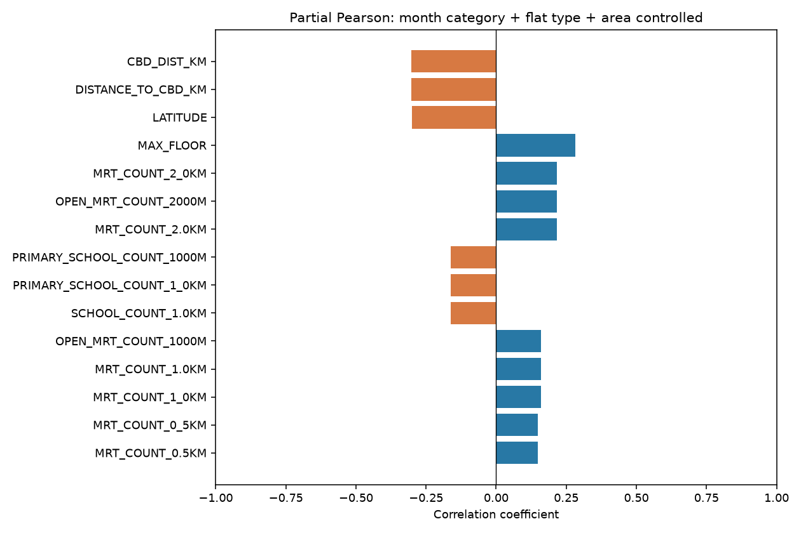
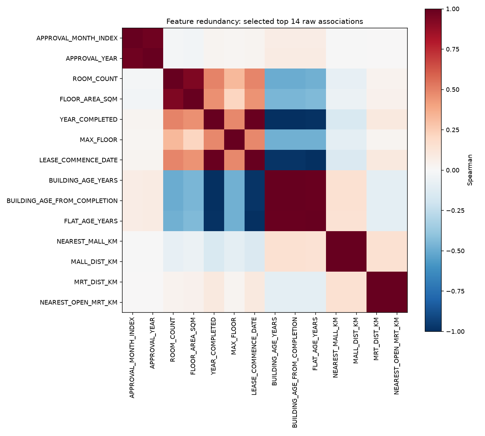
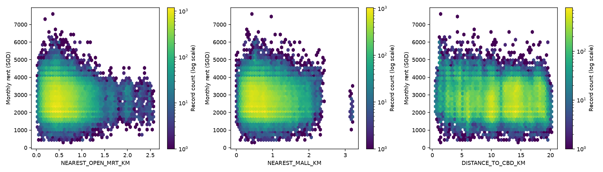
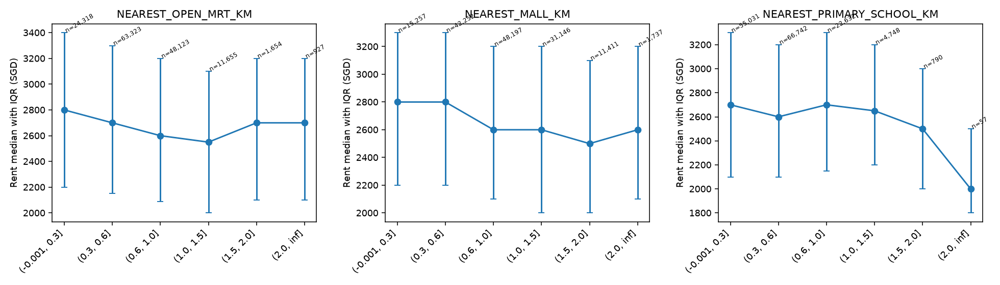
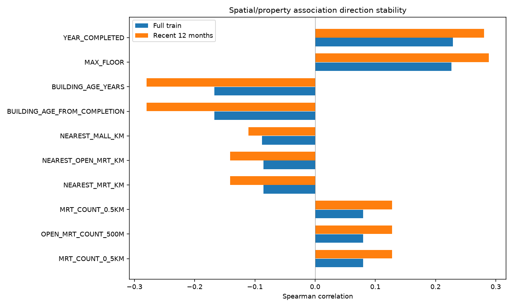

# 空间与房屋特征：月租关联分析

训练集共 150,000 行；仅使用训练租金标签进行描述分析，未训练预测模型。最近 12 个月定义为 APPROVAL_MONTH_INDEX 最大值往前 11 个月（含两端），共 35,158 行。

## 特征与统计方法

内存特征表保留原始列和行序，增加规范化地址/类别、楼栋经纬度、最高楼层、竣工年份与区域、时间、距租约起始年数和楼龄，以及 MRT、商场、小学和 CBD 球面直线距离与 500m/1km/2km 内设施坐标数。字段定义见 [feature_dictionary.csv](feature_dictionary.csv)，实现以 `analysis/pipeline/auxiliary.py` 为准。MAX_FLOOR 是楼栋最高楼层；租约年数不等于楼龄。

所有数值列（排除目标、ID、SOURCE_ROW_ID）均在 [完整相关表](tables/all_numeric_correlations.csv) 中报告 Pearson、Spearman、有效样本数、缺失/非有限值数和唯一值数；常数列保留并给出空相关值。Spearman 使用平均秩后的 Pearson，无显著性检验。按绝对 Spearman 值排序；|r|≥0.5 为高、0.3≤|r|<0.5 为中等、<0.3 为弱，仅为描述标签，绝非显著性或预测价值阈值。

调整关联采用标准化后的 x、租金分别对“审批年月类别、规范化户型类别、面积”进行最小二乘残差化，再对两组残差计算 Pearson。每个特征使用其与目标和控制项均有效的记录；控制项本身不列入调整排名。设计矩阵存在共线性时 numpy 最小二乘仍可给出投影残差。这是线性控制后的关联，不是因果效果，也不是调整后的 Spearman。日历月类别只用于本次训练集描述，不建议直接用于未来月份外推。

## 空间及楼栋特征实际排名

全体数值特征按绝对 Spearman 排名（含原始面积与时间控制）：

| feature | n_valid | pearson | spearman |
| --- | --- | --- | --- |
| APPROVAL_MONTH_INDEX | 150000 | 0.5346 | 0.5639 |
| APPROVAL_YEAR | 150000 | 0.5172 | 0.5538 |
| ROOM_COUNT | 141766 | 0.3489 | 0.3396 |
| FLOOR_AREA_SQM | 150000 | 0.3293 | 0.3177 |
| YEAR_COMPLETED | 149841 | 0.2291 | 0.2290 |
| MAX_FLOOR | 149841 | 0.2904 | 0.2267 |
| LEASE_COMMENCE_DATE | 150000 | 0.2294 | 0.2255 |
| BUILDING_AGE_YEARS | 149841 | -0.1783 | -0.1676 |

达到高相关描述阈值的全部特征：APPROVAL_MONTH_INDEX, APPROVAL_YEAR。时间趋势强，不能把其相关强度归于空间特征。

按全训练集绝对 Spearman 排名：

| feature | n_valid | pearson | spearman | recent_spearman |
| --- | --- | --- | --- | --- |
| YEAR_COMPLETED | 149841 | 0.2291 | 0.2290 | 0.2807 |
| MAX_FLOOR | 149841 | 0.2904 | 0.2267 | 0.2887 |
| BUILDING_AGE_YEARS | 149841 | -0.1783 | -0.1676 | -0.2799 |
| BUILDING_AGE_FROM_COMPLETION | 149841 | -0.1783 | -0.1676 | -0.2799 |
| NEAREST_MALL_KM | 150000 | -0.0830 | -0.0879 | -0.1104 |
| NEAREST_OPEN_MRT_KM | 150000 | -0.0847 | -0.0858 | -0.1412 |
| NEAREST_MRT_KM | 150000 | -0.0847 | -0.0858 | -0.1412 |
| MRT_COUNT_0.5KM | 150000 | 0.0967 | 0.0800 | 0.1279 |
| OPEN_MRT_COUNT_500M | 150000 | 0.0967 | 0.0800 | 0.1279 |
| MRT_COUNT_0_5KM | 150000 | 0.0967 | 0.0800 | 0.1279 |

按绝对调整 Pearson 排名：

| feature | adjusted_pearson | n_adjusted |
| --- | --- | --- |
| DISTANCE_TO_CBD_KM | -0.3036 | 150000 |
| LATITUDE | -0.3011 | 150000 |
| MAX_FLOOR | 0.2813 | 149841 |
| OPEN_MRT_COUNT_2000M | 0.2173 | 150000 |
| MRT_COUNT_2.0KM | 0.2173 | 150000 |
| MRT_COUNT_2_0KM | 0.2173 | 150000 |
| PRIMARY_SCHOOL_COUNT_1_0KM | -0.1632 | 150000 |
| SCHOOL_COUNT_1.0KM | -0.1632 | 150000 |
| PRIMARY_SCHOOL_COUNT_1000M | -0.1632 | 150000 |
| MRT_COUNT_1.0KM | 0.1605 | 150000 |

完整数值特征排名、调整排名和近期排名分别见 [原始相关](tables/all_numeric_correlations.csv)、[调整关联](tables/adjusted_correlations.csv)、[近期窗口](tables/recent_12month_correlations.csv)。上述空间/楼栋特征中，全样本最高绝对 Spearman 为 0.2290；达到高相关阈值的个数为 0，达到中等区间的个数为 0。弱单变量关联不能证明特征对预测无用；经纬度线性或秩相关弱，也不能证明空间位置不重要，区域关系可能非线性且与户型、面积和时间交互。

## 距离分箱与近期稳定性

[分箱统计](tables/distance_and_count_bins.csv) 提供每组 n、均值、中位数、Q25、Q75 和 IQR；距离按公里分组，1km 设施计数按 0、1、2、3、4–5、6+ 分组。不同组的房型、年份、面积和区域构成可能不同，原始分箱差异不能解释为邻近设施造成的租金溢价。最近 12 月排名仅检查样本窗口下的方向和强度变化，不是独立验证集。

## 数据边界和后续使用

设施表是当前快照，open/planned 状态不是逐月历史状态；近期或历史记录都可能含时间错配。距离是球面直线距离，不是步行距离。设施计数按唯一坐标位置，不是不同 MRT 线路/站代码的数量；共址记录去重规则见构造清单。全部 11 个 planned MRT 坐标与 open 站坐标重合，planned 距离实际反映这些共址站点子集，不能解释为新增独立交通可达性，也不能解释为历史可用交通。

同栋、同房屋属性或月份出现多次交易，记录并非独立同分布；本报告未给出依赖独立性假设的 p 值。报告完整样本的重复记录权重，后续应按时间切分并检查楼栋/地点重复影响。高度冗余的不同半径计数、距离、年份及楼龄见相关矩阵；不应把各自相关值当作独立证据。

所有构造特征未使用租金或测试目标；调整分析仅使用训练标签。若后续采用 KNN，应在训练划分中拟合缺失处理、缩放和编码，再变换验证/测试数据；经纬度、公里距离、平方米和年份不能未经缩放直接混合。应采用时间验证评估新增空间特征的增益，不能由本次相关排名替代预测验证。

复现：在仓库根目录运行 `python -m analysis.main spatial-controls`。特征在内存中由统一管线生成，输出六张图和五张统计 CSV；源数据不修改。
