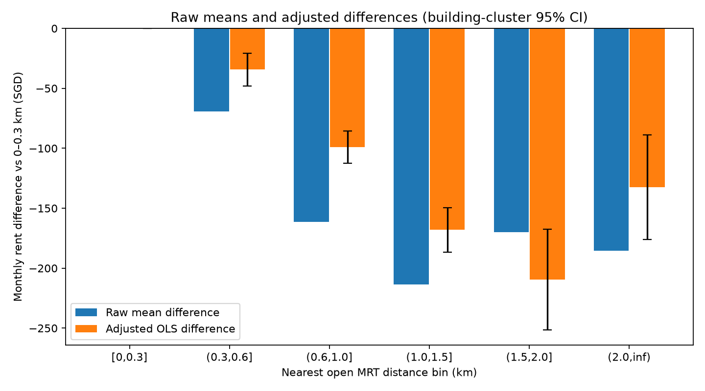

# MRT 距离：控制房屋属性与时间后的租金差异

完整训练集 150,000 行；本分析使用共同完整样本 149,841 行、9,395 个楼栋，排除 159 行。缺失项、设计秩和收敛次数见 [分析清单](analysis_manifest.json)。原始均值差与调整差使用完全相同样本；它们均为相对于 0–0.3km 基准组的 SGD/月差异，原始统计不是中位数。

OLS 控制精确“日历月份 × 规范化户型”交互固定效应和 town 固定效应，另控制中心化/标准化面积及其平方、楼龄及其平方、楼栋最高楼层。交互类别 285 个，town 26 个；固定效应投影后斜率列全部可识别，完整设计秩 320。MAX_FLOOR 不是出租单元楼层。固定效应通过迭代去均值吸收，与完整虚拟变量 OLS 等价；小型独立合成数据已与完整虚拟变量设计的系数及直接逐组计算的聚类协方差逐项对照。

95% 区间使用规范化 town+street+block 楼栋聚类 sandwich 协方差，有限样本修正 G/(G−1)×(N−1)/(N−K)，t 分布自由度 G−1。因环境 SciPy 二进制不可导入，t 临界值使用至自由度负三次项的 Cornish–Fisher 展开（大自由度近似，当前临界值 1.96021655；测试对照 df=100 的已知值误差 <1e−7）。不同楼栋独立是假设，同 town/相邻楼栋仍可能共同变化，区间不能完全排除空间依赖。距离分箱以右端点闭合，基准组为 0≤d≤0.3km，精确 2km 属于 1.5–2 组。

| distance_bin_km | n_rows | n_buildings | raw_mean_difference | adjusted_difference | ci_low | ci_high | adjusted_with_cbd |
| --- | --- | --- | --- | --- | --- | --- | --- |
| [0,0.3] | 24308 | 1346 | 0.00 | 0.00 | 0.00 | 0.00 | 0.00 |
| (0.3,0.6] | 63175 | 3700 | -69.31 | -34.38 | -47.95 | -20.82 | -32.46 |
| (0.6,1.0] | 48122 | 3272 | -161.46 | -99.03 | -112.41 | -85.64 | -96.92 |
| (1.0,1.5] | 11655 | 876 | -213.38 | -168.08 | -186.46 | -149.71 | -169.75 |
| (1.5,2.0] | 1654 | 134 | -169.86 | -209.41 | -251.41 | -167.42 | -225.35 |
| (2.0,inf) | 927 | 67 | -185.63 | -132.38 | -175.97 | -88.80 | -133.51 |

额外增加 CBD 直线距离的敏感性系数列于 adjusted_with_cbd，仍为同一完整样本。它检查 town 内中心性解释，但不是对所有位置混杂的控制。不同调整组的区间重叠与否不能替代直接组间对比；针对远距离“回升”，直接比较以下两组与 1–1.5km，并列出主模型与加入 CBD 距离后的楼栋聚类标准误和 95% 区间：

| contrast | adjusted_difference | cluster_se | ci_low | ci_high | adjusted_with_cbd | cbd_cluster_se | cbd_ci_low | cbd_ci_high |
| --- | --- | --- | --- | --- | --- | --- | --- | --- |
| (1.5,2.0] minus (1.0,1.5] km | -41.33 | 21.35 | -83.18 | 0.52 | -55.59 | 21.18 | -97.12 | -14.07 |
| (2.0,inf) minus (1.0,1.5] km | 35.70 | 22.35 | -8.11 | 79.51 | 36.24 | 25.59 | -13.91 | 86.40 |

设施使用当前 open MRT 快照及球面直线距离，不能当成交易当月站点开放历史或步行距离。本模型结果依赖控制项、函数形式和组内共同支持；按 <30 个楼栋标记的稀疏组见 [系数表](mrt_bin_effects.csv)。楼栋数比交易行数更接近独立支持量，计数也不能保证跨 town/户型/月份存在充分重叠。调整关联不能解释为 MRT 对租金的因果影响，亦不代表预测增益。楼栋聚类纠正重复记录不确定性，但不会修正遗漏混杂。

复现：`python -m analysis.main spatial-controls`。不修改源数据，不训练预测模型。
