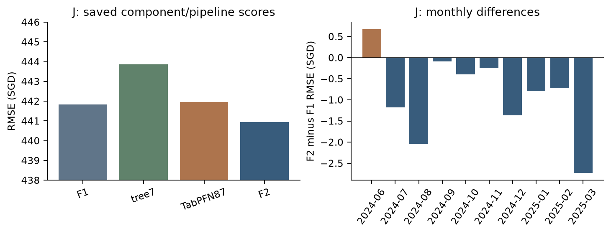

# X11 F2实际组件互补与消融

当前状态：**partial**。来源与运行范围见[执行状态](../../../docs/planning/appendix-execution-status.md)。

| 推理环节 | 内容 |
|---|---|
| 问题/假设 | 固定等权融合为何比两个实际成员的RMSE更低？ |
| 对照与口径 | 相同28995行上比较tree7、TabPFN87、等权F2；F1只作独立管线对照，不是F2成员。 |
| 观察 | F2 RMSE440.95196低于tree7的443.86305及TabPFN的441.95927；TabPFN单独MAE更低。误差相关0.98255。 |
| 取舍依据 | 核验MSE交叉矩恒等式，按月/支持组解释；不以低相关或新权重搜索证明机制；Y未算。 |
| 服务 main | M05/M08；方法质量60%、解释清晰度30%、来源/复现10% |

## 证据入口

- [member_ablation.csv](evaluation/member_ablation.csv)
- [error_moments.json](evaluation/error_moments.json)
- [group_metrics.csv](evaluation/group_metrics.csv)

## 本轮解释图表

图表由 `python -m analysis.appendix_review run --output-dir output/appendix-review/new-run` 从冻结预测重新生成；不训练、不重新选权。
