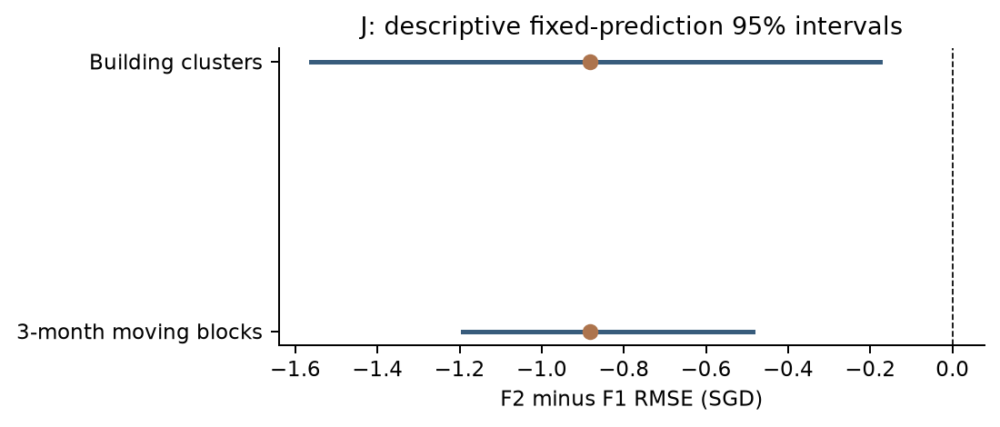

# X12 配对差值描述性区间

当前状态：**partial**。来源与运行范围见[执行状态](../../../docs/planning/appendix-execution-status.md)。

| 推理环节 | 内容 |
|---|---|
| 问题/假设 | 近期F2−F1差值对月份或楼栋构成有多敏感？ |
| 对照与口径 | 冻结J预测；seed42；3个月非循环区块与楼栋簇各3000次，保留簇内记录和抽取重数。 |
| 观察 | RMSE差-0.88258；月份区间[-1.19267,-0.48572]，楼栋区间[-1.56254,-0.17751]。 |
| 取舍依据 | 以固定预测为条件的描述，不能覆盖训练/开发选模不确定性。Y缺F2不计算，区间跨0也可验收。 |
| 服务 main | M08；方法质量60%、解释清晰度30%、来源/复现10% |

## 证据入口

- [paired_intervals.csv](evaluation/paired_intervals.csv)
- [resampling_spec.json](evaluation/resampling_spec.json)

## 本轮解释图表

图表由 `python -m analysis.appendix_review run --output-dir output/appendix-review/new-run` 从冻结预测重新生成；不训练、不重新选权。
