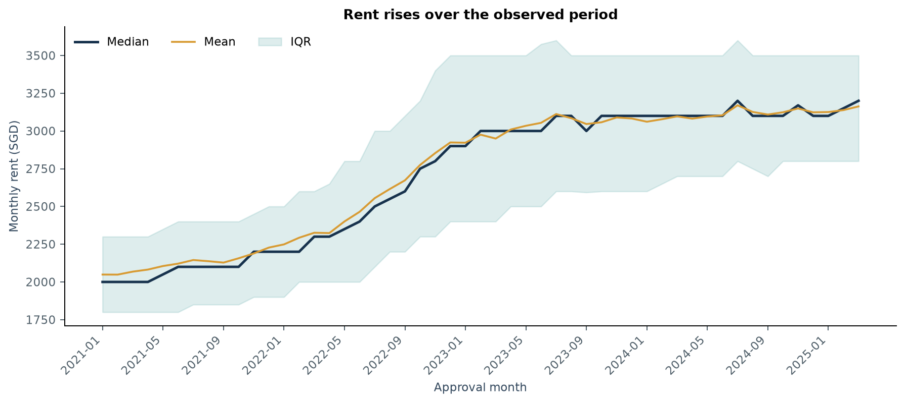
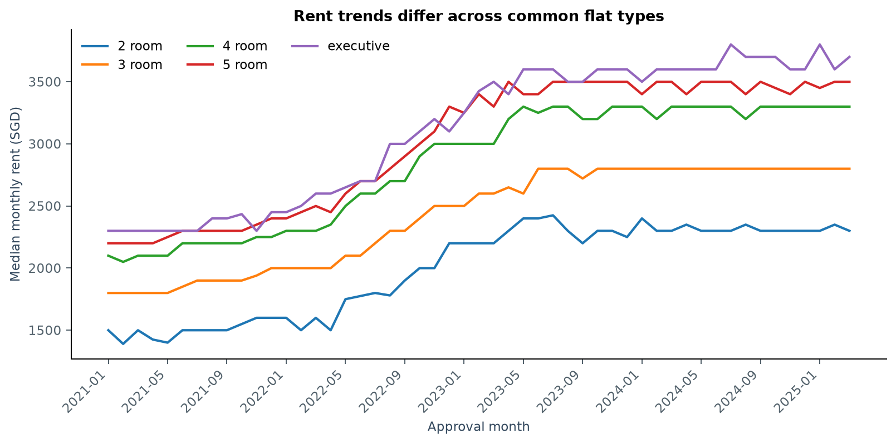
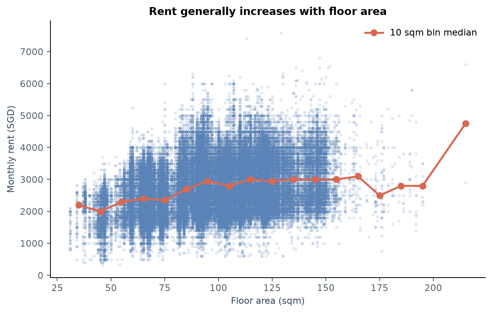
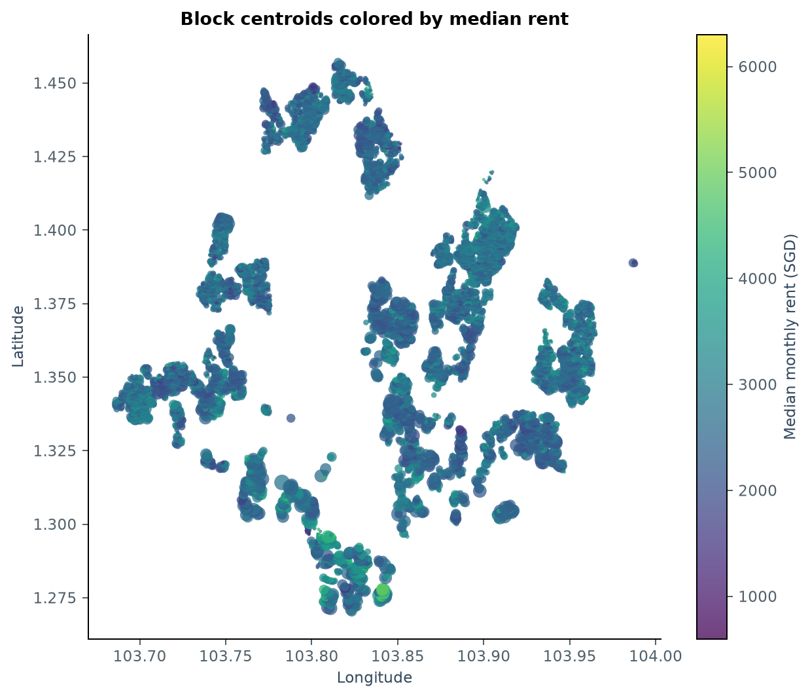

[Chinese version](notes.zh-CN.md)

# CS5228 HDB rental prediction: EDA and progress

This report summarizes exploratory analysis of the repository's training data, competition test data and auxiliary CSVs for the progress report and subsequent modeling. The script is [`analysis/eda/overview.py`](../../analysis/eda/overview.py); statistics are in [`summary.json`](summary.json), with figures and tables in `figures/` and `tables/`. All findings describe local data analysis.

## Research question and current approach

The goal is to predict monthly HDB rent from property attributes, location and rental approval time. Initial analysis asks how rents change over the observed period, which property and spatial fields support useful features, and how random validation differs from future-period validation.

The integrated EDA proceeds through data quality, target and time trends, categorical and numeric variables, auxiliary geographic joins, train/test drift and simple median baselines. Ridge, Random Forest, CatBoost and LightGBM comparisons, A/B/C feature ablations and monthly error analysis are also complete; see the [midterm report](../../docs/archive/midterm_report.md). Those models use a different validation window from the median baselines here. The latest-12-month median is a historical-statistics reference, without a fitted supervised regressor. All implementations are consolidated under `analysis/`.

## Data scope

| Data | Rows | Date range | Notes |
|---|---:|---|---|
| Training set | 150,000 | 2021-01 to 2025-03 | 11 columns, including `MONTHLY_RENT` |
| Test set | 50,000 | 2025-03 to 2026-07 | 10 input fields, without a target |

Training and test data share 10 input fields: approval month, town, block, street, flat type, flat model, floor area, lease commencement year and two constants. Most test records fall in future months absent from training. Random splitting therefore cannot be the sole validation design or represent error over the actual future period.

## Target and time trends

The 150,000 valid training rents have mean SGD 2,719, median SGD 2,700 and standard deviation about SGD 750. They range from SGD 300 to SGD 7,600, with mild right skew (0.386). Skewness alone does not justify a log target; raw and transformed targets should be compared on identical validation splits.

| Year | Rows | Median monthly rent (SGD) |
|---:|---:|---:|
| 2021 | 37,619 | 2,100 |
| 2022 | 32,564 | 2,450 |
| 2023 | 35,654 | 3,000 |
| 2024 | 35,239 | 3,100 |
| 2025 | 8,924 | 3,150 |

The 2025 data cover January–March only and are not directly comparable to full years. Monthly and flat-type trends show that rents are not static. Approval time should be a core feature and validation should simulate future prediction. These observed associations and market changes do not establish that any single field caused rents to rise.





## Property and categorical features

`FLOOR_AREA_SQM` ranges from 31 to 215 square meters, with median 92 and approximate Spearman correlation 0.318 with rent. Large flats are sparse, so binned medians depend on sample composition and size. Analyze area jointly with flat type, town and time; simple correlation does not establish an independent causal effect of area.

Raw text categories contain spelling variants. Normalization reduces `FLAT_TYPE` from 11 raw values to 6 categories and `STREET` from 1,146 to 576. Standardizing whitespace, case and hyphens reduces duplicate categories. `TOWN`, `BLOCK` and `FLAT_MODEL` still need suitable encoding; the few unseen test blocks require fallback handling.



Full category normalization statistics are in [`categorical_normalization.csv`](tables/categorical_normalization.csv); town and flat-type rent summaries are in [`rent_by_town.csv`](tables/rent_by_town.csv) and [`rent_by_flat_type.csv`](tables/rent_by_flat_type.csv).

## Data quality and duplicates

The main training and test tables have no missing values. `FURNISHED` is always `yes` and `FEE` always 0 in both, providing no discrimination. There are 425 exact duplicate training rows and 5,508 exact duplicate test rows. Of 13,434 repeated input combinations, 13,191 have multiple rents. Identical visible property fields can therefore correspond to different prices; deduplicating feature rows would discard target variation.

Prediction must preserve every test row and its original order. This EDA does not deduplicate test inputs and verifies that auxiliary joins retain 50,000 rows. Submission generation must keep this constraint.

## Spatial features

The auxiliary HDB block table has 9,464 unique `TOWN + BLOCK + STREET` keys. After case and whitespace normalization, all 150,000 training and 50,000 test records match, with no duplicate auxiliary join keys or coordinate conflicts. This supports features for coordinates, planning area, subzone, completion year and distances to nearby facilities.

Training-record median distances are 0.533 km to an open MRT station, 0.732 km to a mall and 0.378 km to a primary school. Haversine distances use auxiliary point coordinates. The CBD proxy is Raffles Place MRT (1.2840, 103.8510), an approximate reference point rather than an official CBD boundary.

Unadjusted distance associations are weak: Spearman correlations are -0.086 for open MRT, -0.088 for malls and about -0.011 for primary schools. Median rent is SGD 2,800 at MRT distances of 0–0.3 km and SGD 2,600 at 0.6–1 km. These differences mix town, area, flat type and month, so they do not identify an MRT rental premium. Test spatial features' incremental value in models and examine stratified errors.



## Train/test drift and auxiliary-data caveats

Training spans 2021-01 to 2025-03; testing extends to 2026-07. Sixteen test months are entirely absent from training, covering 49,620 records. Two-sample KS distances are 0.0158 for area, 0.0291 for lease commencement year and 0 for constant `FEE`; Jensen–Shannon distances for town, flat type and street are also small. The largest structural difference is the date range rather than these property marginals. Drift distances are descriptive measures, not significance tests.

Auxiliary data include 243 MRT records (192 open and 11 non-open/planned coordinate-deduplicated locations), 113 malls, 337 school records, 539 COE records and 91,642 daily stock-price records. This EDA audits fields and coverage only; macroeconomic series are not joined to samples. Future work must aggregate by approval date and use information already public at that time, avoiding leakage from same-month data released after the target record.

## Baselines and validation design

References are the training-period global median rent and training medians grouped by `TOWN × FLAT_TYPE`, with the training global median as fallback for unseen groups. MAE / RMSE below are local analysis metrics, not a verified official Kaggle scoring formula.

| Validation split | Available training window | Validation samples | Baseline | MAE (SGD) | RMSE (SGD) |
|---|---|---:|---|---:|---:|
| Random 80/20 | Mixed dates | 30,000 | Town × flat median | 567 | 668 |
| Future period 2024-01 to 2025-03 | All history through 2023-12 | 44,163 | Town × flat full-history median | 787 | 888 |
| Same future period | Latest 12 months through 2023-12 only | 44,163 | Town × flat latest-12-month median | 384 | 518 |
| Recent period 2025-01 to 2025-03 | Latest 12 months through 2024-12 only | 8,924 | Town × flat latest-12-month median | 345 | 491 |

On the identical 2024-01 to 2025-03 validation set, restricting group medians to the latest 12 months reduces RMSE from 888 to 518, about 41.6%. This suggests recency matters for simple historical baselines; it is neither causal evidence nor a comparison with supervised regressors. Random-split RMSE of 668 uses different samples and mixed years, so it is a reference rather than an equivalent temporal comparison.

| Validation design | Global-median RMSE | Town × flat historical-median RMSE | Town × flat latest-12-month RMSE |
|---|---:|---:|---:|
| 2024-01 to 2025-03 | 977 | 888 | 518 |
| 2025-01 to 2025-03 | 845 | 713 | 491 |
| Random 20% | 749 | 668 | Not applicable |

Labels end at 2025-03, so local data cannot measure actual error from 2025-04 onward. Recent temporal validation better approximates future prediction than random splits, but its horizon remains shorter than the competition test horizon. Fit preprocessing, category statistics and medians within each split's fitting subset only.

## Current decisions and next steps

Current decisions: normalize category spellings; remove or ignore constants; retain repeated input records; use temporal validation as the primary design; retain the latest-12-month median as a key naive baseline; ablate geographic features separately; defer macroeconomic series until their availability at prediction time is confirmed.

Planned next steps:

1. Establish reproducible preprocessing and MAE/RMSE evaluation on fixed temporal splits.
2. Compare linear regression and tree ensembles against the latest-12-month median.
3. Add property, temporal and spatial features in stages, recording ablations and errors by month / town / flat type.
4. Test COE or stock features only when release dates can be traced.
5. Select a method, check submission row count and order, and document the final methods, results and limitations.

## Reproduction

Run from the repository root:

```bash
python -m analysis.eda.run --scope overview
python -m analysis.main report
```

EDA scripts read raw CSVs from `data/` and write summaries, tables and figures only under `experiment/eda/`. The report builder reads those artifacts to generate `experiment/eda/progress_report.pdf`. Regenerate tables and reports together to keep numerical versions consistent.
