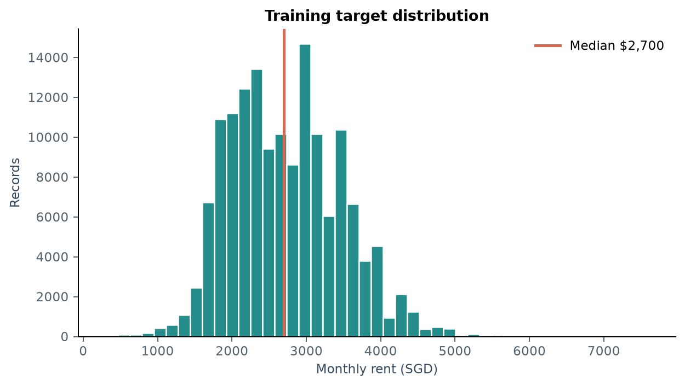
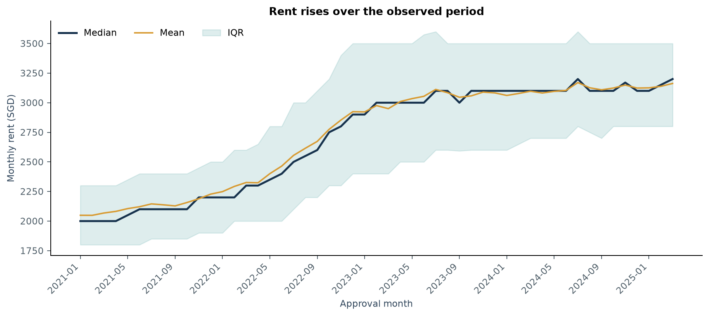
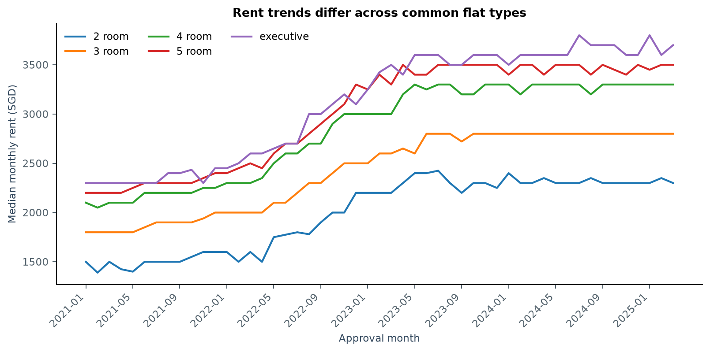
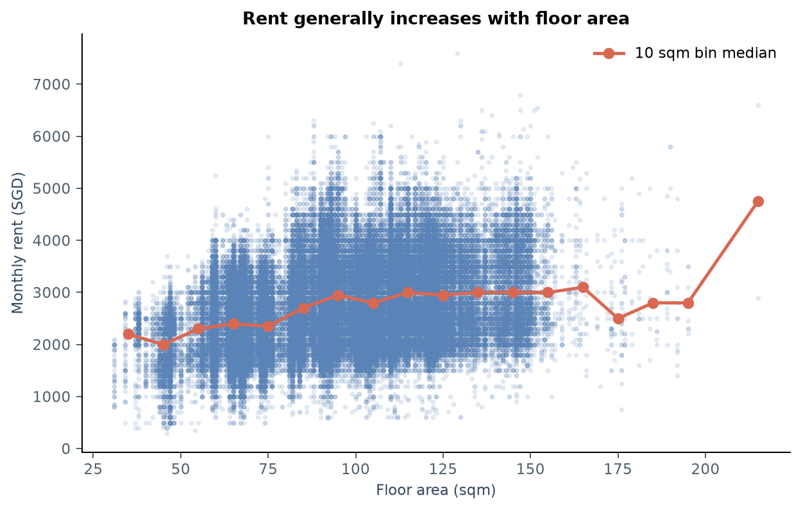
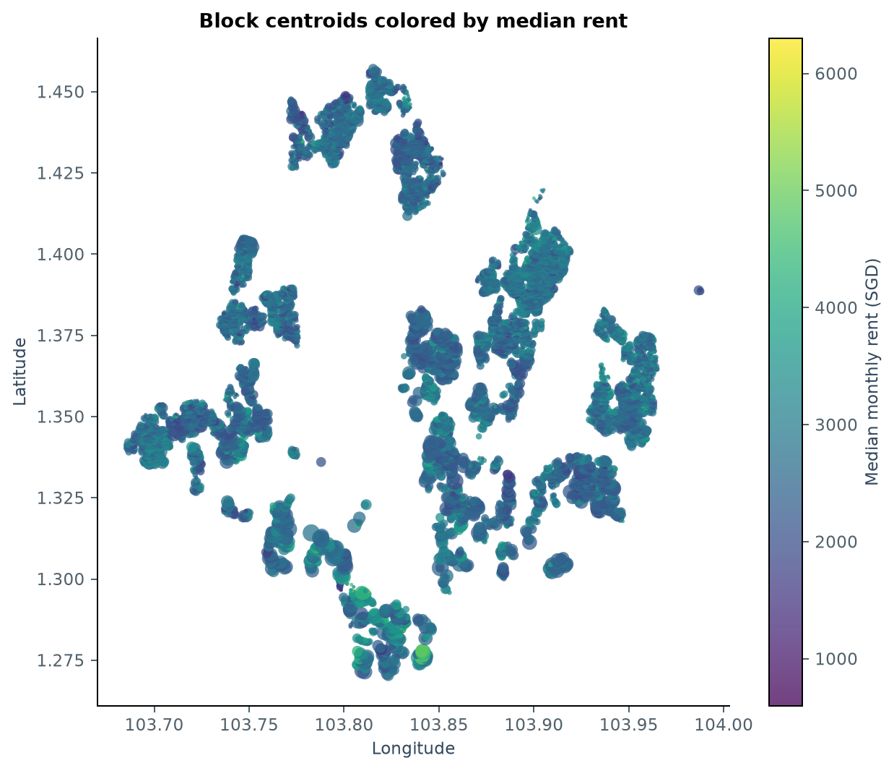
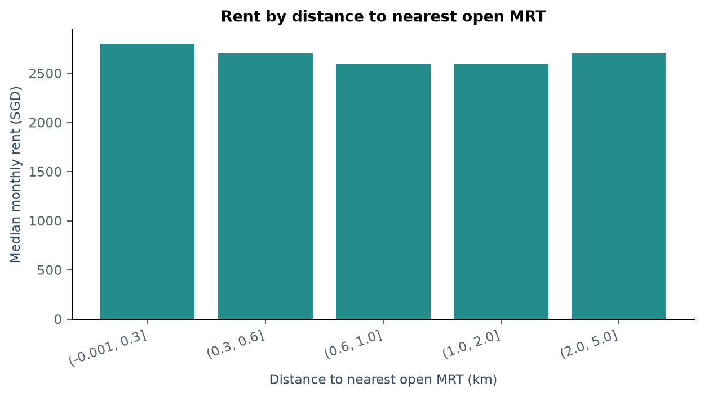

[Chinese version](report.zh-CN.md)

# HDB monthly rent prediction: EDA and interim results

This report uses the repository's actual CSVs and reproducible scripts in `analysis/eda/`. Current outputs include 11 main figures, 18 statistical tables and simple baseline experiments. See the [midterm report](../../../../docs/archive/midterm_report.md) for the four supervised models. All results are local analyses and validation, not reported Kaggle scores.

## 1. Research question and data boundaries

Research question: how well can property attributes, location and time predict future HDB monthly rent? Can economic data add predictive value?

| Data | Rows | Field count | Approval month |
|---|---:|---:|---|
| Training set | 150,000 | 11, including MONTHLY_RENT | 2021-01 to 2025-03 |
| Test set | 50,000 | 10, without target | 2025-03 to 2026-07 |

The actual test set extends through **July 2026**, rather than June as suggested in the task text. No 2026 training labels exist, so that year cannot form a labeled local validation set. Of the test rows, 49,620 belong to 16 unseen months and only 380 share the training month 2025-03.

Sources: [summary.json](summary.json), [train_test_drift.csv](tables/train_test_drift.csv).

## 2. Data quality directly affects preprocessing

| Observation | Processing decision |
|---|---|
| No missing values in the main training or test data | No main-table imputation currently needed; continue checking missingness after joins |
| FURNISHED is always yes; FEE is always 0 | Remove constant fields from formal models |
| FLAT_TYPE reduces from 11 raw categories to 6 | Standardize case, whitespace and hyphens, such as 4-room and 4 room |
| STREET reduces from 1,146 raw categories to 576 | Normalize strings before encoding and auxiliary joins |
| 425 exact duplicate training rows; 5,508 exact duplicate test rows | Keep original records, particularly all 50,000 test rows in original order |
| Of 13,434 repeated feature combinations, 13,191 have multiple rents | Identical visible features need not identify the same transaction; do not simply delete them |
| Approval year minus lease commencement year yields one negative value | Flag and investigate; do not silently clip or delete |

Repeated feature combinations cover 28,981 records, a different definition from duplicate-row counts. Different rents for identical property features may reflect unobserved variation, but these data cannot establish the reasons.

An early training scaffold deduplicated the test set; `analysis/pipeline/data.py` now preserves every row and its order. This EDA did not modify raw data. Source CSV SHA256 values match before and after execution, and auxiliary joins verify row count and order.

Sources: [data quality](tables/data_quality.csv), [category normalization](tables/categorical_normalization.csv), [repeated combinations](tables/repeated_feature_rows.csv).

## 3. Rent distribution: mild right skew does not justify automatic outlier removal

Training rent has mean S$2,719, median S$2,700 and standard deviation about S$750. The middle 50% spans S$2,100–3,200, the 99th percentile is S$4,600 and the range is S$300–7,600. Skewness of 0.386 indicates mild right skew.

Retain the raw target as a baseline and compare alternatives such as a log target through temporal validation. Extreme rents are not necessarily errors; inspect them alongside area, flat type, time and location.

## 4. Time variation is currently the strongest modeling clue

| Year | Samples | Median rent (SGD/month) |
|---|---:|---:|
| 2021 | 37,619 | 2,100 |
| 2022 | 32,564 | 2,450 |
| 2023 | 35,654 | 3,000 |
| 2024 | 35,239 | 3,100 |
| January–March 2025 | 8,924 | 3,150 |

The 2025 figures cover only Q1 and cannot be treated as annual statistics. Rents rose markedly in 2022–2023 before growth slowed; trends also appear within normalized flat types. These descriptive findings do not identify macroeconomic causes or seasonality.

Modeling decisions: derive year, month and elapsed-month features; compare recent windows with full history; use temporal validation and report errors by forecast month. One-hot encoding future months alone cannot represent temporal extrapolation well.

Sources: [annual statistics](tables/annual_rent_trend.csv), [monthly statistics](tables/monthly_rent_trend.csv).

## 5. Property attributes and spatial information

Area spans 31–215 square meters with median 92 and Spearman rent correlation about 0.318. Large-area bins are sparse, so their medians do not establish strict monotonicity. A lease-year-derived variable should be called years since lease commencement, not building age; actual completion year comes from the auxiliary table.

The auxiliary HDB block table has 9,464 unique join keys and matches all training and test records through normalized TOWN, BLOCK and STREET. Coordinates, region, maximum floor and completion year can therefore be tested as features. MAX_FLOOR describes the building's highest floor, not the rental unit's floor.

Spherical straight-line distances to auxiliary MRT points marked open give:

| Distance to nearest MRT | Training records | Median rent (SGD/month) |
|---|---:|---:|
| 0–300m | 24,318 | 2,800 |
| 300–600m | 63,323 | 2,700 |
| 600–1,000m | 48,123 | 2,600 |
| 1–2km | 13,309 | 2,600 |
| 2–5km | 927 | 2,700 |

Raw Spearman rent correlations are about −0.086 for nearest MRT distance, −0.088 for malls and −0.011 for primary schools. These mix time, region, area and flat-type differences. **They neither identify a causal MRT premium nor show that spatial features are useless simply because correlations are weak.**

Distances are spherical geographic distances, not walking times. MRT open/planned status lacks opening dates and cannot establish operation at each historical transaction. Future models must check historical availability or explicitly treat these as static location descriptors. CBD distance uses the declared approximate Raffles Place reference, not an official CBD boundary.

Sources: [spatial feature statistics](tables/location_feature_summary.csv), [MRT distance groups](tables/rent_by_open_mrt_distance.csv).

## 6. Train/test drift and auxiliary economic data

After normalization, test data contain no unseen towns, streets or flat types. There are 11 unseen BLOCK labels, but block numbers alone are not unique island-wide addresses. KS distances of about 0.0158 for area and 0.0291 for lease commencement year indicate small marginal differences, not absence of joint distribution shift. The time range changes substantially.

The COE table has 539 rows; stocks have 91,642 rows, 77 symbols and 510 missing cells. Only structure and coverage are audited; these data are not in the baselines. Specify prediction time, release timing and lag windows before using them: even same-month economic data may be released after approval. Inclusion of future values in an auxiliary file does not make them available at prediction time.

Sources: [drift statistics](tables/train_test_drift.csv), [auxiliary data audit](tables/auxiliary_data_audit.csv).

## 7. Completed baseline experiments: substantial gains from recency

Each baseline calculates medians only within its own training subset, grouped by normalized TOWN × FLAT_TYPE, falling back to that window's global median for unseen combinations.

| Validation period | Training window for group medians | Validation rows | MAE | RMSE |
|---|---|---:|---:|---:|
| 2024-01 to 2025-03 | Full history: 2021–2023 | 44,163 | 787.0 | 887.8 |
| Same as above | Latest 12 months: 2023 | 44,163 | **384.2** | **518.3** |
| 2025-01 to 2025-03 | Full history: 2021–2024 | 8,924 | 612.8 | 712.9 |
| Same as above | Latest 12 months: 2024 | 8,924 | **345.3** | **490.9** |
| Random 20%, seed=5228 | Remaining random 80% | 30,000 | 566.6 | 668.4 |

On the same 15-month validation period, a recent window reduces RMSE from 887.8 to 518.3, about **41.6%**. Group medians remain fixed throughout validation and use no validation rents. This supports investigating time drift, recency weighting and training windows before increasing model complexity.

Random and temporal splits contain different populations and dates, so their entire score gap cannot be attributed to leakage or used directly to rank models. The two temporal periods overlap and are not independent tests. These exploratory results guide design; subsequent model selection needs fixed rolling validation and attention to selection bias from repeated trials.

These are local MAE/RMSE values, not Kaggle leaderboard scores. Medians naturally optimize MAE; include mean baselines when optimizing RMSE. Supervised models have not been compared on these integrated-EDA splits. Ridge, Random Forest, CatBoost and LightGBM were compared on another fixed temporal window; see the midterm report.

Source: [full baseline results](tables/baseline_validation.csv).

## 8. Progress-report conclusions and next steps

Data understanding, EDA, preprocessing rationale, initial experiments and challenges now support a progress report. The key finding is: **time variation and training-window selection yield measurable improvements; spatial features have full coverage, but their incremental value still needs formal experiments.**

Next stages:

1. The formal pipeline is unified and test deduplication fixed; continue using shared fields, temporal splits and experiment logs.
2. Ridge, Random Forest, CatBoost and LightGBM have been compared on one temporal split; add multiple temporal origins next.
3. Ablate auxiliary features: building attributes, MRT, malls/schools and then macroeconomic data. Use economic features only after confirming prediction-time availability.
4. Compare full history, recent windows and time weighting across forecast horizons, avoiding long-horizon decisions based only on short validation.
5. Inspect errors by month, region, flat type and rare category; then run limited boosting-model tuning and interpretation.
6. Generate and check the 50,000-row submission against the `Id,Predicted` template, and finish the final report and reproduction instructions.

## 9. Reproduction and file locations

Run `python -m analysis.main eda` from the repository root to rebuild all EDA under `output/eda/`; add `--scope overview` for main-report figures only. This directory retains frozen evidence and is not overwritten by default. Dependencies are in `environment.yml`. The old interim PDF is no longer tracked on main; `python -m analysis.eda.pdf_report` generates `output/reports/progress_report.pdf` from this directory's figures and tables.

Source checksums, target statistics, join coverage and baseline results are in [summary.json](summary.json). All figures use local data, without unverified external prices or rankings.
