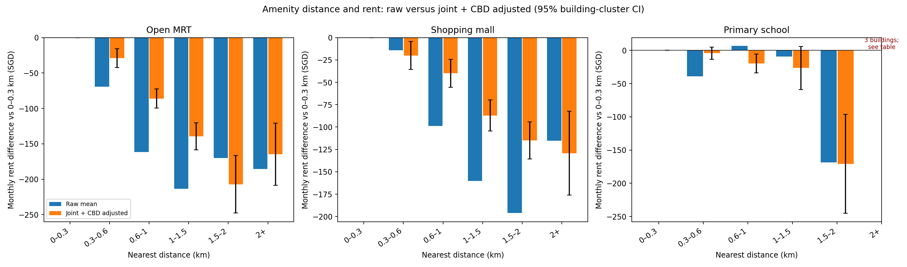

[Chinese version](amenities_adjusted_summary_zh.md)

# Mall, MRT and primary-school distances and HDB rent: controlled analysis

The shared complete sample has 149,841 transactions and 9,395 buildings out of 150,000 training records, excluding 159. All facilities and models use identical records, so coefficient changes are not sample changes. Source SHA-256, per-column missingness, fixed effects and design rank are in the [analysis manifest](analysis_manifest.json). Values below are SGD/month relative to the same facility's 0–0.3 km group. Raw mean difference means means, not medians.

Controls: calendar month × normalized flat-type fixed effects, town fixed effects, standardized area and its square, standardized age and its square, and maximum building floor. Separate adjustment includes one facility distance at a time; joint adjustment includes all three; joint+CBD adds straight-line CBD-reference distance. All slope columns have full rank after fixed-effect projection. The 95% intervals cluster by town+street+block, with finite-sample correction and a building-count-minus-one t critical value (third-order large-df approximation). These are pointwise intervals, not a joint test of multiple groups.

**Overview.** Controlling jointly for facilities and CBD distance, the MRT 0.6–1 km group averages about S$86/month below 0–0.3 km (95% interval −100 to −72), and the 1–1.5 km group about S$139 below. Mall differences are about −S$40 (−56 to −24) and −S$87 respectively. Primary-school 0.3–0.6 km is about −S$4 (−13 to +5), indistinguishable from reference; 0.6–1 km is about −S$20 (−34 to −6), smaller than corresponding MRT and mall differences. MRT and mall gradients are clearer; primary-school patterns are irregular, so the results do not imply that proximity to every facility raises rent.

Separate and joint adjustments also differ: at 1–1.5 km, MRT changes from −168 to −137, malls from −126 to −89 and primary schools from −37 to −21 SGD/month; adding CBD gives −139, −87 and −26. Distances share location information, so separate models cannot attribute the entire difference to one facility. These conditional-mean regressions do not require adequate overlap for every distance combination across towns, months and flat types; sparse combinations remain exposed to extrapolation.

## Open MRT

| Distance km | Rows/buildings | Raw mean difference | Separate adjustment | Joint adjustment | Joint+CBD [95% interval] |
|---|---:|---:|---:|---:|---:|
| 0–0.3 | 24,308/1,346 | +0 | +0 | +0 | +0 [+0, +0] |
| 0.3–0.6 | 63,175/3,700 | -69 | -34 | -32 | -29 [-42, -16] |
| 0.6–1 | 48,122/3,272 | -161 | -99 | -88 | -86 [-100, -72] |
| 1–1.5 | 11,655/876 | -213 | -168 | -137 | -139 [-159, -120] |
| 1.5–2 | 1,654/134 | -170 | -209 | -191 | -207 [-248, -167] |
| 2+ | 927/67 | -186 | -132 | -152 | -165 [-208, -121] |

## Malls

| Distance km | Rows/buildings | Raw mean difference | Separate adjustment | Joint adjustment | Joint+CBD [95% interval] |
|---|---:|---:|---:|---:|---:|
| 0–0.3 | 15,257/992 | +0 | +0 | +0 | +0 [+0, +0] |
| 0.3–0.6 | 42,252/2,535 | -14 | -31 | -18 | -20 [-36, -4] |
| 0.6–1 | 48,073/2,954 | -99 | -74 | -39 | -40 [-56, -24] |
| 1–1.5 | 31,131/1,911 | -160 | -126 | -89 | -87 [-105, -70] |
| 1.5–2 | 11,391/865 | -196 | -139 | -112 | -115 [-136, -94] |
| 2+ | 1,737/138 | -115 | -126 | -117 | -129 [-176, -82] |

## Primary schools

| Distance km | Rows/buildings | Raw mean difference | Separate adjustment | Joint adjustment | Joint+CBD [95% interval] |
|---|---:|---:|---:|---:|---:|
| 0–0.3 | 55,021/3,591 | +0 | +0 | +0 | +0 [+0, +0] |
| 0.3–0.6 | 66,727/4,148 | -39 | -9 | -3 | -4 [-13, +5] |
| 0.6–1 | 22,498/1,397 | +7 | -27 | -17 | -20 [-34, -6] |
| 1–1.5 | 4,748/213 | -9 | -37 | -21 | -26 [-59, +6] |
| 1.5–2 | 790/43 | -169 | -167 | -137 | -171 [-245, -96] |
| 2+* | 57/3 | -593 | +80 | +254 | +425 [+300, +549] |

Bars for primary schools beyond 2 km are omitted because they contain only three buildings; full values remain in the table.

An asterisk marks fewer than 30 buildings. The primary-school >2 km group has only 57 records and three buildings: its +425 coefficient and formal interval depend heavily on those buildings. A narrow interval is not reliable general evidence. The 1.5–2 km school group also has only 43 buildings. Changes after adjustment reflect dependence among facility distances, CBD centrality and housing conditions. Intervals containing 0 do not distinguish a group from the 0–0.3 km reference under this model and standard error; exclusion of 0 indicates only that specific model-based contrast.

Schools here mean nearest primary schools, including mixed schools marked p1, not all educational facilities or school quality. Distances are spherical building-to-facility distances, not walking routes. Current snapshots do not reconstruct opening histories by rental month. Even after town and housing controls, micro-location, renovation, transport quality and other unobserved factors may affect both rents and distances. Building clustering adjusts uncertainty from repeated records only. These conditional associations establish neither causal rent effects nor guaranteed predictive gains.

Reproduction: `.venv/bin/python scripts/analyze_amenities_adjusted.py --test`, followed by `.venv/bin/python scripts/analyze_amenities_adjusted.py`. Full row-level results: [CSV](amenity_bin_effects.csv).
