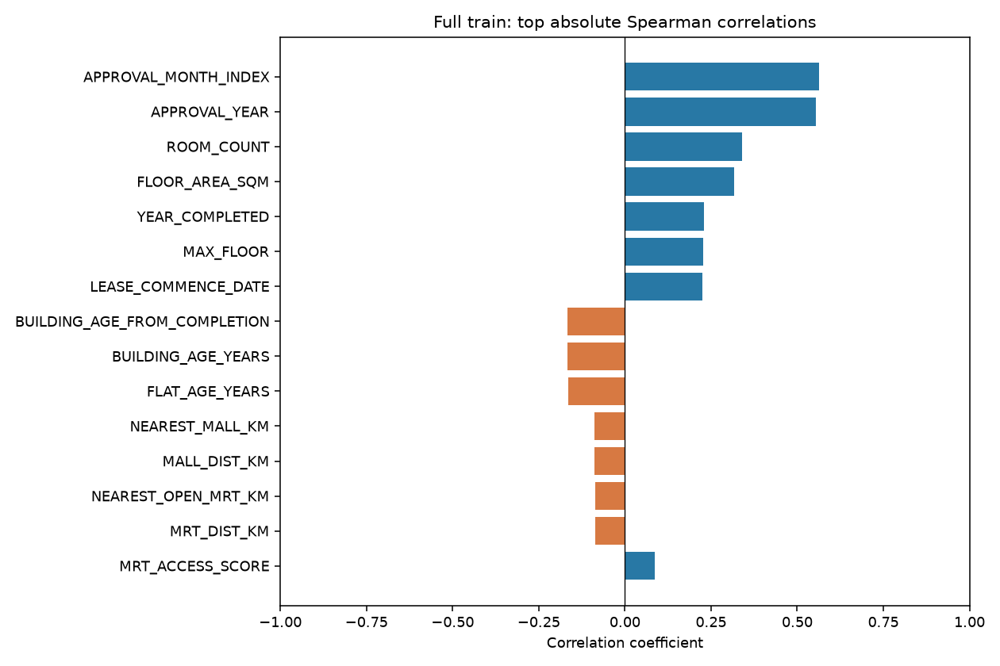
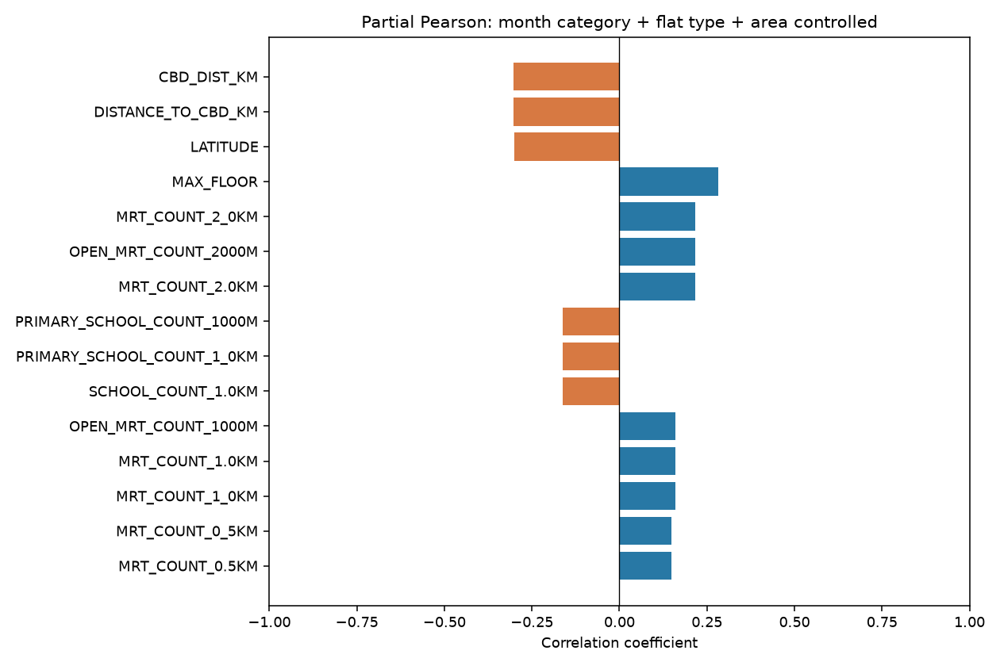
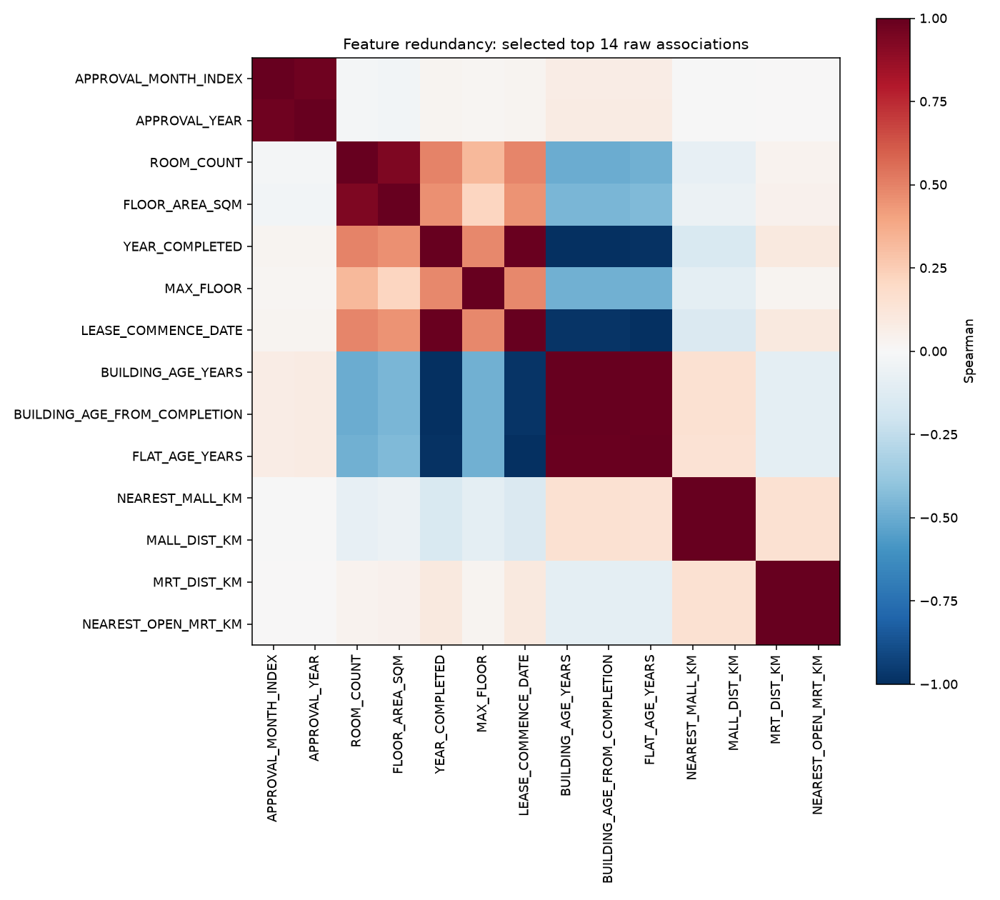
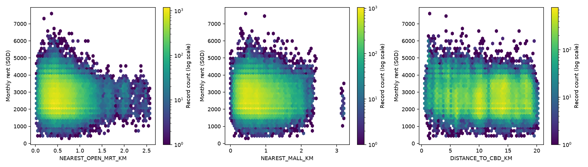
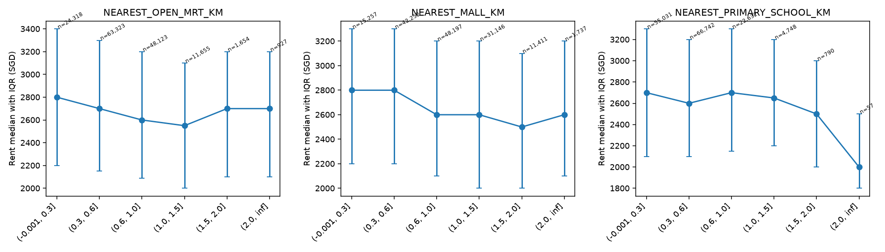
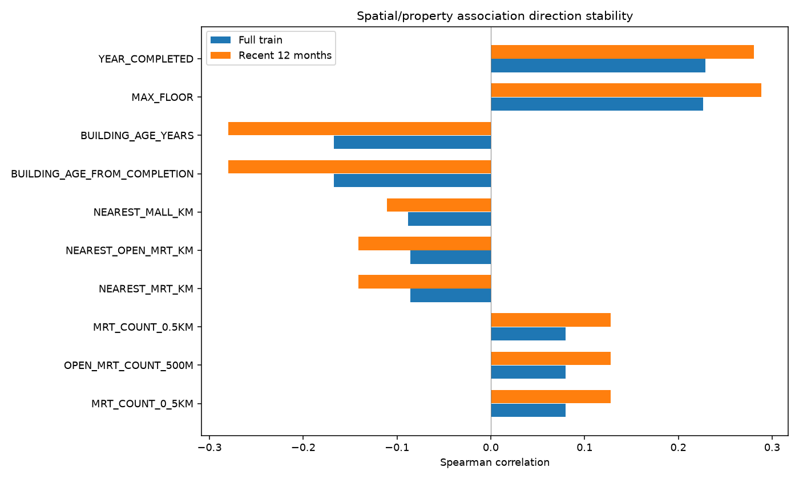

[Chinese version](EDA_summary_zh.md)

# Spatial and property features: associations with monthly rent

The training set has 150,000 rows. Only training rent labels are used for descriptive analysis; no predictive model is trained. The latest 12 months run from the maximum APPROVAL_MONTH_INDEX back 11 months inclusive, covering 35,158 rows.

## Features and statistical methods

The in-memory feature table retains original columns and row order, adding normalized addresses/categories, building coordinates, maximum floor, completion year and region, time, years since lease commencement and building age, spherical distances to MRT, malls, primary schools and CBD, and facility-location counts within 500m/1km/2km. Definitions: [feature_dictionary.csv](feature_dictionary.csv); implementation: `analysis/pipeline/auxiliary.py`. MAX_FLOOR is the building maximum, not unit floor; lease years are not building age.

The [full correlation table](tables/all_numeric_correlations.csv) reports Pearson, Spearman, valid counts, missing/nonfinite counts and unique counts for every numeric column except target, ID and SOURCE_ROW_ID. Constants remain with null correlations. Spearman is Pearson on average ranks, without significance tests. Features are ordered by absolute Spearman: |r|≥0.5 is labeled high, 0.3≤|r|<0.5 moderate and <0.3 weak. These are descriptive labels, not significance or predictive-value thresholds.

Adjusted associations residualize standardized x and rent separately against approval year-month categories, normalized flat-type categories and area using least squares, then correlate residuals with Pearson. Each feature uses records valid for that feature, target and controls; controls are excluded from adjusted rankings. NumPy least squares still provides projection residuals under collinearity. This is a linearly adjusted association, neither causation nor adjusted Spearman. Calendar-month categories serve this training-data description and are not recommended for future-month extrapolation.

## Observed spatial and building-feature rankings

All numeric features ranked by absolute Spearman, including original area and time controls:

| feature | n_valid | pearson | spearman |
| --- | --- | --- | --- |
| APPROVAL_MONTH_INDEX | 150000 | 0.5346 | 0.5639 |
| APPROVAL_YEAR | 150000 | 0.5172 | 0.5538 |
| ROOM_COUNT | 141766 | 0.3489 | 0.3396 |
| FLOOR_AREA_SQM | 150000 | 0.3293 | 0.3177 |
| YEAR_COMPLETED | 149841 | 0.2291 | 0.2290 |
| MAX_FLOOR | 149841 | 0.2904 | 0.2267 |
| LEASE_COMMENCE_DATE | 150000 | 0.2294 | 0.2255 |
| BUILDING_AGE_YEARS | 149841 | -0.1783 | -0.1676 |

All features meeting the descriptive high-correlation threshold: APPROVAL_MONTH_INDEX, APPROVAL_YEAR. Their strong time trend must not be attributed to spatial features.

Ranked by full-training absolute Spearman:

| feature | n_valid | pearson | spearman | recent_spearman |
| --- | --- | --- | --- | --- |
| YEAR_COMPLETED | 149841 | 0.2291 | 0.2290 | 0.2807 |
| MAX_FLOOR | 149841 | 0.2904 | 0.2267 | 0.2887 |
| BUILDING_AGE_YEARS | 149841 | -0.1783 | -0.1676 | -0.2799 |
| BUILDING_AGE_FROM_COMPLETION | 149841 | -0.1783 | -0.1676 | -0.2799 |
| NEAREST_MALL_KM | 150000 | -0.0830 | -0.0879 | -0.1104 |
| NEAREST_OPEN_MRT_KM | 150000 | -0.0847 | -0.0858 | -0.1412 |
| NEAREST_MRT_KM | 150000 | -0.0847 | -0.0858 | -0.1412 |
| MRT_COUNT_0.5KM | 150000 | 0.0967 | 0.0800 | 0.1279 |
| OPEN_MRT_COUNT_500M | 150000 | 0.0967 | 0.0800 | 0.1279 |
| MRT_COUNT_0_5KM | 150000 | 0.0967 | 0.0800 | 0.1279 |

Ranked by absolute adjusted Pearson:

| feature | adjusted_pearson | n_adjusted |
| --- | --- | --- |
| DISTANCE_TO_CBD_KM | -0.3036 | 150000 |
| LATITUDE | -0.3011 | 150000 |
| MAX_FLOOR | 0.2813 | 149841 |
| OPEN_MRT_COUNT_2000M | 0.2173 | 150000 |
| MRT_COUNT_2.0KM | 0.2173 | 150000 |
| MRT_COUNT_2_0KM | 0.2173 | 150000 |
| PRIMARY_SCHOOL_COUNT_1_0KM | -0.1632 | 150000 |
| SCHOOL_COUNT_1.0KM | -0.1632 | 150000 |
| PRIMARY_SCHOOL_COUNT_1000M | -0.1632 | 150000 |
| MRT_COUNT_1.0KM | 0.1605 | 150000 |

Full, adjusted and recent rankings are in [raw correlations](tables/all_numeric_correlations.csv), [adjusted associations](tables/adjusted_correlations.csv) and [recent window](tables/recent_12month_correlations.csv). Among these spatial/building features, the highest full-sample absolute Spearman is 0.2290; zero meet either the high or moderate threshold. Weak univariate associations do not establish predictive uselessness. Weak linear or rank correlations for coordinates do not show that location is unimportant: relationships may be nonlinear and interact with flat type, area and time.

## Distance bins and recent stability

[Bin statistics](tables/distance_and_count_bins.csv) report n, mean, median, Q25, Q75 and IQR. Distances use kilometer bins; facility counts within 1km use 0, 1, 2, 3, 4–5 and 6+. Groups can differ in flat type, year, area and region, so raw differences do not identify facility proximity premiums. Latest-12-month rankings check direction and strength under another sample window, not an independent validation set.

## Data boundaries and subsequent use

Facility tables are current snapshots; open/planned status is not monthly historical status. Both recent and historical records may have temporal mismatches. Distances are spherical straight-line distances, not walking distances. Counts refer to unique coordinates, not MRT lines/station codes; deduplication rules are in the build manifest. All 11 planned MRT coordinates coincide with open stations, so planned distances describe that colocated subset, not new independent transport access or historical transport availability.

Repeated transactions in the same building, property profile or month are not IID. This report provides no p-values requiring independence. Full-sample statistics retain duplicate-record weights; later work should split temporally and examine repeated-building/location effects. Counts at different radii, distances, years and ages can be highly redundant; their correlations are not independent evidence.

Constructed features use neither rents nor test targets; adjusted analysis uses training labels only. If KNN is later used, fit imputation, scaling and encoding inside training splits before transforming validation/test data. Do not mix coordinates, kilometers, square meters and years without scaling. Temporal predictive validation, not correlation rankings, must establish incremental spatial value.

Reproduction: run `python -m analysis.main spatial-controls` from the repository root. The unified pipeline constructs features in memory and outputs six figures and five statistical CSVs without modifying source data.
