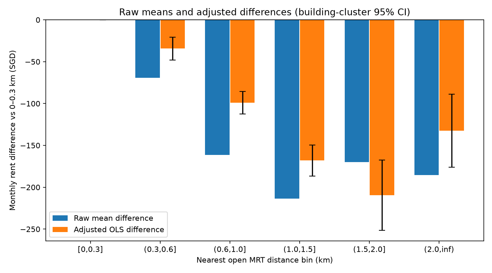

[Chinese version](MRT_adjusted_summary_zh.md)

# MRT distance: rent differences controlling for property and time

Of 150,000 training rows, the shared complete sample has 149,841 rows and 9,395 buildings, excluding 159. Missingness, design rank and iteration counts are in the [analysis manifest](analysis_manifest.json). Raw and adjusted mean differences use identical samples, in SGD/month relative to 0–0.3km; raw statistics are not medians.

OLS controls exact calendar month × normalized flat-type interaction fixed effects, town fixed effects, centered/standardized area and its square, age and its square, and maximum building floor. There are 285 interaction categories and 26 towns; slopes are identified after projection, with full design rank 320. MAX_FLOOR is not the unit floor. Iterative demeaning absorbs fixed effects equivalently to full-dummy OLS; independent small synthetic checks compare coefficients and directly grouped cluster covariances term by term.

The 95% intervals use sandwich covariance clustered by normalized town+street+block, correction G/(G−1)×(N−1)/(N−K), and t degrees of freedom G−1. Because SciPy binaries could not be imported, critical values use a Cornish–Fisher expansion through inverse-df cubed (large-df approximation; current value 1.96021655; error <1e−7 against the known df=100 value). Independence across buildings is assumed; nearby or same-town buildings may covary, leaving spatial dependence. Distance bins are right-closed: reference 0≤d≤0.3km, exactly 2km in 1.5–2.

| distance_bin_km | n_rows | n_buildings | raw_mean_difference | adjusted_difference | ci_low | ci_high | adjusted_with_cbd |
| --- | --- | --- | --- | --- | --- | --- | --- |
| [0,0.3] | 24308 | 1346 | 0.00 | 0.00 | 0.00 | 0.00 | 0.00 |
| (0.3,0.6] | 63175 | 3700 | -69.31 | -34.38 | -47.95 | -20.82 | -32.46 |
| (0.6,1.0] | 48122 | 3272 | -161.46 | -99.03 | -112.41 | -85.64 | -96.92 |
| (1.0,1.5] | 11655 | 876 | -213.38 | -168.08 | -186.46 | -149.71 | -169.75 |
| (1.5,2.0] | 1654 | 134 | -169.86 | -209.41 | -251.41 | -167.42 | -225.35 |
| (2.0, inf) | 927 | 67 | -185.63 | -132.38 | -175.97 | -88.80 | -133.51 |

`adjusted_with_cbd` adds straight-line CBD distance on the same complete sample, testing within-town centrality without eliminating all location confounding. Interval overlap between groups cannot replace direct contrasts. For the distant rebound, the following groups are compared directly against 1–1.5km, reporting building-clustered standard errors and 95% intervals for both primary and CBD-adjusted models:

| contrast | adjusted_difference | cluster_se | ci_low | ci_high | adjusted_with_cbd | cbd_cluster_se | cbd_ci_low | cbd_ci_high |
| --- | --- | --- | --- | --- | --- | --- | --- | --- |
| (1.5,2.0] minus (1.0,1.5] km | -41.33 | 21.35 | -83.18 | 0.52 | -55.59 | 21.18 | -97.12 | -14.07 |
| (2.0, inf) minus (1.0,1.5] km | 35.70 | 22.35 | -8.11 | 79.51 | 36.24 | 25.59 | -13.91 | 86.40 |

Facilities use the current open-MRT snapshot and spherical distances, not historical opening states or walking routes. Results depend on controls, functional form and within-group overlap. Groups with <30 buildings are flagged in the [coefficient table](mrt_bin_effects.csv). Building counts better approximate independent support than transaction counts but do not guarantee overlap across towns/types/months. Adjusted associations establish neither causal MRT effects nor predictive gains. Clustering adjusts repeated-record uncertainty, not omitted confounding.

Reproduction: `python -m analysis.main spatial-controls`. No source changes or predictive-model training.
