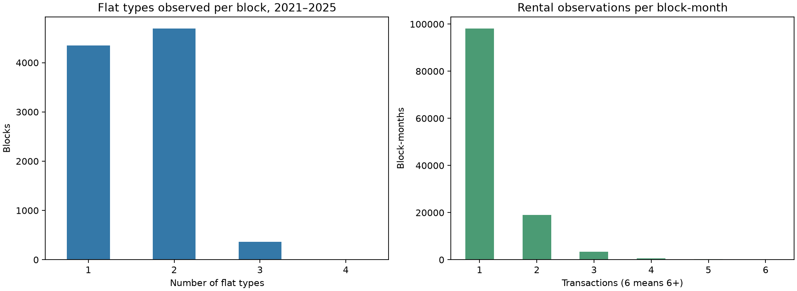
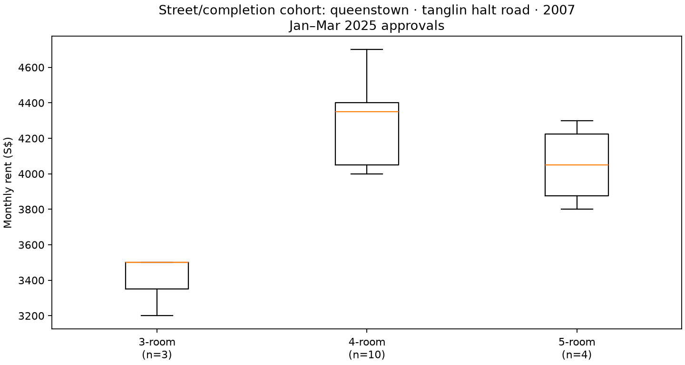

# Rental types and rents within HDB blocks

Source: 150,000 labeled rental records from January 2021 to March 2025, matched to the local HDB block table by town, street, and block number. Month is rental approval month. A record is a transaction, not a distinct vacant unit or listing; no unit number or official project ID is supplied.

## What the observations show

- 9,406 blocks have at least one observed rental. Observed types per block: 1 type: 4,349, 2 type: 4,693, 3 type: 363, 4 type: 1.
- Across 121,322 observed block-months, 80.9% have one transaction. 1 observed type(s): 114,668, 2 observed type(s): 6,604, 3 observed type(s): 50.
- 128,026 block × type × month cells contain a rental; 2,952 have at least three and 145 have at least five. The median within-cell IQR among cells with at least three is S$325; the 90th percentile is S$700. These supported cells are a small, selected subset.

Monthly observed type sets vary mainly because few flats rent in any one block-month. This does not establish changes in the block's built flat mix or its vacant inventory.

## Same-block, same-month flat-type gaps

| Comparison | Block-months with both types | Median difference (S$) | 25th–75th percentile (S$) |
| --- | ---: | ---: | ---: |
| 4-room minus 3-room | 2,660 | 500 | 100–864 |
| 5-room minus 4-room | 3,246 | 200 | -150–579 |

Differences are between the type-specific transaction medians of the same block and approval month. A cell often has only one transaction per type, so these gaps describe a noisy observed sample.

## One building over a recent quarter

Illustrative high-volume block: `clementi|clementi avenue 2|329`; 9 approvals in January–March 2025. The individual flat/unit numbers are unavailable, so repeated approvals cannot be assigned to the same or different units.

| Flat type | Transactions | 25th percentile (S$) | Median (S$) | 75th percentile (S$) |
| --- | ---: | ---: | ---: | ---: |
| 3-room | 8 | 3075 | 3150 | 3200 |
| 4-room | 1 | 3900 | 3900 | 3900 |

## Street and completion-year cohort example

The source has no HDB project name. Town + street + completion year groups nearby blocks for an example, but can merge distinct projects or split one project. These groups are never labeled as official projects.

There are 1,652 such cohorts, including 1,396 with at least two observed blocks. Among those multi-block cohorts, 1,011 have different **observed** flat-type sets across their blocks. Sampling can cause part of that difference. Only 8,863 of 52,848 observed cohort-months have at least five transactions across at least two blocks.

Illustrative compact cohort: `queenstown|tanglin halt road|2007`; 17 January–March 2025 transactions from 3 blocks.

| Flat type | Transactions | 25th percentile (S$) | Median (S$) | 75th percentile (S$) |
| --- | ---: | ---: | ---: | ---: |
| 3-room | 3 | 3350 | 3500 | 3500 |
| 4-room | 10 | 4050 | 4350 | 4400 |
| 5-room | 4 | 3875 | 4050 | 4225 |

This example is chosen for transaction support and illustrates the mixture of flat types. It cannot establish the full price distribution of a true named HDB project or isolate floor, interior condition, lease terms, and tenant selection.

## Modeling implication

At month *t*, describe a block's rent as a flat-type mixture: p(rent | block, t) = Σ_type w(type | block, t) × p(rent | block, type, t). The observed transaction shares estimate the mixture of **approved rentals** in this sample; they are not stock shares or listing probabilities. Fit the type-conditioned distribution with partial pooling across nearby blocks/town and recent months, since most block-month/type cells cannot support a free-standing distribution.

HDB's Property Information dataset publishes per-block counts by flat type but lacks a project ID; a dated stock snapshot would help define feasible types and stock weights. Historical snapshots would be needed to make stock features point-in-time safe for forecasting. Source: https://data.gov.sg/datasets/d_17f5382f26140b1fdae0ba2ef6239d2f/view

Reproduce: `.venv/Scripts/python.exe analysis/describe_building_rent_distribution.py`.
