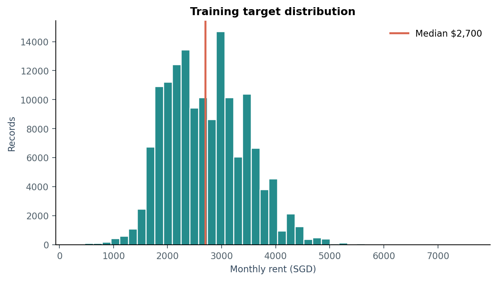
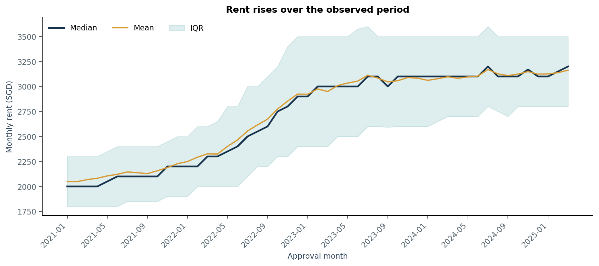
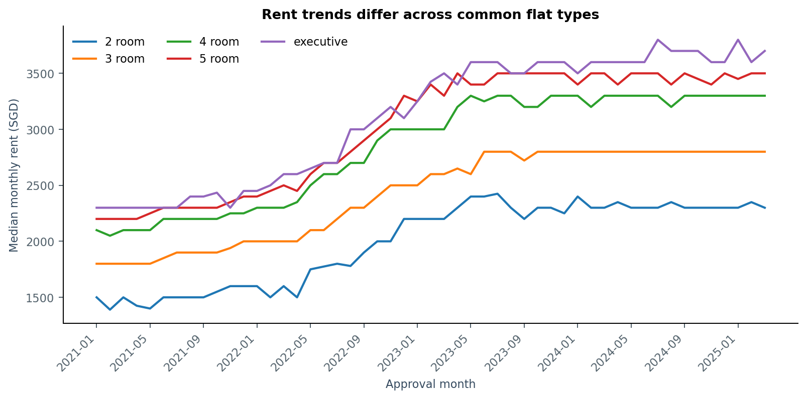
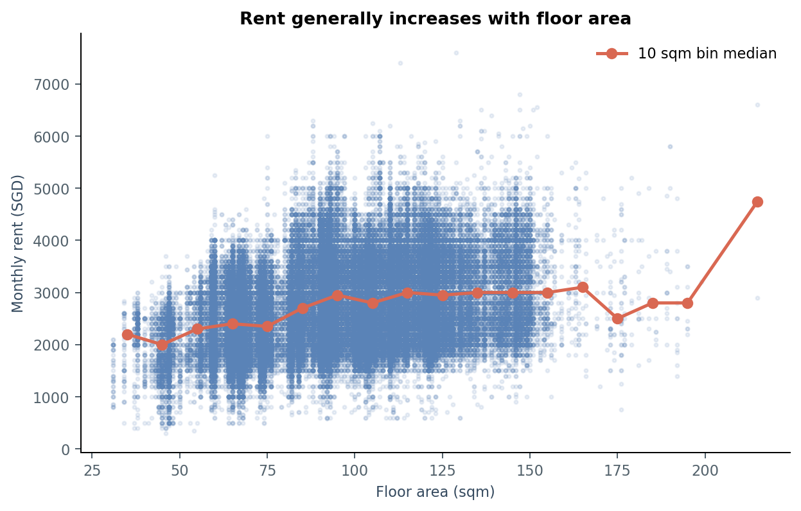
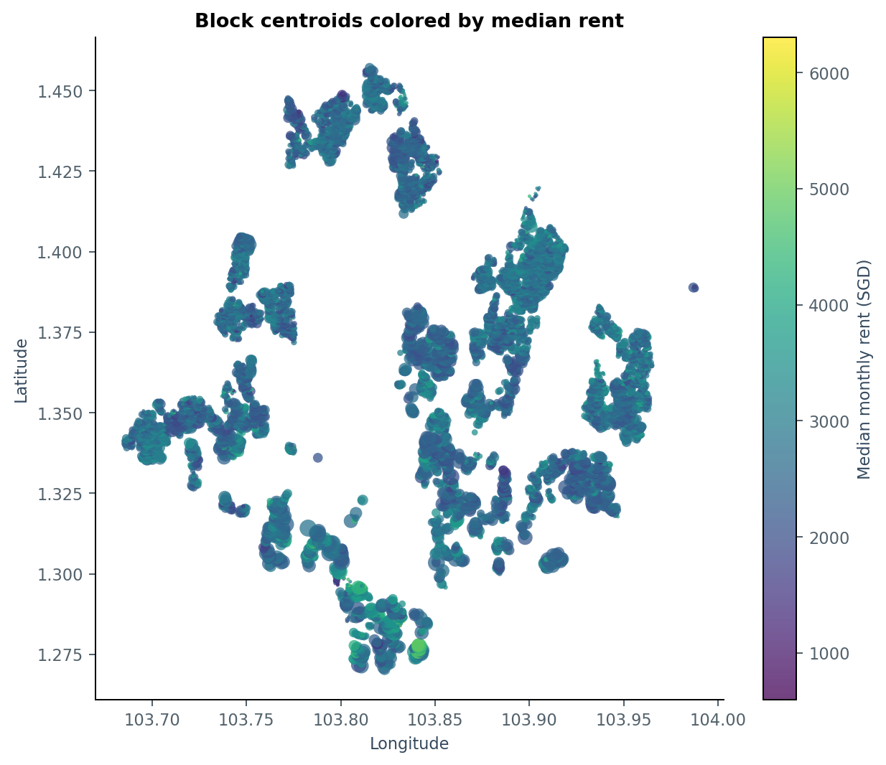
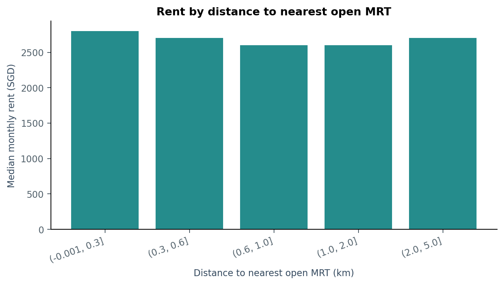

# HDB 月租预测：EDA 与阶段性结果总结

本报告基于仓库内实际 CSV 和已执行的 `scripts/eda_analysis.py`。分析由 GPT-6 Luna 子代理编写，我负责方法与结果审查。当前成果包括 11 张图、18 份统计表和简单基线实验；尚未完成正式模型比较、调参或 Kaggle 提交。

## 1. 研究问题与数据边界

研究问题：房屋属性、地理位置和时间信息能够在多大程度上预测未来 HDB 月租？经济数据是否能提供额外预测价值？

| 数据 | 行数 | 字段数 | 审批月份 |
|---|---:|---:|---|
| 训练集 | 150,000 | 11，包含 MONTHLY_RENT | 2021-01 至 2025-03 |
| 测试集 | 50,000 | 10，不含目标 | 2025-03 至 2026-07 |

实际测试集覆盖到 **2026 年 7 月**，与建议文字中的 6 月不同。2026 年没有训练标签，因此不能用其作本地有标签验证集。测试集中 49,620 行属于训练未见的 16 个月份，只有 380 行属于共同月份 2025-03。

来源：[summary.json](summary.json)、[train_test_drift.csv](tables/train_test_drift.csv)。

## 2. 数据质量直接影响预处理

| 观察 | 处理决策 |
|---|---|
| 主训练集和测试集无缺失值 | 当前无需对主表补值，但后续特征连接仍检查缺失 |
| FURNISHED 恒为 yes，FEE 恒为 0 | 正式模型中移除常量字段 |
| FLAT_TYPE 从 11 个原始类别归并为 6 个 | 统一大小写、空白及连字符，例如 4-room 与 4 room |
| STREET 从 1,146 个原始类别归并为 576 个 | 在编码和连接辅助表前统一字符串 |
| 训练集有 425 行完全重复；测试集有 5,508 行完全重复 | 保留原始记录；尤其测试集必须保持 50,000 行及原顺序 |
| 13,434 个重复特征组合中，13,191 个对应多个租金 | 相同可见特征不代表同一交易，不能直接删除这些记录 |
| 按审批年份减去租约起始年份得到 1 条负值 | 标记并进一步核查，不静默裁剪或删除 |

重复特征组合覆盖 28,981 条记录；这个数与“重复行数”口径不同。房屋特征相同而租金不同，可能体现未观测差异，但当前数据无法判断具体原因。

当前已有 `src/preprocessor.py` 会对测试集去重，后续正式建模必须修正这一行为。本次 EDA 没有改动原训练管线或原始数据。运行前后源 CSV 的 SHA256 一致，连接辅助表时验证了行数与顺序。

来源：[数据质量](tables/data_quality.csv)、[类别归并](tables/categorical_normalization.csv)、[重复组合](tables/repeated_feature_rows.csv)。

## 3. 租金分布：轻度右偏，不宜自动删除极端值

训练租金均值为 S$2,719，中位数 S$2,700，标准差约 S$750；中间 50% 位于 S$2,100–3,200，99% 分位数为 S$4,600，范围为 S$300–7,600。偏度为 0.386，属于轻度右偏。

这支持保留原始目标作为基线，再通过时间验证比较 log 目标等方案。高低租金不能仅因为极端就判定为错误；需结合面积、户型、时间及区域检查。

## 4. 时间变化是目前最强的建模线索

| 年份 | 样本数 | 租金中位数（SGD/月） |
|---|---:|---:|
| 2021 | 37,619 | 2,100 |
| 2022 | 32,564 | 2,450 |
| 2023 | 35,654 | 3,000 |
| 2024 | 35,239 | 3,100 |
| 2025 年 1–3 月 | 8,924 | 3,150 |

2025 年数字仅涵盖第一季度，不能当作全年统计。总体租金在 2022–2023 年明显上升，随后增幅趋缓；按归一化户型分层后，也能观察到时间变化。以上是描述性结果，不代表已经识别了宏观原因或季节性。

建模决策：构造年、月、距起始月份的月数等时间特征，比较近期窗口与全部历史数据，采用时间验证并按预测月份报告误差。单纯把未来月份当作 one-hot 类别难以表示时间外推。

来源：[年度统计](tables/annual_rent_trend.csv)、[月份统计](tables/monthly_rent_trend.csv)。

## 5. 房屋属性与空间信息

面积为 31–215 平方米，中位数为 92 平方米；面积与租金的 Spearman 相关系数约为 0.318。面积较大的区间样本稀疏，分箱中位数不能被解释为严格单调关系。由租约年份构造的变量应称“距租约起始的年数”，不等于楼龄；实际竣工年份来自辅助表。

辅助 HDB block 表有 9,464 个唯一连接键，通过规范化的 TOWN、BLOCK、STREET 可匹配全部训练与测试记录。这使经纬度、区域、最高楼层及竣工年份成为可进一步测试的特征。MAX_FLOOR 是楼栋最高楼层，并不是出租单元所在楼层。

以辅助表标记为 open 的 MRT 点计算球面直线距离，得到：

| 距最近 MRT 的距离 | 训练记录数 | 租金中位数（SGD/月） |
|---|---:|---:|
| 0–300m | 24,318 | 2,800 |
| 300–600m | 63,323 | 2,700 |
| 600–1,000m | 48,123 | 2,600 |
| 1–2km | 13,309 | 2,600 |
| 2–5km | 927 | 2,700 |

最近 MRT 距离与租金的原始 Spearman 相关约 −0.086，商场距离约 −0.088，最近小学距离约 −0.011。它们混合了时间、区域、面积和户型差异，**不能据此识别 MRT 的因果溢价，也不能仅凭弱相关就断定空间特征无用**。

距离是经纬度球面距离，并不是步行时间。MRT 的 open/planned 是辅助表状态，缺少开通日期，不能证明该站在每笔历史交易时已经开放。未来模型需核查历史可用性，或明确将其当作静态区位描述。CBD 距离使用脚本声明的 Raffles Place 近似参考点，不是官方 CBD 边界。

来源：[空间特征统计](tables/location_feature_summary.csv)、[MRT 距离分组](tables/rent_by_open_mrt_distance.csv)。

## 6. Train/test 漂移与辅助经济数据

归一化后，测试集没有未见的 town、street 或 flat type；BLOCK 有 11 个未见标签，但单独的 block 编号并不是全岛唯一地址。面积与租约起始年份的 KS 距离分别约 0.0158、0.0291，说明这两个边际分布差异较小，不能据此认定整体联合分布没有漂移。时间范围仍有明显变化。

COE 表有 539 行，股票表有 91,642 行、77 个代码。股票表有 510 个缺失单元格。当前只审计其结构和覆盖情况，未把它们加入基线。后续需约定预测时点、发布时间和滞后窗口；同月经济数据也可能晚于租约审批才可获得。辅助文件包含未来数据不等于预测时可以使用。

来源：[漂移统计](tables/train_test_drift.csv)、[辅助数据审计](tables/auxiliary_data_audit.csv)。

## 7. 已完成的基线实验：近期窗口有明显收益

所有基线只从各自训练子集计算中位数。分组为归一化的 TOWN × FLAT_TYPE，遇到训练未见组合时回退到该训练窗口的全局中位数。

| 验证区间 | 分组中位数的训练窗口 | 验证行数 | MAE | RMSE |
|---|---|---:|---:|---:|
| 2024-01 至 2025-03 | 全部历史：2021–2023 | 44,163 | 787.0 | 887.8 |
| 同上 | 最近 12 个月：2023 年 | 44,163 | **384.2** | **518.3** |
| 2025-01 至 2025-03 | 全部历史：2021–2024 | 8,924 | 612.8 | 712.9 |
| 同上 | 最近 12 个月：2024 年 | 8,924 | **345.3** | **490.9** |
| 随机 20%，seed=5228 | 其余随机 80% | 30,000 | 566.6 | 668.4 |

在相同的 15 个月验证区间，近期窗口使 RMSE 从 887.8 降至 518.3，约降低 **41.6%**。验证期间没有更新分组中位数，也没有使用验证租金。这个结果支持继续研究时间漂移、近期样本加权和训练窗口，而不是立即增加模型复杂度。

随机划分的验证人群和时间范围不同，不能把它与时间划分的分数差全部解释为泄漏；也不能直接给两者排模型优劣。两段时间验证有重叠，不是独立测试集。当前结果用于探索和设计，后续模型选择需要固定滚动验证方案，并对反复试验导致的选择偏差保持警惕。

这些是本地 MAE/RMSE，不是 Kaggle leaderboard 成绩；官方比赛指标未完成核验。Median 对 MAE 自然适配，若主要优化 RMSE，后续也应加入均值基线。Linear Regression、Random Forest、CatBoost 等尚未在本次分析中完成比较。

来源：[完整基线结果](tables/baseline_validation.csv)。

## 8. 对应 Progress Report 的结论与下一步

目前已经具备数据理解、EDA、预处理依据、初步实验和挑战说明，足以组成阶段性报告。核心结论是：**时间变化及训练窗口选择已经带来可测量的改进；空间特征具有完整覆盖，但其增量价值还需要正式实验检验。**

下一阶段依次完成：

1. 修正正式管线的测试集去重行为，统一字段值，固定时间切分及实验记录。
2. 在相同切分上比较均值/中位数、线性模型、决策树、Random Forest 和一种 boosting 模型。
3. 做特征消融：房屋属性、增加时间、增加空间；经济特征只有在确认信息可用时才加入。
4. 比较全历史、近期窗口及时间加权，覆盖不同预测长度，避免仅凭短期验证决定长周期预测方案。
5. 检查月份、区域、户型的误差和稀有类别，再做调参和解释分析。
6. 生成并检查 50,000 行提交文件，核对 Id/Predicted 模板，完成最终报告及复现说明。

不假定尚未给出的 final deadline；最后两页进度报告按后续工作阶段安排。

## 9. 复现与文件位置

从仓库根目录运行已有脚本 `scripts/eda_analysis.py` 可重建图、表和 `summary.json`。EDA 依赖见 `requirements-eda.txt`。PDF 构建脚本是 `scripts/build_progress_report.py`，需要额外的 ReportLab；当前项目内 `.venv` 已具备运行环境。PDF 输出位置是 `output/pdf/progress_report.pdf`。

源文件校验值、目标描述统计、连接覆盖和基线结果均保存在 [summary.json](summary.json)。所有图表引用本地数据，没有使用未经验证的外部价格或排名。
