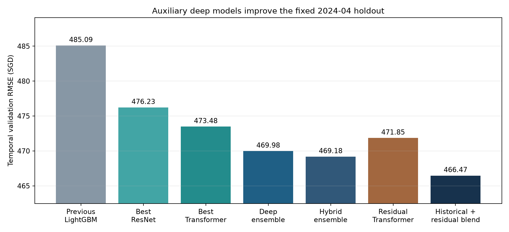
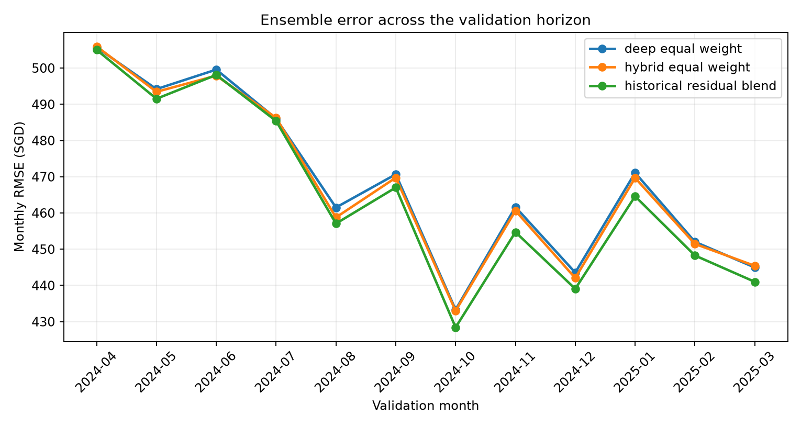

# Deep-learning experiments

These experiments use the same chronological holdout as the midterm models:
fit through 2024-03 and validate on 2024-04 through 2025-03 (35,158 rows).
No Kaggle test target or post-cutoff economic series is used.

## Features

- Main property, approval-time, town, street and block identifiers.
- Static HDB block attributes: coordinates, completion year, maximum floor,
  subzone, planning area and region.
- Haversine distances and neighbourhood counts for currently open MRT points,
  malls and primary schools. These are static location proxies, not historical
  availability claims.
- Smoothed fitting-only encodings for address/flat-type groups. Training rows
  use leave-one-out values; validation rows use mappings learned only from the
  fitting partition.
- A past-only hierarchical rent baseline. For residual training, each training
  month is predicted using only earlier months; the Transformer learns the
  remaining property-level error.
- COE and stock-market files were tested as optional contemporaneous features.
  They worsened both CatBoost and Transformer validation RMSE and are excluded
  from the selected ensemble.

## Models and result

The strongest direct deep-only ensemble is an equal-weight average of two
feature Transformers and one entity-embedding ResNet. Its validation RMSE is
469.98, compared with 485.09 for the previous main-table LightGBM reference.
Adding the auxiliary LightGBM gives 469.18. A chronological residual
Transformer reaches 471.85 alone; combining it with the hybrid ensemble and a
48-month hierarchical rent prior reaches **466.47 RMSE** (MAE 341.14), an
18.62-point / 3.84% reduction from the reference. These numbers reuse one
holdout for model selection and must be confirmed with rolling temporal
validation before final model choice.

Machine-readable metrics, predictions and monthly errors are in `summary/`.
Model checkpoints (`*.pt`) and fitted joblib files are local artifacts and are
excluded from Git.





## Reproduce

```powershell
python -m pip install -r requirements-deep.txt

python -m analysis.main deep --architecture transformer --width 64 --blocks 3 --batch-size 512 --learning-rate 0.0005 --recency-half-life 0 --target-encoding --seed 42 --output-dir reports/experiments/deep_learning/aux_transformer_te18_seed42
python -m analysis.main deep --architecture transformer --width 64 --blocks 3 --batch-size 512 --learning-rate 0.0005 --recency-half-life 0 --target-encoding --seed 77 --output-dir reports/experiments/deep_learning/aux_transformer_te18_seed77
python -m analysis.main deep --architecture resnet --recency-half-life 0 --target-encoding --seed 77 --output-dir reports/experiments/deep_learning/aux_resnet_te18_seed77
python -m analysis.main aux-boost --output-dir reports/experiments/deep_learning/aux_lightgbm_l31
python -m analysis.main deep --architecture transformer --width 64 --blocks 3 --batch-size 512 --learning-rate 0.0005 --recency-half-life 0 --target-encoding --residual-baseline --seed 42 --output-dir reports/experiments/deep_learning/aux_transformer_residual_te18_seed42
python -m analysis.experiments.historical_priors
python -m analysis.main deep-summary
```
