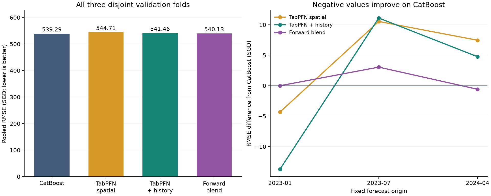
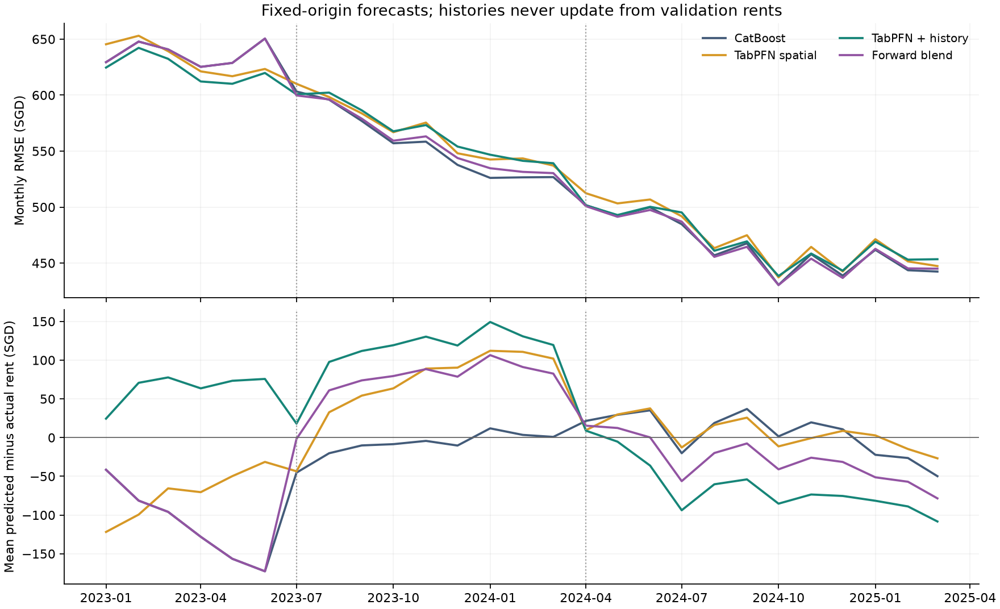

# TabPFN fixed-origin rental comparison

Selected candidate: **catboost**. Promotion requires at least 1% lower pooled RMSE and improvement on every disjoint fold. The forward blend may tie its uncalibrated first fold, but must improve both later folds. This exception was set before TabPFN scoring.

## Configuration

Local v3.5 regressor, 4 estimators, 50000 rows per estimator, seed 42, `fit_with_cache`. GPU: NVIDIA GeForce RTX 4080. Target: raw monthly rent in SGD; predictive mean. Each variant has the same complete fitting population; context subsampling is internal to TabPFN. No COE or stock inputs are used.

Spatial features reuse the existing property, HDB-block, planning and amenity inputs. The history variant adds strictly earlier signature, block × flat-type and area × flat-type means/counts/last means/recency. Training histories exclude the entire current month. Validation histories freeze at the origin, with recency advancing by forecast month. Constant furnished/fee fields and current-row target transformations are excluded.

## Pooled transaction scores

| model | n | rmse_sgd | mae_sgd | bias_sgd | delta_rmse_vs_catboost_sgd |
| --- | --- | --- | --- | --- | --- |
| catboost | 79817 | 539.288 | 413.605 | -26.736 | 0.000 |
| catboost_tabpfn_forward_blend | 79817 | 540.131 | 412.488 | -13.398 | 0.843 |
| tabpfn_history | 79817 | 541.456 | 412.588 | 24.083 | 2.168 |
| tabpfn_spatial | 79817 | 544.708 | 413.681 | 8.945 | 5.420 |

## Fold RMSE (SGD)

| model | 2023-01 | 2023-07 | 2024-04 |
| --- | --- | --- | --- |
| catboost | 637.408 | 557.353 | 466.228 |
| catboost_tabpfn_forward_blend | 637.408 | 560.402 | 465.646 |
| tabpfn_history | 623.716 | 568.464 | 470.993 |
| tabpfn_spatial | 633.103 | 567.899 | 473.695 |

## Forward-only blend

The TabPFN-history weight minimizes squared error on all earlier folds, constrained to [0, 1]. The first fold defaults to CatBoost (zero calibration rows). Later validation labels never choose their own weight. Consequently the pooled blend includes a CatBoost-only first fold; it is not a globally tuned blend score.

| validation_start | tabpfn_weight | calibration_rows |
| --- | --- | --- |
| 2023-01 | 0.000 | 0 |
| 2023-07 | 0.688 | 17754 |
| 2024-04 | 0.490 | 44659 |

## Timing and limits

| validation_start | model | fit_predict_seconds | fit_seconds | predict_seconds | peak_vram_gib |
| --- | --- | --- | --- | --- | --- |
| 2023-01 | catboost | 50.035 | — | — | — |
| 2023-01 | tabpfn_spatial | — | 19.938 | 134.334 | 7.824 |
| 2023-01 | tabpfn_history | — | 35.013 | 132.391 | 7.738 |
| 2023-07 | catboost | 56.152 | — | — | — |
| 2023-07 | tabpfn_spatial | — | 19.072 | 200.444 | 7.825 |
| 2023-07 | tabpfn_history | — | 21.245 | 202.400 | 7.739 |
| 2024-04 | catboost | 67.091 | — | — | — |
| 2024-04 | tabpfn_spatial | — | 19.352 | 261.850 | 7.825 |
| 2024-04 | tabpfn_history | — | 21.510 | 265.222 | 7.739 |

The three validation windows are disjoint. Their months have been examined previously in this project, so these are development results rather than an untouched final test. Supplied amenity tables are current snapshots without historical opening dates. Model/package versions, source hashes, settings and checkpoint paths are recorded in `results.json`. All predictions retain original source row IDs.

Run: `.venv/Scripts/python.exe analysis/compare_tabpfn.py --output reports/tabpfn_50k --model-version v3.5 --context-rows 50000 --n-estimators 4 --batch-size 200 --fit-mode fit_with_cache`. Use `--resume` to reuse matching completed folds. Model downloads may require authentication; data stays local.

## Runtime notes

CatBoost timings combine fitting and prediction; TabPFN reports them separately. Peak memory is PyTorch maximum allocated memory; driver reservations and display memory are additional.

This run uses sequential estimator execution to avoid GPU memory paging. Reproduce the environment before running the command above:

```powershell
$env:OMP_NUM_THREADS = '1'
$env:TABPFN_MAX_BATCHED_ESTIMATOR_ROWS = '0'
```

## Diagnostic figures





Regenerate with `.venv/Scripts/python.exe analysis/plot_tabpfn.py --input reports/tabpfn_50k`.
