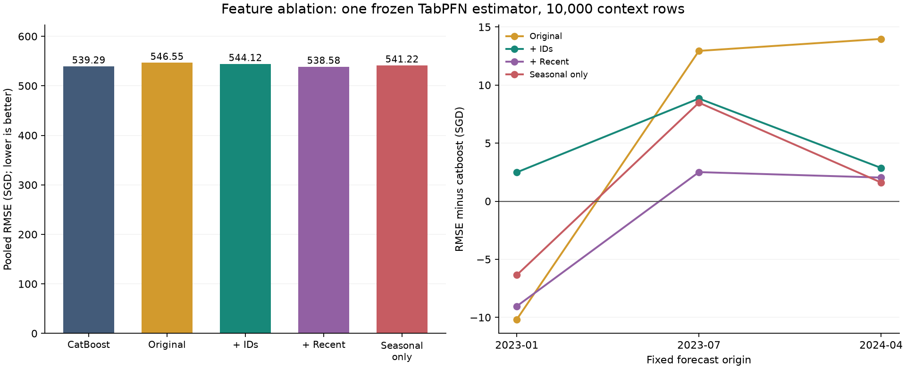
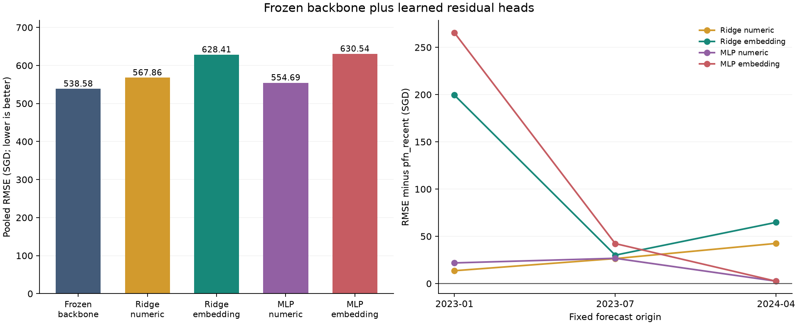

# TabPFN feature engineering and frozen residual heads

Selected candidate: **catboost**. Backbone-gradient pilot gate: **not passed** (no qualifying embedding head).

## Pooled scores

| model | n | rmse_sgd | mae_sgd | bias_sgd | delta_vs_catboost_sgd |
| --- | --- | --- | --- | --- | --- |
| pfn_recent | 79817 | 538.581 | 410.994 | 6.511 | -0.707 |
| catboost | 79817 | 539.288 | 413.605 | -26.736 | 0.000 |
| pfn_seasonal_only | 79817 | 541.217 | 411.206 | 20.698 | 1.928 |
| pfn_identifiers | 79817 | 544.122 | 415.222 | -12.844 | 4.834 |
| pfn_original | 79817 | 546.550 | 421.713 | -19.940 | 7.261 |
| mlp_numeric | 79817 | 554.691 | 418.189 | 64.346 | 15.402 |
| ridge_numeric | 79817 | 567.856 | 425.897 | 145.485 | 28.567 |
| ridge_embedding | 79817 | 628.410 | 483.758 | 54.437 | 89.122 |
| mlp_embedding | 79817 | 630.545 | 462.588 | 208.277 | 91.257 |

## Fold RMSE (SGD)

| model | 2023-01 | 2023-07 | 2024-04 |
| --- | --- | --- | --- |
| catboost | 637.408 | 557.353 | 466.228 |
| mlp_embedding | 893.865 | 602.199 | 470.772 |
| mlp_numeric | 650.240 | 586.615 | 470.808 |
| pfn_identifiers | 639.895 | 566.195 | 469.096 |
| pfn_original | 627.236 | 570.296 | 480.203 |
| pfn_recent | 628.369 | 559.859 | 468.266 |
| pfn_seasonal_only | 631.053 | 565.840 | 467.840 |
| ridge_embedding | 827.835 | 589.940 | 533.025 |
| ridge_numeric | 641.967 | 586.308 | 510.769 |

## Design

All new feature and head models use the same frozen TabPFN-3.5 checkpoint, one estimator, 10,000 context rows and seed 42. `pfn_original` is the matched smaller-backbone control; it is separate from the prior four-estimator/50,000-context benchmark. The reference CatBoost predictions are reused only after source hashes and row labels match.

`pfn_identifiers` adds normalized block/street categoricals. `pfn_recent` additionally uses strictly earlier 3/6/12-month counts, means, shrunken means, sample standard deviations and local contrasts. `pfn_seasonal_only` replaces approval-month trend/ordinal month with sine/cosine seasonality. Heads use the prespecified recent-feature backbone, irrespective of outer scores.

Quarterly historical origins from July 2021 to January 2024 generate horizons 1, 3, 6 and 12. Each query month is sampled without looking at rents, capped at 600 rows. Context labels end before the origin, queries begin at the origin, and row IDs are disjoint. Histories freeze at each origin. A source row can represent several forecasting tasks under different earlier origins; every copy goes to the same inner partition by its query month.

Each outer head uses only episode query labels before its own origin. The final three fitting months select Ridge alpha or MLP epoch; outer validation labels never select head hyperparameters. After selection, heads refit on all eligible earlier episodes. All imputation/scaling is fitted within the corresponding head-training partition. The backbone weights are frozen and embeddings are obtained as query tokens, not labelled training tokens.

Numeric-only heads control for calibration without learned representations. Embedding heads add the 1024-dimensional query representation to the same numeric inputs. Both predict an additive residual in SGD. The MLP has hidden widths 64/32, GELU, dropout 0.1, AdamW and patience 6. Model details and inner learning curves are in `head_selection.json`; episode audits are in `episode_audits.json`.

## Limits and reproduction

These outer windows have been examined previously, so scores are development evidence. Episode sampling, context capping and fixed head architectures are deliberate computational limits, not an exhaustive search. No future COE/stock observations are used. The plan predates scoring and defines both promotion and gradient-pilot rules.

Run `.venv/Scripts/python.exe analysis/compare_tabpfn_adaptation.py --resume`. Embeddings and intermediate arrays are under ignored `.cache/tabpfn_adaptation/`, signed by source/code/settings fingerprints. Row predictions retain source IDs. Raw CSVs and earlier model reports are preserved.

## Verified diagnostics

Recent-feature TabPFN improves matched original-feature TabPFN by **S$7.97 pooled RMSE**. Its pooled gain over CatBoost is **S$0.71**, but it worsens the second and third outer folds and misses the prespecified 1%/all-fold promotion criterion. CatBoost remains the selected candidate; recent-feature TabPFN has the lowest observed pooled error in this run.

Every learned residual head worsens all three folds relative to its own frozen recent-feature backbone. Embedding Ridge and MLP have particularly large errors at the first origin. This is evidence against these heads and this chronological training design; it does not establish the ceiling of other adaptations. `head_transfer.csv` compares inner-selection performance with outer performance; temporal/context distribution shift is a plausible explanation, not an isolated causal finding.

The gradient pilot gate failed, so backbone weights were **not fine-tuned**. That stage was conditional in the plan. No conclusion about fine-tuned TabPFN accuracy is claimed.

`verification.json` records successful checks for 79,817 outer validation rows, 24,000 historical query tasks, context/query chronology, inner partitions, and source/cache/prediction/head hashes. Imputation/scaling and head selection use only pre-outer data. Peak memory in timing records is PyTorch allocated memory, excluding driver reservations and display memory.

Regenerate diagnostics with `.venv/Scripts/python.exe analysis/plot_tabpfn_adaptation.py` after the experiment completes.
