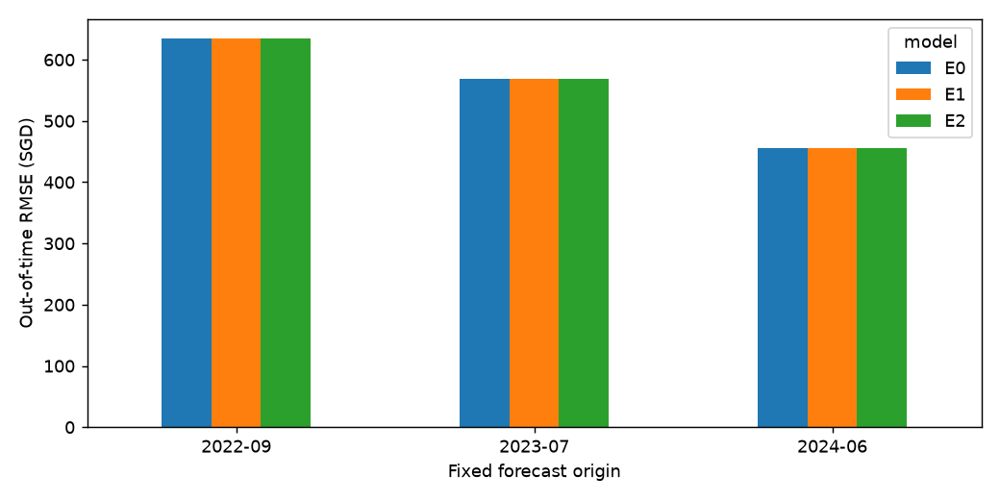
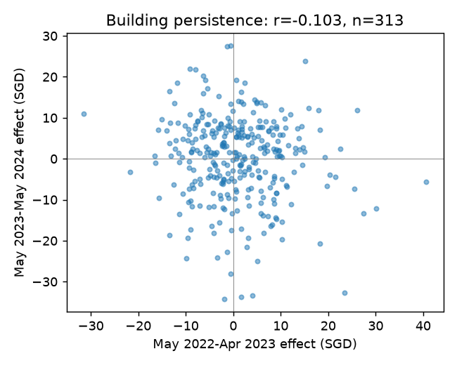
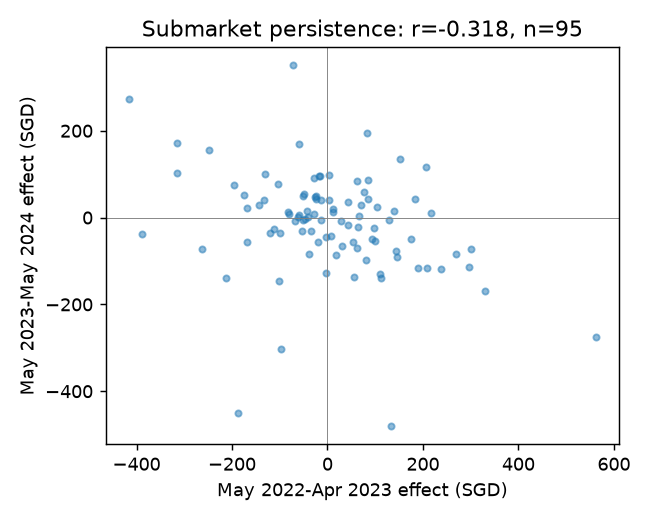
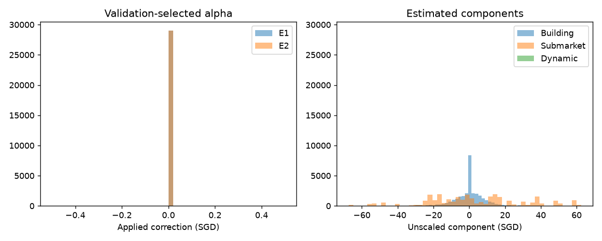
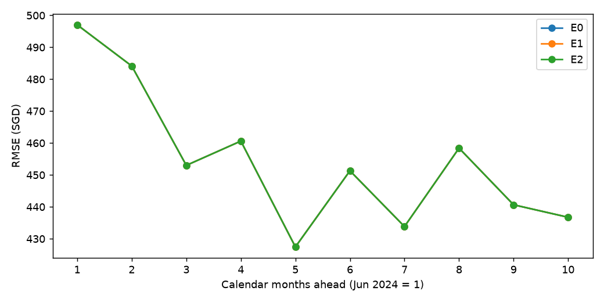
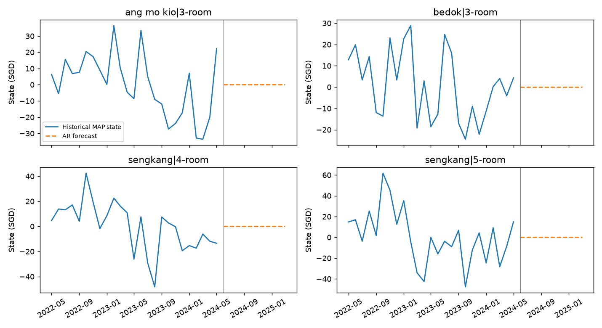
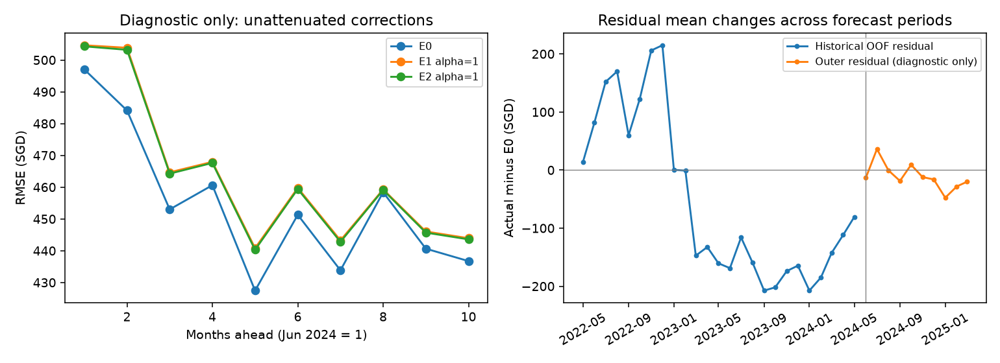

# Hierarchical latent residuals on frozen TabPFN

Recommended model: **E0**. The family chosen before reading the main outer scores was **E0**. The decision rule requires improvement at both non-cold outer origins and on pooled predictions; a tiny improvement in this repeatedly used development holdout is not evidence of a general improvement.

## Main 80/20 comparison

All 28,995 evaluation transactions, June 2024-March 2025; context has 121,005 transactions through May 2024. Prices and errors are SGD. Alpha is selected on earlier folds; alpha=1 is separately reported.

| model | rmse_sgd | mae_sgd | bias_sgd | rmse_improvement_pct | mae_improvement_pct | fit_seconds | predict_overhead_seconds |
| --- | --- | --- | --- | --- | --- | --- | --- |
| E0 | 455.396 | 327.794 | 10.793 | 0.000 | 0.000 | 25.826 | 228.267 |
| E1 | 455.396 | 327.794 | 10.793 | 0.000 | 0.000 | 0.083 | 0.174 |
| E2 | 455.396 | 327.794 | 10.793 | 0.000 | 0.000 | 0.090 | 0.342 |
| E1_alpha1 | 464.650 | 349.760 | -84.303 | -2.032 | -6.701 | not available | not available |
| E2_alpha1 | 464.246 | 349.136 | -82.453 | -1.943 | -6.511 | not available | not available |
| selected_prediction | 455.396 | 327.794 | 10.793 | 0.000 | 0.000 | not available | not available |

E1 adds global/building/town x flat-type effects; E2 adds regularized monthly submarket AR(1) states. `selected_prediction` is the family selected on earlier validation, not a new ensemble. Latent inference times are additional CPU costs over E0; E0's fit is context preparation, without optimization. Alpha=0 reproduces E0 bit for bit. No TabPFN parameters changed, no gradients or adapters were used, and no final Kaggle output was overwritten.

## Frozen baseline and provenance

The retained original **77 features** contain 31 static/calendar/identity variables, 37 causal rental-history variables and 9 temporal variables. The exact names, categories and temporal provenance are in [feature_specification.md](feature_specification.md) and [feature_catalog.csv](feature_catalog.csv). Historical features already encode signature, block/type and area/type histories with 3/6/12-month counts, shrinkage, dispersion and trend. Extra economy/landscape/amenity-quality features and deduplicated data did not establish a stronger retained frozen baseline. They are excluded. Adapted MSE-only DiagScale's S$455.071 is outside this experiment's frozen-weight constraints.

TabPFN 9.2.0, V3.5 FAST checkpoint `tabpfn-v3.5-fast-20260909.safetensors`, SHA256 `14e0b81285bca7a6d1ef121169f27f651f76dff49cad6c0b8779d5c836018550`. Use the plain TabPFNRegressor class, 2 preprocessing estimators, seed42, full expanding historical context (no cap or subsampling), batch200, fit_with_cache, GPU cache, one preprocessing job, RTX4080. Settings and feature/checkpoint/source hashes are in [settings.json](settings.json).

Earlier December2023-May2024 calibration (600 fixed sampled rows) selected 2 estimators: RMSE520.473 versus521.864 for1. One-view replay matched its saved reference within 4.9e-09 SGD; two independent bare-model 400-row runs agreed exactly. The previous two-view 'frozen' artifact used a zero-initialized adapter wrapper and failed strict plain-model equivalence (maximum full-output difference 0.554555 SGD). It was investigated and not reused. The complete plain-model E0 was recomputed: **RMSE455.396319, MAE327.794168**, versus455.395927/327.793699 in that prior control. Small aggregate agreement does not establish row-wise identity; all E0/E1/E2 comparisons here share the new bare-model predictions.

## Chronological protocol

Earlier established fixed-origin backtests at September2022 and July2023 retain their original label-independent200 queries/month and month-population sampling weights; the main June2024 window evaluates every query. Each window spans10 target months. Earlier-window metrics estimate their represented population, rather than scoring every transaction. Their target-month windows do not overlap one another or the main window. Pooled RMSE is sqrt(sum(weight * squared error)/sum(weight)), never a mean of fold RMSEs. The main holdout and feature family were examined during prior development: **these are development backtests, not an untouched final test**.

Seven cached feature bundles were validated and used for fresh, compatible bare-two-view historical predictions. All context rows are retained (49,389 to109,008 historical context rows); the outer main context is121,005. Small early contexts may yield a different residual distribution, so results need cautious interpretation. There are12,800 historical forecast cases before eligibility filtering; overlapping forecasts of a physical source row are reduced to its latest available forecast at each fit origin. Both its label month and its forecast origin must precede the fit origin. Weights are normalized to the number of distinct residual cases, avoiding artificial sample-size inflation. The main latent fit uses 11,925 distinct historical residual cases. This de-duplication concerns cached forecasts, not removing real transactions from the original dataset.

Each inner forecast fits latent effects only to residual labels available before its own origin; its validation labels must precede the corresponding outer origin. Small grids: block/group penalties25 or100, alpha0/.25/.5/.75/1, then shared rho0/.5/.9 and state penalty25/100. E2 uses the earlier-selected static penalties. E0/E1/E2 family ties within0.1% prefer E0 thenE1 thenE2. The earliest September2022 origin has no complete earlier inner validation: alpha0 is selected prospectively, so equality there is a cold-start fallback, not evidence for the corrections. Selection metadata is written before outer metrics and includes label cutoffs and ID hashes.

| origin | model | alpha | block_penalty | group_penalty | dynamic_enabled | inner_rmse_sgd | baseline_inner_rmse_sgd | residual_fit_rows | selected_family | rho | state_penalty |
| --- | --- | --- | --- | --- | --- | --- | --- | --- | --- | --- | --- |
| 2022-09 | E1 | 0.000 | 100.000 | 100.000 | False | not available | not available | 800 | E0 | not available | not available |
| 2022-09 | E2 | 0.000 | 100.000 | 100.000 | False | not available | not available | 800 | E0 | not available | not available |
| 2023-07 | E1 | 0.000 | 100.000 | 100.000 | False | 643.840 | 643.840 | 5331 | E0 | not available | not available |
| 2023-07 | E2 | 0.000 | 100.000 | 100.000 | True | 643.840 | 643.840 | 5331 | E0 | 0.000 | 100.000 |
| 2024-06 | E1 | 0.000 | 100.000 | 100.000 | False | 616.719 | 616.719 | 11925 | E0 | not available | not available |
| 2024-06 | E2 | 0.000 | 100.000 | 100.000 | True | 616.719 | 616.719 | 11925 | E0 | 0.000 | 100.000 |

## All fixed-origin results

| origin | model | n | rmse_sgd | mae_sgd | bias_sgd | rmse_improvement_pct |
| --- | --- | --- | --- | --- | --- | --- |
| 2022-09 | E0 | 2000 | 635.088 | 512.053 | 51.208 | 0.000 |
| 2022-09 | E1 | 2000 | 635.088 | 512.053 | 51.208 | 0.000 |
| 2022-09 | E2 | 2000 | 635.088 | 512.053 | 51.208 | 0.000 |
| 2023-07 | E0 | 2000 | 569.479 | 430.429 | 117.527 | 0.000 |
| 2023-07 | E1 | 2000 | 569.479 | 430.429 | 117.527 | 0.000 |
| 2023-07 | E2 | 2000 | 569.479 | 430.429 | 117.527 | 0.000 |
| 2024-06 | E0 | 28995 | 455.396 | 327.794 | 10.793 | 0.000 |
| 2024-06 | E1 | 28995 | 455.396 | 327.794 | 10.793 | 0.000 |
| 2024-06 | E2 | 28995 | 455.396 | 327.794 | 10.793 | 0.000 |
| pooled | E0 | 32995 | 557.343 | 422.351 | 60.657 | 0.000 |
| pooled | E1 | 32995 | 557.343 | 422.351 | 60.657 | 0.000 |
| pooled | E2 | 32995 | 557.343 | 422.351 | 60.657 | 0.000 |

Unattenuated alpha=1 scores for all windows are included in [comparison.csv](comparison.csv). [inner_forecast_skill.csv](inner_forecast_skill.csv) reports actual inner forecast skill against zero correction, rather than in-sample residual fit.

## Residual evidence and estimation

Buildings are normalized town|street|block; block number alone is not used. No individual rental-unit identifiers are available. Submarkets are town x flat type. Monthly historical residual summaries, building/submarket counts and variances, and horizon diagnostics are in `diagnostics/`. Non-overlapping target periods May2022-April2023 and May2023-May2024 assess persistence. Building estimates use separate shrunken fits; submarket residual means have fitted building effects and the global intercept removed. These are descriptive checks, not validation scores.

| group | common_groups | minimum_cases_per_period | pearson | spearman |
| --- | --- | --- | --- | --- |
| building | 313 | 2 | -0.103 | -0.074 |
| submarket | 95 | 5 | -0.318 | -0.297 |

The main historical pool contains 25 monthly means with lag1 correlation 0.881. This justifies testing dynamics, not assuming forecast improvement. A per-origin gate requires at least8 observed months and absolute monthly lag1 correlation>=0.1; earlier origins cannot borrow later evidence. If the gate is disabled E2 is explicitly the E1 fallback. Fits minimize weighted squared residuals plus positive Gaussian building/group penalties; the global intercept is unpenalized. Rare groups shrink more, unseen buildings get zero building effect, and unseen submarkets fall back to the global effect. Shared AR prior is lambda_d*((1-rho^2)*d_first^2 + sum(d_t-rho*d_previous)^2), including missing calendar months. Only historical states through origin-1 are fitted; future values are rho^h times the final historical state. Even rho0 can change the joint historical static fit, while its future dynamic contribution is zero.

Sparse augmented least squares uses [SciPy LSMR](https://docs.scipy.org/doc/scipy/reference/generated/scipy.sparse.linalg.lsmr.html), tolerances1e-10 and checked convergence. No dense observation-by-parameter matrix or covariance is built. These are Gaussian MAP point estimates, not full posterior uncertainty estimates. E2 improves historical reconstruction but not necessarily forecasting; reconstruction scores below are descriptive.

| origin | model | fit_seconds | predict_overhead_seconds | solver_iterations | system_columns | system_nnz | training_reconstruction_rmse_sgd |
| --- | --- | --- | --- | --- | --- | --- | --- |
| 2022-09 | E1 | 0.008 | 0.013 | 9 | 852 | 3251 | 467.089 |
| 2022-09 | E2 | 0.010 | 0.015 | 9 | 852 | 3251 | 467.089 |
| 2023-07 | E1 | 0.038 | 0.015 | 16 | 3873 | 19865 | 621.556 |
| 2023-07 | E2 | 0.047 | 0.042 | 16 | 5539 | 28409 | 614.643 |
| 2024-06 | E1 | 0.083 | 0.174 | 21 | 6051 | 41825 | 598.974 |
| 2024-06 | E2 | 0.090 | 0.342 | 22 | 9101 | 59728 | 592.800 |

Fresh primary E0 plus seven historical runs took 409.2s of recorded fit/inference time, excluding calibration probes, hashing and feature-cache loading. Small-grid tuning times are recorded per selection JSON; inference overhead excludes file serialization. Saved models live in `.cache/tabpfn_hierarchical_latent_80_20`.

## Horizons and subgroups

Horizon1 means the first target month after the last available label month; June2024=1 and March2025=10. The 6-month row is **exactly h=6**, not horizons1-6. Existing forecasts stop at10, so **12-month RMSE is unavailable**. No performance claim is made for the longer unlabeled Kaggle forecast.

| group | model | n | rmse_sgd | rmse_difference_sgd |
| --- | --- | --- | --- | --- |
| 1-3 months | E0 | 9089 | 479.046 | 0.000 |
| 1-3 months | E1 | 9089 | 479.046 | 0.000 |
| 1-3 months | E2 | 9089 | 479.046 | 0.000 |
| 4-5 months | E0 | 5371 | 444.480 | 0.000 |
| 4-5 months | E1 | 5371 | 444.480 | 0.000 |
| 4-5 months | E2 | 5371 | 444.480 | 0.000 |
| 6 months | E0 | 2715 | 451.305 | 0.000 |
| 6 months | E1 | 2715 | 451.305 | 0.000 |
| 6 months | E2 | 2715 | 451.305 | 0.000 |
| 7-10 months | E0 | 11820 | 442.389 | 0.000 |
| 7-10 months | E1 | 11820 | 442.389 | 0.000 |
| 7-10 months | E2 | 11820 | 442.389 | 0.000 |

Residual support refers to the number of sampled chronological residual observations for a building, which differs from full TabPFN training-context support. A building unseen in the residual pool can already have many rental records in TabPFN's context. Full-context rare/unseen groups, all towns and all flat types are in [subgroup_scores.csv](subgroup_scores.csv). E1 improves 0/26 town RMSEs; subgroup comparisons are descriptive and were not used for tuning.

| group | model | n | rmse_sgd | rmse_difference_sgd |
| --- | --- | --- | --- | --- |
| unseen in residual fit | E0 | 6397 | 460.868 | 0.000 |
| unseen in residual fit | E1 | 6397 | 460.868 | 0.000 |
| unseen in residual fit | E2 | 6397 | 460.868 | 0.000 |
| 1-2 residuals | E0 | 13668 | 456.580 | 0.000 |
| 1-2 residuals | E1 | 13668 | 456.580 | 0.000 |
| 1-2 residuals | E2 | 13668 | 456.580 | 0.000 |
| 3-9 residuals | E0 | 8779 | 449.204 | 0.000 |
| 3-9 residuals | E1 | 8779 | 449.204 | 0.000 |
| 3-9 residuals | E2 | 8779 | 449.204 | 0.000 |
| 10+ residuals | E0 | 151 | 472.184 | 0.000 |
| 10+ residuals | E1 | 151 | 472.184 | 0.000 |
| 10+ residuals | E2 | 151 | 472.184 | 0.000 |

| group | model | n | rmse_sgd | rmse_difference_sgd |
| --- | --- | --- | --- | --- |
| 1-room | E0 | 10 | 381.653 | 0.000 |
| 1-room | E1 | 10 | 381.653 | 0.000 |
| 1-room | E2 | 10 | 381.653 | 0.000 |
| 2-room | E0 | 788 | 428.167 | 0.000 |
| 2-room | E1 | 788 | 428.167 | 0.000 |
| 2-room | E2 | 788 | 428.167 | 0.000 |
| 3-room | E0 | 9581 | 430.621 | 0.000 |
| 3-room | E1 | 9581 | 430.621 | 0.000 |
| 3-room | E2 | 9581 | 430.621 | 0.000 |
| 4-room | E0 | 10544 | 457.189 | 0.000 |
| 4-room | E1 | 10544 | 457.189 | 0.000 |
| 4-room | E2 | 10544 | 457.189 | 0.000 |
| 5-room | E0 | 6597 | 467.515 | 0.000 |
| 5-room | E1 | 6597 | 467.515 | 0.000 |
| 5-room | E2 | 6597 | 467.515 | 0.000 |
| executive | E0 | 1475 | 549.116 | 0.000 |
| executive | E1 | 1475 | 549.116 | 0.000 |
| executive | E2 | 1475 | 549.116 | 0.000 |

## Paired uncertainty

Main-window paired cluster bootstrap,5,000 replicates,seed42. Values are model RMSE minus reference RMSE (negative favors model). Months and buildings are resampled separately; neither calculation assumes independent transactions. Only10 time clusters limit temporal inference; building resampling does not capture all shared market shocks. Intervals are descriptive after repeated model development, not confirmatory confidence in a new Kaggle score.

| cluster | clusters | model | reference | rmse_difference_sgd | lower95_sgd | upper95_sgd |
| --- | --- | --- | --- | --- | --- | --- |
| month | 10 | E1 | E0 | 0.000 | 0.000 | 0.000 |
| month | 10 | E2 | E0 | 0.000 | 0.000 | 0.000 |
| month | 10 | E2 | E1 | 0.000 | 0.000 | 0.000 |
| building | 8210 | E1 | E0 | 0.000 | 0.000 | 0.000 |
| building | 8210 | E2 | E0 | 0.000 | 0.000 | 0.000 |
| building | 8210 | E2 | E1 | 0.000 | 0.000 | 0.000 |

## Correctness and limitations

[correctness_audit.json](correctness_audit.json) verifies source hashes, model serialization/replay, exact alpha0, row alignment, finite SGD predictions, disjoint residual-fit/evaluation IDs and strict fitting-label cutoffs. Poisoning evaluation targets leaves latent predictions unchanged. All eight primary/history inference runs have matching before/after full parameter digests; backward/autograd calls were prohibited. Existing feature builders and pseudo-origins are preserved; target-causality tests are recorded in `tests.log`. Baseline and historical residual target values are converted back to SGD once before correction and metrics.

The original static MRT snapshot includes sites whose availability does not match every historical date. It is inherited and held identical across E0/E1/E2; this is **not a certification of fully point-in-time external geography**. No new external data is introduced. Historical residual queries cover only200 transactions/month, limiting building-effect coverage. Different expanding context sizes and overlapping inner forecast cases can reduce effective information. Inner validation is chronological but some historical targets occur in more than one forecast task; final latent fitting counts each physical source row once. Three outer origins, a cold-start earliest window and a repeatedly used main holdout limit certainty. No labeled Kaggle test is available. No new submission is generated by this evaluation.

## Diagnostic figures

## Reproduce and artifacts

From the repository root: `.venv/Scripts/python.exe analysis/compare_tabpfn_hierarchical_latent.py --stage prepare`, then `--stage historical`, then `--stage latent`. Cached predictions avoid repeated GPU inference. `settings.json` and `latent_plan.json` lock source/code hashes; changed code fails provenance checks. Predictions with transaction row IDs, origins, actuals, all correction components and selected/unattenuated outputs are in `predictions_all_origins.csv` and `origins/*/predictions.csv`. Source row_id is the original training CSV index. Selection grids, fit pools, timings and serialized models are retained. Existing baseline experiments, pretrained weights and Kaggle submissions are unchanged.

## Additional interpretation and independent replay

**Neither E1 nor E2 supplies validated extra predictive signal in this implementation.** Both choose alpha0 at each non-cold origin. Their reported selected-model horizon/subgroup differences and bootstrap intervals are therefore exactly zero by construction; those zeros are not independent evidence of model equivalence. The alpha1 diagnostics below show what the rejected corrections would have done.

The 313 recurring buildings have across-period effect correlation -0.103, and the 95 common submarkets have correlation -0.318 after removing fitted building/global effects. These residual premiums are not positively persistent in these periods. Strong monthly historical autocorrelation (0.881) coexists with poor out-of-time correction skill. The residual-level shift below is consistent with changes in market regime, forecast horizons and expanding TabPFN context; this experiment cannot identify which caused it.

| origin | residual_fit_rows | weighted_historical_residual_mean | evaluation_residual_mean | mean_E1_alpha1_correction | mean_E2_alpha1_correction |
| --- | --- | --- | --- | --- | --- |
| 2022-09 | 800 | 101.025 | -51.208 | 100.107 | 100.107 |
| 2023-07 | 5331 | -4.836 | -117.527 | -4.931 | -2.830 |
| 2024-06 | 11925 | -95.106 | -10.793 | -95.096 | -93.246 |

All main E1/E2 penalty and persistence candidates tie when alpha=0, so reported lambda100 and rho0 are **deterministic tie-break values, not identified optimal effect variances or evidence of zero underlying market persistence**. Conditional on a nonzero correction, the best earlier-validation results still fail to beat E0:

| origin | model | condition | alpha | cv_rmse_sgd | baseline_cv_rmse_sgd | inner_forecast_R2 |
| --- | --- | --- | --- | --- | --- | --- |
| 2023-07 | E1 | positive_alpha | 0.250 | 649.621 | 643.840 | -0.018 |
| 2023-07 | E1 | alpha1 | 1.000 | 673.613 | 643.840 | -0.095 |
| 2023-07 | E2 | positive_alpha | 0.250 | 649.574 | 643.840 | -0.018 |
| 2023-07 | E2 | alpha1 | 1.000 | 673.323 | 643.840 | -0.094 |
| 2024-06 | E1 | positive_alpha | 0.250 | 621.373 | 616.719 | -0.015 |
| 2024-06 | E1 | alpha1 | 1.000 | 639.197 | 616.719 | -0.074 |
| 2024-06 | E2 | positive_alpha | 0.250 | 621.048 | 616.719 | -0.014 |
| 2024-06 | E2 | alpha1 | 1.000 | 639.268 | 616.719 | -0.074 |

E2 lowers main historical residual reconstruction RMSE from598.974 to592.800; its alpha1 future RMSE464.246 remains worse than E0's455.396. E2's small alpha1 improvement over E1's464.650 does not justify deploying either model.

The main selected E2 has rho0, so its future dynamic-state forecasts are identically zero; the plotted historical states still come from a regularized joint fit. Other rho candidates were tested only through the documented earlier validation, not selected retrospectively on the outer targets.

### Unattenuated correction uncertainty and subgroup diagnosis

Paired RMSE differences below use alpha1, which was rejected by earlier validation. They are diagnostic, not a proposed deployment setting. Negative E2-E1 means E2 is better than E1; it does not imply that either beats E0. The selected alpha0 bootstrap table earlier is necessarily degenerate.

| cluster | clusters | model | reference | rmse_difference_sgd | lower95_sgd | upper95_sgd |
| --- | --- | --- | --- | --- | --- | --- |
| month | 10 | E1 | E0 | 9.254 | 6.306 | 12.606 |
| month | 10 | E2 | E0 | 8.850 | 5.970 | 12.122 |
| month | 10 | E2 | E1 | -0.405 | -0.483 | -0.334 |
| building | 8210 | E1 | E0 | 9.254 | 7.989 | 10.437 |
| building | 8210 | E2 | E0 | 8.850 | 7.613 | 10.003 |
| building | 8210 | E2 | E1 | -0.405 | -0.434 | -0.374 |

| group | model | n | rmse_sgd | rmse_difference_sgd |
| --- | --- | --- | --- | --- |
| 1-3 months | E0 | 9089 | 479.046 | 0.000 |
| 1-3 months | E1 | 9089 | 492.244 | 13.198 |
| 1-3 months | E2 | 9089 | 491.768 | 12.722 |
| 4-5 months | E0 | 5371 | 444.480 | 0.000 |
| 4-5 months | E1 | 5371 | 454.700 | 10.220 |
| 4-5 months | E2 | 5371 | 454.277 | 9.797 |
| 6 months | E0 | 2715 | 451.305 | 0.000 |
| 6 months | E1 | 2715 | 459.790 | 8.484 |
| 6 months | E2 | 2715 | 459.403 | 8.098 |
| 7-10 months | E0 | 11820 | 442.389 | 0.000 |
| 7-10 months | E1 | 11820 | 448.091 | 5.702 |
| 7-10 months | E2 | 11820 | 447.750 | 5.361 |

| group | model | n | rmse_sgd | rmse_difference_sgd |
| --- | --- | --- | --- | --- |
| unseen in residual fit | E0 | 6397 | 460.868 | 0.000 |
| unseen in residual fit | E1 | 6397 | 470.313 | 9.445 |
| unseen in residual fit | E2 | 6397 | 469.924 | 9.056 |
| 1-2 residuals | E0 | 13668 | 456.580 | 0.000 |
| 1-2 residuals | E1 | 13668 | 464.657 | 8.077 |
| 1-2 residuals | E2 | 13668 | 464.296 | 7.717 |
| 3-9 residuals | E0 | 8779 | 449.204 | 0.000 |
| 3-9 residuals | E1 | 8779 | 460.096 | 10.892 |
| 3-9 residuals | E2 | 8779 | 459.616 | 10.412 |
| 10+ residuals | E0 | 151 | 472.184 | 0.000 |
| 10+ residuals | E1 | 151 | 485.722 | 13.539 |
| 10+ residuals | E2 | 151 | 485.052 | 12.868 |

All flat-type, town, horizon and rare/unseen groups for rejected alpha1 corrections are also saved in [subgroup_scores_alpha1.csv](subgroup_scores_alpha1.csv). No subgroup was used to alter selection. Sparse building coverage and nonpersistent effects limit conclusions about denser, more recent residual collections; this result concerns the specified small Gaussian models and these folds, not every possible latent model.

### Independent feature and artifact checks

In addition to22 passing unit tests, an independent numerical replay reconstructs all46 target-derived inputs from permitted raw labels for2 rows in every target month in all8 inference windows, plus two context pseudo-origins per window. All reproduce the cached inputs within1e-7. All additive baselines match TEMP_LOCAL_FORECAST, with the original zero fallback for missing early context forecasts. See [feature_replay_audit.json](feature_replay_audit.json). This checks historical rent causality and reconstruction, while the inherited static MRT timing caveat remains.

Core experimental code and selection results remain unchanged. [supplementary_audit_manifest.json](supplementary_audit_manifest.json) records the independent postprocessing code and the original plan hash. To regenerate summary artifacts from the completed, locked fits, run `.venv/Scripts/python.exe -m analysis.summarize_tabpfn_hierarchical_latent`, followed by `.venv/Scripts/python.exe analysis/audit_tabpfn_hierarchical_latent.py`. The latent-fitting command is for a fresh fit; immutable selection files intentionally guard against overwriting earlier decisions with a new run.
